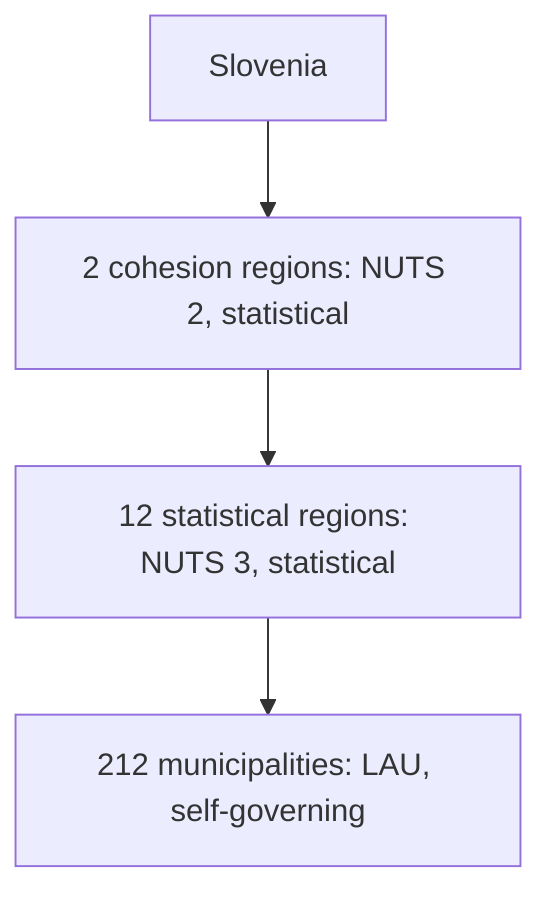

## Answer {#answer}

In this article, a first-level administrative division is the largest unit with its own administration directly below the national level.
Each EU country sets these units itself, so their type and number differ widely.[^2][^11]
With the method in this article, the count ranges from 3 units in Belgium and Portugal to 615 in Cyprus (inferred).[^11]
For comparable statistics, the EU uses a separate system of regions called NUTS.[^1]

## Key insights {#key-insights}

- Each EU country decides its own administrative units.[^2]
- NUTS is a statistical classification with three levels of regions.[^1]
- NUTS generally follows national administrative borders, but some NUTS levels exist only for statistics.[^2]
- Slovenia has one level of local self-government: 212 municipalities.[^7]
- The table in this article lists one type of first-level unit for each of the 27 EU countries.[^11]

## Administrative units and statistical regions {#definition}

The EU created NUTS to name the regions of its member countries for statistics.[^1]
NUTS generally follows the administrative divisions of each country.[^2]
This makes data easy to collect and policies easy to apply.[^2]
Some NUTS levels match administrative units.[^2]
Other NUTS levels are non-administrative and exist only for statistics.[^2]
So the two systems often overlap, but they are not the same.[^2]

## NUTS regions {#nuts}

NUTS stands for "Nomenclature of territorial units for statistics".[^1]
It divides each EU country into three levels:[^1]

- NUTS 1: major socio-economic regions
- NUTS 2: basic regions for regional policies
- NUTS 3: small regions for specific diagnoses

The NUTS 2024 classification applies from 1 January 2024.[^1]
It has 92 NUTS 1, 244 NUTS 2 and 1,165 NUTS 3 regions.[^1]
The NUTS 2027 classification will apply from 1 January 2027.[^1]
It has 91 NUTS 1, 242 NUTS 2 and 1,170 NUTS 3 regions.[^1]
The EU defines the regions that can get cohesion policy support at NUTS 2 level.[^1]

## How NUTS regions are drawn {#principles}

Each NUTS level has a population range:[^2]

| NUTS level | Inhabitants per region |
|---|---|
| NUTS 1 | 3,000,000–7,000,000 |
| NUTS 2 | 800,000–3,000,000 |
| NUTS 3 | 150,000–800,000 |

If a NUTS level matches an administrative level, only the average population of its regions must be in the range.[^2]
Eurostat generally changes the classification no more often than every 3 years.[^2]

## Local administrative units {#lau}

Below NUTS 3, Eurostat keeps a list of local administrative units (LAU).[^3]
LAUs are the municipalities and communes of the EU.[^3]
They are the building blocks of NUTS.[^3]
Since 2017, there is only one LAU level.[^3]
EU countries send Eurostat an updated list of their LAUs every year.[^3]

## First-level units in the 27 EU countries {#first-level-table}

The table gives one type of first-level unit for each EU country.
For most countries, it uses the highest level that Eurostat lists as an administrative unit (inferred method).[^11]
Eurostat marks non-administrative units with an asterisk in its correspondence table.[^11]
The table skips those levels.
For France, Ireland, Poland and Slovenia, the table uses a national source.[^5][^6][^7][^12]
The Eurostat counts are based on NUTS 2024 and on the LAU list for 2022.[^11]

| Country | Unit (local name) | Unit (English) | Number | Level | Source |
|---|---|---|---:|---|---|
| Austria | *Länder* | states | 9 | NUTS 2 | Eurostat[^11] |
| Belgium | *Gewesten / Régions* | regions | 3 | NUTS 1 | Eurostat[^11] |
| Bulgaria | *Oblasti* | provinces | 28 | NUTS 3 | Eurostat[^11] |
| Croatia | *Županije* | counties | 21 | NUTS 3 | Eurostat[^11] |
| Cyprus | *Dimoi, koinotites* | municipalities and communities | 615 | LAU | Eurostat[^11] |
| Czechia | *Kraje* | regions | 14 | NUTS 3 | Eurostat[^11] |
| Denmark | *Regioner* | regions | 5 | NUTS 2 | Eurostat[^11] |
| Estonia | *Linn, vald* | cities and rural municipalities | 79 | LAU | Eurostat[^11] |
| Finland | *Maakunnat / Landskap* | regions | 19 | NUTS 3 | Eurostat[^11] |
| France | *Régions* | regions | 18 | national | Insee[^5] |
| Germany | *Länder* | states | 16 | NUTS 1 | Eurostat[^4][^11] |
| Greece | *Periferies* | regions | 13 | NUTS 2 | Eurostat[^11] |
| Hungary | *Megyék* | counties | 20 | NUTS 3 | Eurostat[^11] |
| Ireland | *Local authorities* | local authorities | 31 | national | CSO[^12] |
| Italy | *Regioni* | regions | 21 | NUTS 2 | Eurostat[^11] |
| Latvia | *Valstspilsētas, novadi* | state cities and municipalities | 43 | LAU | Eurostat[^11] |
| Lithuania | *Apskritys* | counties | 10 | NUTS 3 | Eurostat[^11] |
| Luxembourg | *Communes* | communes | 102 | LAU | Eurostat[^11] |
| Malta | *Localities* | localities | 68 | LAU | Eurostat[^11] |
| Netherlands | *Provincies* | provinces | 12 | NUTS 2 | Eurostat[^11] |
| Poland | *Województwa* | voivodeships | 16 | national | GUS[^6] |
| Portugal | *Continente, Regiões Autónomas* | mainland and autonomous regions | 3 | NUTS 1 | Eurostat[^11] |
| Romania | *Județe* | counties | 42 | NUTS 3 | Eurostat[^11] |
| Slovakia | *Kraje* | regions | 8 | NUTS 3 | Eurostat[^11] |
| Slovenia | *Občine* | municipalities | 212 | LAU | gov.si[^7][^11] |
| Spain | *Comunidades y Ciudades Autónomas* | autonomous communities and cities | 19 | NUTS 2 | Eurostat[^11] |
| Sweden | *Län* | counties | 21 | NUTS 3 | Eurostat[^11] |

In 6 countries, the first-level unit is the municipal (LAU) level: Cyprus, Estonia, Latvia, Luxembourg, Malta and Slovenia (inferred).[^11]
For Poland, Eurostat lists 17 NUTS 2 units, but Statistics Poland lists 16 voivodeships.[^6][^11]
The chart shows the same numbers on a log scale, because Cyprus has many more units than the other countries.

*Figure 1. Number of first-level units in each EU country, on a log scale: Cyprus has the most, Belgium and Portugal the fewest. Data: Eurostat NUTS 2024, Table 5, and national sources. Chart: Aigora, CC BY-SA 4.0.*

Description

- Most units: Cyprus 615, Slovenia 212, Luxembourg 102, Estonia 79, Malta 68.
- Middle: from 8 (Slovakia) to 43 (Latvia) units in 19 countries.
- Fewest: Denmark 5, Belgium 3, Portugal 3.
- The data file is `media/eu-administrative-divisions/first-level-units/data.csv`.

## Examples {#examples}

Germany is a federal state with 16 Länder.[^4]
Three Länder are city-states: Berlin, Hamburg and Bremen.[^4]
France has 18 regions: 13 in metropolitan France and 5 overseas.[^5]
The overseas regions are Guadeloupe, Martinique, Guyane, La Réunion and Mayotte.[^5]
The 18 regions contain 101 départements.[^5]
On 1 January 2025, Poland had these units:[^6]

- 16 voivodeships (*województwa*)
- 314 counties (*powiaty*)
- 66 cities with county status
- 2,479 municipalities (*gminy*)

## Slovenia {#slovenia}

Slovenia has 212 municipalities (*občine*).[^7]
Of these, 12 have the status of urban municipality.[^7]
The constitution provides for provinces (*pokrajine*), but the state has not established them.[^7]
So municipalities are the only level of local self-government.[^7]
Slovenia also has 58 administrative units (*upravne enote*).[^10]
These are local offices of the state administration, not self-governing bodies.[^10]

For statistics, the national classification groups the 212 municipalities into 12 statistical regions and 2 cohesion regions.[^8]
Since 1 January 2008, the 2 cohesion regions form the NUTS 2 level of Slovenia.[^9]
They are Eastern Slovenia (*Vzhodna Slovenija*) and Western Slovenia (*Zahodna Slovenija*).[^9]
The diagram shows that only the lowest level, the municipality, is self-governing.[^7][^11]

*Figure 2. Statistical and self-governing levels in Slovenia. Sources: gov.si, SURS and Eurostat NUTS 2024.*

For a topic about one Slovene region, see [[bela-krajina-dialects]].

## Key claims {#key-claims}

- NUTS divides each EU country into three levels of statistical regions.[^1]
- NUTS 2024 has 92 NUTS 1, 244 NUTS 2 and 1,165 NUTS 3 regions.[^1]
- NUTS generally follows national administrative divisions.[^2]
- Germany has 16 Länder, France 18 regions and Poland 16 voivodeships.[^4][^5][^6]
- Slovenia has 212 municipalities and no provinces.[^7]
- The 12 statistical regions and 2 cohesion regions of Slovenia are statistical units, not administrations.[^8][^9]
- In the Eurostat NUTS 2024 correspondence table, Cyprus has 615 local units and Belgium has 3 regions.[^11]

## Quiz {#quiz}

The quiz for this article is in `quizzes/eu-administrative-divisions.yaml`.
The site shows it on the quiz page for this article.

## Open questions {#open-questions}

- Which level counts as "first level" is an editorial choice. For some countries, Eurostat lists more than one administrative level, for example Länder and Kreise in Germany.[^11]
- The counts for Cyprus, Estonia, Latvia, Luxembourg and Malta come from the LAU list for 2022. EU countries update their LAU lists every year, so these counts need a check against the latest list.[^3][^11]
- For Italy, the table follows Eurostat, which lists 21 NUTS 2 units named *Regioni*. An Italian government source should confirm the national count.[^11]
- For Ireland, Eurostat lists 166 Local Electoral Areas at LAU level. The table uses the 31 local authorities that the CSO lists.[^11][^12]
- Eurostat does not mark Lithuanian counties (*apskritys*) or the Portuguese NUTS 1 units as non-administrative. The sources used here do not describe their powers.[^11]

## Sources {#sources}

The sources are listed in the frontmatter field `sources`. The text cites them as footnotes.
