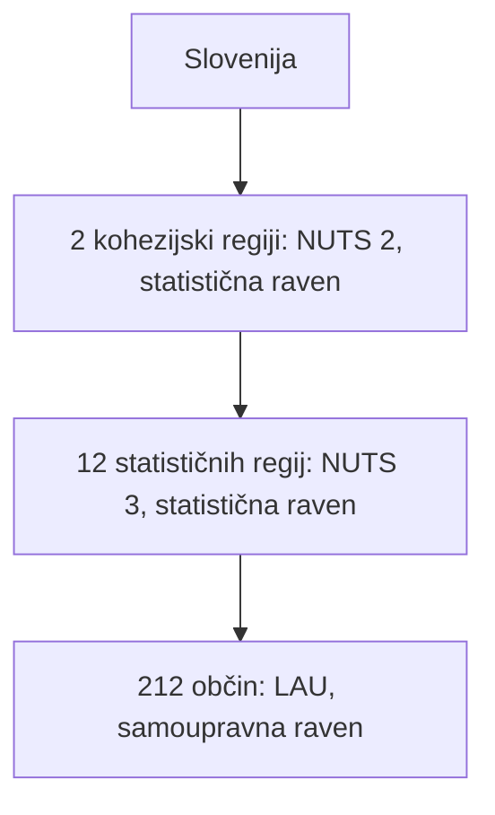

## Odgovor {#answer}

V tem članku je enota prve ravni največja enota z lastno upravo neposredno pod ravnijo države.
Vsaka država EU te enote določi sama, zato se po vrsti in številu zelo razlikujejo.[^2][^11]
Po metodi tega članka imata Belgija in Portugalska po 3 enote, Ciper pa 615 (sklepanje).[^11]
Za primerljivo statistiko EU uporablja ločen sistem regij, imenovan NUTS.[^1]
Angleška različica: [[eu-administrative-divisions]].

## Ključni poudarki {#key-insights}

- Vsaka država EU sama določi svoje upravne enote.[^2]
- NUTS je statistična klasifikacija s tremi ravnmi regij.[^1]
- NUTS praviloma sledi nacionalnim upravnim mejam, nekatere ravni NUTS pa obstajajo le za statistiko.[^2]
- Slovenija ima eno raven lokalne samouprave: 212 občin.[^7]
- Preglednica v tem članku za vsako od 27 držav EU navaja eno vrsto enot prve ravni.[^11]

## Upravne enote in statistične regije {#definition}

EU je klasifikacijo NUTS uvedla, da lahko regije držav članic poimenuje za statistične namene.[^1]
NUTS praviloma sledi upravni delitvi posamezne države.[^2]
Tako je podatke laže zbirati in politike laže izvajati.[^2]
Nekatere ravni NUTS se ujemajo z upravnimi enotami.[^2]
Druge ravni NUTS niso upravne in obstajajo le za statistiko.[^2]
Sistema se zato pogosto prekrivata, nista pa enaka.[^2]
Pozor: v Sloveniji izraz *upravna enota* pomeni območno enoto državne uprave.[^10]
Zato ta članek govori o enotah prve ravni.

## Regije NUTS {#nuts}

NUTS je kratica za *Nomenclature of territorial units for statistics*.[^1]
Slovensko ime je skupna statistična klasifikacija teritorialnih enot.[^9]
NUTS vsako državo EU deli na tri ravni:[^1]

- NUTS 1: večje družbenoekonomske regije
- NUTS 2: osnovne regije za regionalne politike
- NUTS 3: manjše regije za podrobnejše analize

Klasifikacija NUTS 2024 velja od 1. januarja 2024.[^1]
Ima 92 regij NUTS 1, 244 regij NUTS 2 in 1165 regij NUTS 3.[^1]
Klasifikacija NUTS 2027 bo veljala od 1. januarja 2027.[^1]
Imela bo 91 regij NUTS 1, 242 regij NUTS 2 in 1170 regij NUTS 3.[^1]
EU na ravni NUTS 2 določi regije, ki lahko dobijo sredstva kohezijske politike.[^1]

## Kako se določajo regije NUTS {#principles}

Za vsako raven NUTS je določen razpon števila prebivalcev:[^2]

| Raven NUTS | Prebivalci na regijo |
|---|---|
| NUTS 1 | 3.000.000–7.000.000 |
| NUTS 2 | 800.000–3.000.000 |
| NUTS 3 | 150.000–800.000 |

Če se raven NUTS ujema z upravno ravnijo, mora biti v razponu le povprečno število prebivalcev njenih regij.[^2]
Eurostat klasifikacijo praviloma spremeni največ vsaka 3 leta.[^2]

## Lokalne upravne enote {#lau}

Pod ravnijo NUTS 3 Eurostat vodi seznam lokalnih upravnih enot (LAU).[^3]
LAU so občine in komune v državah EU.[^3]
Iz njih so sestavljene regije NUTS.[^3]
Od leta 2017 obstaja samo ena raven LAU.[^3]
Države EU vsako leto pošljejo Eurostatu posodobljen seznam svojih LAU.[^3]

## Enote prve ravni v 27 državah EU {#first-level-table}

Preglednica za vsako državo EU navaja eno vrsto enot prve ravni.
Za večino držav uporablja najvišjo raven, ki jo Eurostat navaja kot upravno enoto (metoda je sklepanje).[^11]
Eurostat v svoji preglednici ujemanja z zvezdico označi enote, ki niso upravne.[^11]
Teh ravni preglednica ne upošteva.
Za Francijo, Irsko, Poljsko in Slovenijo preglednica uporablja nacionalni vir.[^5][^6][^7][^12]
Števila Eurostata temeljijo na NUTS 2024 in na seznamu LAU za leto 2022.[^11]

| Država | Enota (izvirno ime) | Enota (slovensko) | Število | Raven | Vir |
|---|---|---|---:|---|---|
| Avstrija | *Länder* | zvezne dežele | 9 | NUTS 2 | Eurostat[^11] |
| Belgija | *Gewesten / Régions* | regije | 3 | NUTS 1 | Eurostat[^11] |
| Bolgarija | *Oblasti* | oblasti | 28 | NUTS 3 | Eurostat[^11] |
| Ciper | *Dimoi, koinotites* | občine in skupnosti | 615 | LAU | Eurostat[^11] |
| Češka | *Kraje* | kraji | 14 | NUTS 3 | Eurostat[^11] |
| Danska | *Regioner* | regije | 5 | NUTS 2 | Eurostat[^11] |
| Estonija | *Linn, vald* | mestne in podeželske občine | 79 | LAU | Eurostat[^11] |
| Finska | *Maakunnat / Landskap* | regije | 19 | NUTS 3 | Eurostat[^11] |
| Francija | *Régions* | regije | 18 | nacionalni vir | Insee[^5] |
| Grčija | *Periferies* | regije | 13 | NUTS 2 | Eurostat[^11] |
| Hrvaška | *Županije* | županije | 21 | NUTS 3 | Eurostat[^11] |
| Irska | *Local authorities* | lokalne oblasti | 31 | nacionalni vir | CSO[^12] |
| Italija | *Regioni* | dežele | 21 | NUTS 2 | Eurostat[^11] |
| Latvija | *Valstspilsētas, novadi* | državna mesta in občine | 43 | LAU | Eurostat[^11] |
| Litva | *Apskritys* | okrožja | 10 | NUTS 3 | Eurostat[^11] |
| Luksemburg | *Communes* | občine | 102 | LAU | Eurostat[^11] |
| Madžarska | *Megyék* | županije | 20 | NUTS 3 | Eurostat[^11] |
| Malta | *Localities* | kraji | 68 | LAU | Eurostat[^11] |
| Nemčija | *Länder* | zvezne dežele | 16 | NUTS 1 | Eurostat[^4][^11] |
| Nizozemska | *Provincies* | province | 12 | NUTS 2 | Eurostat[^11] |
| Poljska | *Województwa* | vojvodstva | 16 | nacionalni vir | GUS[^6] |
| Portugalska | *Continente, Regiões Autónomas* | celina in avtonomni regiji | 3 | NUTS 1 | Eurostat[^11] |
| Romunija | *Județe* | okrožja | 42 | NUTS 3 | Eurostat[^11] |
| Slovaška | *Kraje* | kraji | 8 | NUTS 3 | Eurostat[^11] |
| Slovenija | *Občine* | občine | 212 | LAU | gov.si[^7][^11] |
| Španija | *Comunidades y Ciudades Autónomas* | avtonomne skupnosti in mesti | 19 | NUTS 2 | Eurostat[^11] |
| Švedska | *Län* | okraji | 21 | NUTS 3 | Eurostat[^11] |

V 6 državah je enota prve ravni občinska raven (LAU): na Cipru, v Estoniji, Latviji, Luksemburgu, na Malti in v Sloveniji (sklepanje).[^11]
Za Poljsko Eurostat navaja 17 enot NUTS 2, poljski statistični urad pa 16 vojvodstev.[^6][^11]
Diagram kaže enaka števila na logaritemski lestvici, ker ima Ciper veliko več enot kot druge države.

*Slika 1. Število enot prve ravni v posamezni državi EU na logaritemski lestvici: največ jih ima Ciper, najmanj Belgija in Portugalska. Podatki: Eurostat NUTS 2024, tabela 5, in nacionalni viri. Diagram: Aigora, CC BY-SA 4.0.*

Opis

- Največ enot: Ciper 615, Slovenija 212, Luksemburg 102, Estonija 79, Malta 68.
- Sredina: od 8 (Slovaška) do 43 (Latvija) enot v 19 državah.
- Najmanj enot: Danska 5, Belgija 3, Portugalska 3.
- Podatkovna datoteka je `charts/upravna-delitev-drzav-eu/enote-prve-ravni/data.csv`.

## Primeri {#examples}

Nemčija je zvezna država s 16 zveznimi deželami (*Länder*).[^4]
Tri zvezne dežele so mestne države: Berlin, Hamburg in Bremen.[^4]
Francija ima 18 regij: 13 v celinski Franciji in 5 čezmorskih.[^5]
Čezmorske regije so Guadeloupe, Martinik, Francoska Gvajana, Réunion in Mayotte.[^5]
Teh 18 regij obsega 101 departma.[^5]
Poljska je 1. januarja 2025 imela te enote:[^6]

- 16 vojvodstev (*województwa*)
- 314 okrajev (*powiaty*)
- 66 mest s statusom okraja
- 2479 občin (*gminy*)

## Slovenija {#slovenia}

Slovenija ima 212 občin.[^7]
Od teh ima 12 občin status mestne občine.[^7]
Ustava predvideva tudi pokrajine, vendar jih država še ni ustanovila.[^7]
Občine so zato edina raven lokalne samouprave.[^7]
Slovenija ima tudi 58 upravnih enot.[^10]
Te opravljajo naloge državne uprave in niso organi lokalne samouprave.[^10]

Za statistične namene nacionalni šifrant 212 občin združuje v 12 statističnih regij in 2 kohezijski regiji.[^8]
Od 1. januarja 2008 kohezijski regiji sestavljata slovensko raven NUTS 2.[^9]
To sta Vzhodna Slovenija in Zahodna Slovenija.[^9]
Diagram kaže, da je samoupravna le najnižja raven, občina.[^7][^11]

*Slika 2. Statistične in samoupravne ravni v Sloveniji. Viri: gov.si, SURS in Eurostat NUTS 2024.*

Za temo z enega slovenskega območja glejte članek [[belokranjska-narecja]].

## Ključne trditve {#key-claims}

- NUTS vsako državo EU deli na tri ravni statističnih regij.[^1]
- NUTS 2024 ima 92 regij NUTS 1, 244 regij NUTS 2 in 1165 regij NUTS 3.[^1]
- NUTS praviloma sledi nacionalni upravni delitvi.[^2]
- Nemčija ima 16 zveznih dežel, Francija 18 regij, Poljska pa 16 vojvodstev.[^4][^5][^6]
- Slovenija ima 212 občin in nima pokrajin.[^7]
- Statistične regije (12) in kohezijski regiji (2) v Sloveniji so statistične, ne upravne enote.[^8][^9]
- V Eurostatovi preglednici ujemanja za NUTS 2024 ima Ciper 615 lokalnih enot, Belgija pa 3 regije.[^11]

## Kviz {#quiz}

Kviz za ta članek je v datoteki `quizzes/upravna-delitev-drzav-eu.yaml`.
Spletno mesto ga prikaže na strani s kvizom za ta članek.

## Odprta vprašanja {#open-questions}

- Katera raven šteje kot »prva«, je uredniška odločitev. Za nekatere države Eurostat navaja več upravnih ravni, na primer za Nemčijo zvezne dežele (*Länder*) in okraje (*Kreise*).[^11]
- Števila za Ciper, Estonijo, Latvijo, Luksemburg in Malto so s seznama LAU za leto 2022. Države EU sezname LAU posodobijo vsako leto, zato je treba ta števila preveriti na najnovejšem seznamu.[^3][^11]
- Za Italijo preglednica sledi Eurostatu, ki navaja 21 enot NUTS 2 z imenom *Regioni*. Nacionalno število naj potrdi vir italijanske vlade.[^11]
- Za Irsko Eurostat na ravni LAU navaja 166 lokalnih volilnih območij (*Local Electoral Areas*). Preglednica uporablja 31 lokalnih oblasti, ki jih navaja irski statistični urad CSO.[^11][^12]
- Eurostat litovskih okrožij (*apskritys*) in portugalskih enot NUTS 1 ne označi kot neupravnih. Viri tega članka ne opisujejo njihovih pristojnosti.[^11]

## Viri {#sources}

Viri so navedeni v polju `sources` v glavi datoteke. V besedilu so citirani kot opombe.
