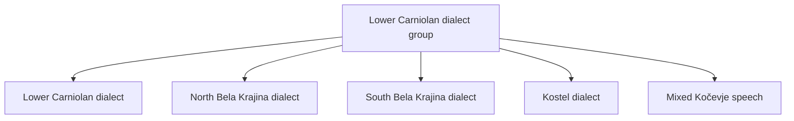

## Answer {#answer}

Bela Krajina has two Slovene dialects: the North Bela Krajina dialect and the South Bela Krajina dialect.[^2]
Both dialects belong to the Lower Carniolan dialect group on the official map of Slovene dialects.[^1]
Serbo-Croatian influence is much stronger in the south than in the north.[^2]
A few villages on the Kolpa river speak Shtokavian (Serbo-Croatian).[^2]

## Key insights {#key-insights}

- The official map puts both Bela Krajina dialects in the Lower Carniolan dialect group.[^1]
- The border between the two dialects runs roughly from Jelševnik to Krasinec.[^2]
- In the south, the old acute vowels stayed short, as in Croatian and Serbian.[^2]
- Migrations after Ottoman raids in the 15th and 16th centuries mixed Slovene, Croatian and Serbian speech.[^2]
- Experts describe the border between the two dialects as not clearly defined.[^2]

## Overview {#overview}

Bela Krajina (White Carniola) is a region in south-east Slovenia.[^2]
The Gorjanci hills are to the north, and the Kočevje forests are to the west.[^2]
The Kolpa river is to the south and forms the border with Croatia.[^2]
The local speech has two dialects:[^2]

- the North Bela Krajina dialect (*severnobelokranjsko narečje*)
- the South Bela Krajina dialect (*južnobelokranjsko narečje*)

Speech in the region mixes Slovene, Croatian and Serbian elements in different amounts.[^2]
For the official administrative and statistical units of Slovenia, see [[eu-administrative-divisions#slovenia|administrative divisions in the EU]].

*Figure 1. The Bela Krajina landscape seen from above Semič, a town in the North Bela Krajina dialect area. "View of Bela Krajina from the Semic viewpoint 02" by Ajznponar, Wikimedia Commons, CC0 1.0, resized.*

## Classification {#classification}

The Fran Ramovš Institute of the Slovenian Language at ZRC SAZU publishes the official map of Slovene dialects.[^1]
Its 2023 version builds on the 1983 map by Tine Logar and Jakob Rigler.[^1]
The map puts both Bela Krajina dialects in the Lower Carniolan dialect group (*dolenjska narečna skupina*).[^1]
The map lists five members of this group, as the diagram shows.[^1]

*Figure 2. Members of the Lower Carniolan dialect group. Both Bela Krajina dialects are in this group. Source: ZRC SAZU, Map of Slovene dialects (2023).*

People often summarise the institute's map as 48 dialects and 13 subdialects of Slovene.[^3]

## North Bela Krajina dialect {#north}

People speak the northern dialect around Semič, Črnomelj and Metlika.[^2]
The dialectologist Tine Logar drew its southern border.[^2]
This border runs roughly from Jelševnik (near Dobliče) to Krasinec (near Podzemelj).[^2]
North of this line, the old long and old acute vowels changed in the same way as in Lower Carniola and other central dialects.[^2]
The short vowels also became reduced, as in most Slovene dialects.[^2]
Shtokavian influence is smaller here than in the south.[^2]

## South Bela Krajina dialect {#south}

People speak the southern dialect south of the Jelševnik–Krasinec line.[^2]
There, the old acute vowels stayed short, as in Croatian and Serbian.[^2]
Most southern local dialects did not go through the modern Slovene vowel reduction.[^2]
Some of them keep a non-Slovene type of pitch accent.[^2]
Examples are the local dialects in Dobliče, Dragatuš, Vinica and Stari trg ob Kolpi.[^2]
Many southern local dialects are mixed or have a non-Slovene base.[^2]

## Shtokavian villages {#shtokavian}

After Ottoman raids in the 15th and 16th centuries, many local people moved north.[^2]
Uskoks and other settlers from Lika, Bosnia and Dalmatia came to the region.[^2]
Logar found three kinds of local speech in the region:[^2]

- purely or mostly Slovene
- mixed Slovene–Croatian
- purely Croatian or Serbian

Shtokavian speech islands are clearest along the Kolpa, in Bojanci, Marindol, Miliči and Paunoviči.[^2]
These villages used Serbo-Croatian as a school language until the 1960s.[^2]

## History of classification {#history}

The classification changed over time:[^1][^2]

- 1931: the linguist Fran Ramovš divided Bela Krajina speech into four dialects on a Lower Carniolan base.
- 1935: Ramovš called the same varieties local dialects (*govori*), not full dialects.
- 1983: Tine Logar and Jakob Rigler published the map of Slovene dialects.
- 2023: ZRC SAZU published a new version of the map, based on the 1983 map.

In 1935, Ramovš also called them mixed Slovene–Serbo-Croatian dialects.[^2]
He saw more Slovene in the north and more Serbo-Croatian in the south.[^2]
Logar later drew the north–south border that experts still use.[^2]

## Standard language {#standard}

The first two printed books in Slovene appeared in 1550.[^4]
They are the *Catechismus* and the *Abecedarium* by Primož Trubar.[^4]
For how print changed written languages, see [[printing-press#effects|effects of printing]].

## Key claims {#key-claims}

- Bela Krajina has two Slovene dialects: North and South Bela Krajina.[^1][^2]
- Both are in the Lower Carniolan dialect group on the official ZRC SAZU map.[^1]
- The border between them runs roughly from Jelševnik to Krasinec.[^2]
- Serbo-Croatian influence is much stronger in the southern dialect.[^2]
- Bojanci, Marindol, Miliči and Paunoviči are Shtokavian-speaking villages.[^2]
- The first printed Slovene books appeared in 1550.[^4]

## Quiz {#quiz}

The quiz for this article is in `quizzes/bela-krajina-dialects.yaml`.
The site shows it on the quiz page for this article.

## Open questions {#open-questions}

- Experts describe the border between the Bela Krajina dialects as not clearly defined.[^2]
- Nobody has yet researched how the local dialects on the Kolpa relate to the neighbouring Croatian Kajkavian dialects.[^2]

## Sources {#sources}

The sources are listed in the frontmatter field `sources`. The text cites them as footnotes.
