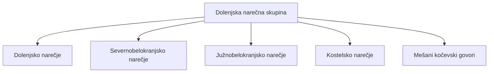

## Odgovor {#answer}

V Beli krajini se govorita dve slovenski narečji: severnobelokranjsko in južnobelokranjsko.[^2]
Na uradni karti slovenskih narečij obe spadata v dolenjsko narečno skupino.[^1]
Srbohrvaški vpliv je na jugu precej močnejši kot na severu.[^2]
V nekaj vaseh ob Kolpi govorijo štokavsko (srbohrvaško).[^2]
Angleška različica: [[bela-krajina-dialects]].

## Ključni poudarki {#key-insights}

- Uradna karta obe belokranjski narečji uvršča v dolenjsko narečno skupino.[^1]
- Meja med narečjema poteka približno od Jelševnika do Krasinca.[^2]
- Na jugu so staroakutirani samoglasniki ostali kratki, kot v hrvaščini in srbščini.[^2]
- Preseljevanja po turških vpadih v 15. in 16. stoletju so pomešala slovenske, hrvaške in srbske govore.[^2]
- Strokovnjaki mejo med narečjema opisujejo kot nejasno.[^2]

## Pregled {#overview}

Bela krajina je pokrajina na jugovzhodu Slovenije.[^2]
Na severu jo omejujejo Gorjanci, na zahodu kočevski gozdovi.[^2]
Na jugu teče reka Kolpa, ki je državna meja s Hrvaško.[^2]
Krajevne govore v Beli krajini uvrščamo v dve narečji:[^2]

- severnobelokranjsko narečje
- južnobelokranjsko narečje

V govorih se v različnem razmerju prepletajo slovenske, hrvaške in srbske prvine.[^2]
O uradni upravni in statistični delitvi Slovenije govori članek [[upravna-delitev-drzav-eu#slovenia|Upravna delitev držav EU]].

*Slika 1. Belokranjska pokrajina, kot se vidi z vzpetine nad Semičem, krajem na območju severnobelokranjskega narečja. »View of Bela Krajina from the Semic viewpoint 02«, avtor Ajznponar, Wikimedia Commons, CC0 1.0, pomanjšano.*

## Uvrstitev {#classification}

Uradno Karto slovenskih narečij izdaja Inštitut za slovenski jezik Frana Ramovša ZRC SAZU.[^1]
Različica iz leta 2023 temelji na karti Tineta Logarja in Jakoba Riglerja iz leta 1983.[^1]
Karta obe belokranjski narečji uvršča v dolenjsko narečno skupino.[^1]
Karta v tej skupini navaja pet narečij in govorov, kot kaže diagram.[^1]

*Slika 2. Člani dolenjske narečne skupine. Obe belokranjski narečji spadata vanjo. Vir: ZRC SAZU, Karta slovenskih narečij (2023).*

Po karti inštituta se slovenščina navadno deli na 48 narečij in 13 podnarečij.[^3]

## Severnobelokranjsko narečje {#north}

Severnobelokranjsko narečje govorijo v okolici Semiča, Črnomlja in Metlike.[^2]
Njegovo južno mejo je določil dialektolog Tine Logar.[^2]
Meja poteka približno od Jelševnika (pri Dobličah) do Krasinca (pri Podzemlju).[^2]
Severno od te črte so se staroakutirani in stalno dolgi samoglasniki razvili enako kot v dolenjskih in drugih osrednjih narečjih.[^2]
Kratki samoglasniki so se tu reducirali, kot v večini slovenskih narečij.[^2]
Štokavski vplivi so tu manjši kot na jugu.[^2]

## Južnobelokranjsko narečje {#south}

Južnobelokranjsko narečje govorijo južno od črte Jelševnik–Krasinec.[^2]
Staroakutirani samoglasniki so tu ostali kratki, kot je značilno za hrvaščino in srbščino.[^2]
Večina južnih govorov ni doživela moderne slovenske samoglasniške redukcije.[^2]
Nekateri ohranjajo neslovensko tonemsko naglaševanje.[^2]
Taki so na primer govori v Dobličah, Dragatušu, Vinici in Starem trgu ob Kolpi.[^2]
Veliko južnih govorov je mešanih ali ima neslovensko jezikovno osnovo.[^2]

## Štokavske vasi {#shtokavian}

Po turških vpadih v 15. in 16. stoletju se je veliko domačinov umaknilo proti severu.[^2]
Na njihovo mesto so prišli uskoki in drugi priseljenci iz Like, Bosne in Dalmacije.[^2]
Logar je na tem območju ločil tri skupine govorov:[^2]

- čisto ali pretežno slovenske
- mešane slovensko-hrvaške
- čiste hrvaške oziroma srbske

Štokavski jezikovni otoki so najizrazitejši ob Kolpi, v Bojancih, Marindolu, Miličih in Paunovičih.[^2]
V teh vaseh je bila srbohrvaščina učni jezik v šolah do šestdesetih let 20. stoletja.[^2]

## Zgodovina uvrščanja {#history}

Uvrstitev se je s časom spreminjala:[^1][^2]

- 1931: Fran Ramovš je belokranjske govore razdelil na štiri dialekte z dolenjsko osnovo.
- 1935: Ramovš jih je obravnaval kot govore, ne več kot samostojne dialekte.
- 1983: Tine Logar in Jakob Rigler sta izdala karto slovenskih narečij.
- 2023: ZRC SAZU je izdal novo različico karte, ki temelji na karti iz leta 1983.

Leta 1935 jih je Ramovš označil tudi za mešane slovensko-srbskohrvaške dialekte.[^2]
Na severu je videl več slovenskih, na jugu pa več srbskohrvaških prvin.[^2]
Logar je pozneje potegnil ločnico med severom in jugom, ki jo strokovnjaki uporabljajo še danes.[^2]

## Knjižni jezik {#standard}

Prvi slovenski tiskani knjigi sta izšli leta 1550.[^4]
To sta Trubarjeva *Katekizem* in *Abecednik*.[^4]

## Ključne trditve {#key-claims}

- V Beli krajini se govorita dve slovenski narečji: severnobelokranjsko in južnobelokranjsko.[^1][^2]
- Na uradni karti ZRC SAZU obe spadata v dolenjsko narečno skupino.[^1]
- Meja med njima poteka približno od Jelševnika do Krasinca.[^2]
- Srbohrvaški vpliv je precej močnejši v južnobelokranjskem narečju.[^2]
- Bojanci, Marindol, Miliči in Paunoviči so vasi s štokavskimi govori.[^2]
- Prvi slovenski tiskani knjigi sta izšli leta 1550.[^4]

## Kviz {#quiz}

Kviz za ta članek je v datoteki `quizzes/belokranjska-narecja.yaml`.
Spletno mesto ga prikaže na strani s kvizom za ta članek.

## Odprta vprašanja {#open-questions}

- Strokovnjaki mejo med belokranjskima narečjema opisujejo kot nejasno.[^2]
- Povezanosti govorov tik ob Kolpi s sosednjimi hrvaškimi kajkavskimi govori še nihče ni raziskal.[^2]

## Viri {#sources}

Viri so navedeni v polju `sources` v glavi datoteke. V besedilu so citirani kot opombe.
