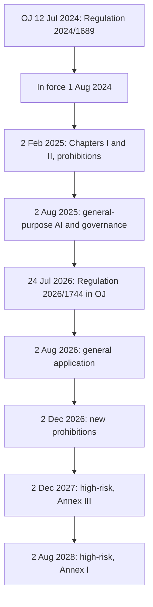

# AI and ethics

## Answer {#answer}

AI ethics asks how systems that rank, predict, watch and act should be built, used and governed. SEP calls it a very young discipline: the first machine-ethics papers appeared in the early 2000s and the first AI-ethics conference in 2012.[^1] The classic theories each pick out a different part of a decision: character, respect for persons, outcomes and fair institutions.[^3][^4][^5][^6] The main debates cover bias, opacity, privacy, responsibility, moral status, alignment, risk and work.[^1][^2] As of 2026-10-18 the EU AI Act is binding law, as amended in July 2026, while the OECD and UNESCO texts are recommendations.[^13][^14][^17][^18]

This is part 9 of the series on the history of philosophy. It follows [[philosophy-of-mind-and-technology]]. Slovenian version: [[umetna-inteligenca-in-etika]].

## Key insights {#key-insights}

- The four classic traditions are not interchangeable recipes. Each asks a different question about the same AI decision (inferred).[^3][^4][^5][^6]
- Statistical fairness measures can conflict. Except in highly unusual circumstances, two groups cannot be treated equally on both COMPAS measures at once.[^7]
- Responsibility gaps appear when no human fully controls what a system does. Philosophers dispute how real these gaps are.[^1][^9]
- Alignment is a normative problem as well as a technical one: whose values should a system pursue?[^1][^11]
- SEP warns against framing AI ethics only as risk, since some harms are already actual.[^1]

## Four traditions, four questions {#traditions}

Take a hypothetical system that ranks job applicants. The questions in the list are our own illustration (inferred).

- **Virtue ethics** uses three Greek concepts: *arete* (virtue), *phronesis* (practical wisdom) and *eudaimonia* (flourishing).[^3] Do the people who build and use the system show practical judgment? See [[ancient-greek-philosophy#aristotle-ethics]].
- **Kant's Humanity Formula** says to treat humanity "as a means only but always as an end in itself".[^4] SEP's Kant entry says we should not use AI "to deceive consumers, manipulate voters, exploit vulnerable populations, or kill innocent people".[^4] See [[enlightenment-philosophy#kant]].
- **Consequentialism** holds that "normative properties depend only on consequences".[^5] What are the benefits and harms for everyone affected? See [[enlightenment-philosophy#smith-bentham]].
- **Rawls:** the veil of ignorance "prevents arbitrary facts about citizens from influencing the agreement".[^6] Would you accept the rules if you did not know whether you would own the system or be judged by it? See [[twentieth-century-philosophy#rawls]].

## Machine ethics {#machine-ethics}

- IEP calls Asimov's Three Laws of Robotics, from "Runaround" (1942), the first ethical code for AI. Its standard view is that they are important but not enough.[^2]
- IEP lists bottom-up, top-down and hybrid ways to build ethics into machines.[^2]
- Moor distinguishes kinds of machine agent. For him "an average adult human is a full ethical agent", able to make and justify explicit ethical judgments.[^1]

## Bias, opacity and privacy {#fairness}

- **Feedback loops:** in IEP's predictive-policing example (O'Neil 2016), more police in an area lead to more reported crime there, which seems to confirm the prediction.[^2]
- **COMPAS:** after ProPublica's critique, computer scientists showed that two common fairness measures cannot generally be satisfied together (Kleinberg et al. 2016; Chouldechova 2016).[^7] Green and Hu warn that calling this an impossibility of fairness in general "is mistaking the map for the territory".[^7]
- **Opacity:** IEP names corporate secrecy, lack of public expertise and "black box" systems as sources of opacity. Counterfactual explanations show which facts would have had to differ for another decision.[^2]
- **Privacy:** SEP quotes Schneier: "surveillance is the business model of the Internet".[^1] Nissenbaum's "contextual integrity" judges information flows by the norms of each social context.[^8]

## Responsibility and autonomous weapons {#responsibility}

- **Matthias (2004):** as systems grow complex and less directly controlled, it becomes harder to hold humans responsible. He calls this a "responsibility gap".[^9]
- **Sparrow (2007):** for autonomous weapons, "neither the human nor the machine may be responsible".[^1]
- **Responses:** keep humans "in the loop" or in "meaningful control" (Santoni de Sio and van den Hoven 2018). Sceptics doubt the gaps are real.[^1]
- SEP's regulatory assessment is that "a total ban now seems off the cards".[^1] The AI Act excludes systems used "exclusively for military, defence or national security purposes" (Art. 2(3)).[^13]
- UNESCO: in life-and-death or irreversible decisions, "final human determination should apply".[^18]

## Moral status and alignment {#moral-status}

- **Sentience:** SEP reports concern about creating conscious AI, since it might suffer. Some authors call for a "moratorium on synthetic phenomenology" (Metzinger 2021).[^1] See [[philosophy-of-mind-and-technology#llms]].
- **Relational turn:** Coeckelbergh and Gunkel ask whether how we relate to robots matters more than what they "really" are.[^2]
- **Wiener (1960):** a machine may act too fast for us to interfere. Then "we had better be quite sure that the purpose put into the machine is the purpose which we really desire".[^10] See [[twentieth-century-philosophy#wiener]].
- **Russell (2019),** as quoted by Sutrop, proposes three principles:[^11]
  1. "The machine’s only objective is to maximise the realization of human preferences."
  2. "The machine is initially uncertain about what those preferences are."
  3. "The ultimate source of information about human preferences is human behavior."
- Sutrop separates the technical challenge of encoding values from the normative one of choosing whose values. She argues developers underrate the second.[^11]

## Risk and work {#x-risk}

- **Existential risk:** the classic argument says AI may reach superintelligence and that this carries a chance of catastrophe (Bostrom 2014).[^1] SEP says "it remains an open question whether AI is on course towards general intelligence".[^1]
- SEP notes that such arguments often rely on "fanaticism", where a tiny chance of a huge outcome outweighs secure goods.[^1]
- SEP asks AI ethics to generate "a positive vision of a future worth wanting".[^1]
- **Work (as reported by SEP, 2025 figures):** the labour-market impact of AI is now "clearly visible", and AI investment was about US$0.5 trillion in 2025.[^1] SEP cites the World Economic Forum (2025) for net job creation so far, "but there are indications that this will change".[^1]
- **OECD:** governments should ensure "a fair transition for workers" and that AI's benefits are "broadly and fairly shared".[^17]

## Governance as of 2026-10-18 {#governance}

The diagram shows the AI Act's application dates under Article 113 as amended by Regulation (EU) 2026/1744.[^13][^14]

### EU AI Act {#eu-ai-act}

- **Regulation (EU) 2024/1689** (CELEX 32024R1689) is dated 13 June 2024, the signing date. It was published in the Official Journal on 12 July 2024.[^12] It entered into force on 1 August 2024, twenty days after publication.[^12][^16]
- **Regulation (EU) 2026/1744**, the Digital Omnibus on AI (CELEX 32026R1744), was signed on 8 July 2026. It was published on 24 July 2026 and entered into force three days later.[^14]
- **Procedure:** the Commission proposed it on 19 November 2025 (COM(2025) 836). Parliament adopted its position on 16 June 2026 and the Council on 29 June 2026.[^15][^14]
- **Prohibitions** include harmful manipulation, social scoring, untargeted facial scraping and emotion recognition at work and in education.[^16]
- **New 2026 prohibition:** AI that generates non-consensual intimate images, such as "nudification" apps, or child sexual abuse material. It applies from 2 December 2026.[^16][^13][^14]
- **Other changes:** a legal basis for processing special-category data to detect bias (new Article 4a) and simpler rules for small mid-caps.[^14][^16]
- Article 2(7) keeps the GDPR and other EU data-protection law in force, subject to Articles 4a and 59.[^13]

### OECD and UNESCO {#oecd-unesco}

- **OECD:** the Recommendation was adopted on 22 May 2019. It was revised on 8 November 2023 (the AI-system definition) and on 3 May 2024.[^17]
- **UNESCO:** the Recommendation was adopted on 23 November 2021. Member States apply it "on a voluntary basis".[^18] It says AI "should not be used for social scoring or mass surveillance purposes".[^18]

## Later influence {#thread}

Each point below links an idea from this article to a later topic. The links are our own reasoning (inferred).

- **Back to the start:** virtue ethics still uses Aristotle's terms, so the series ends where part 1 began.[^3]
- **Law and philosophy:** the AI Act turns earlier debates on dignity, fairness and control into legal duties.[^13]
- **Open future:** the dates above will change, so this article has an early review date.[^14]

## Key claims {#key-claims}

- Virtue ethics is built on *arete*, *phronesis* and *eudaimonia*.[^3]
- SEP applies Kant's Humanity Formula against manipulative and deceptive AI.[^4]
- Common statistical fairness measures cannot generally be satisfied together.[^7]
- Sparrow (2007) suggested a responsibility gap for autonomous weapons.[^1]
- Russell's principles make machines uncertain about human preferences.[^11]
- Regulation (EU) 2024/1689 was published on 12 July 2024 and entered into force on 1 August 2024.[^12]
- Regulation (EU) 2026/1744 moved Annex III high-risk duties to 2 December 2027.[^13][^14]
- UNESCO's 2021 Recommendation is applied on a voluntary basis.[^18]

## Quiz {#quiz}

The quiz for this article is in `quizzes/ai-and-ethics.yaml`.
The site shows it on the quiz page for this article.

## Open questions {#open-questions}

- Who should settle disagreements about the values AI systems pursue?
- What evidence would justify treating an artificial system as a moral patient?
- Are responsibility gaps real? SEP leaves this open.[^1]
- The Commission may issue further guidance on the AI Act. Re-check all dates by 2027-04-17.

## Sources {#sources}

The sources are listed in the frontmatter field `sources`. The text cites them as footnotes.
