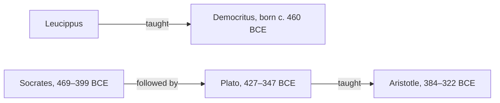

## Answer {#answer}

Greek philosophy began with the Presocratics, thinkers of the 6th and 5th centuries BCE.[^1]
Later antiquity saw them as the first philosophers and scientists of the Western tradition.[^1]
With the Sophists and Socrates, ethics and political thought became more prominent.[^1]
Plato showed that true belief is not enough for knowledge, and Aristotle wrote the earliest formal logic that survives.[^13][^16]
This is part 1 of the series on the history of philosophy. Slovenian version: [[starogrska-filozofija]].

## Key insights {#key-insights}

1. Almost everything we know about the Presocratics comes from quotations (fragments) and reports (testimonia) in later authors.[^1]
2. Presocratic thought differs from earlier Greek thought in how it explains the world. Scholars disagree about how large the difference is.[^1]
3. In the *Theaetetus*, Plato separates knowledge from true belief. The modern "justification" condition is often traced to this point.[^15]
4. Aristotle's logical works contain the earliest formal study of logic that we have.[^16]
5. Plato and Aristotle are the founders of virtue ethics in the West. Today it is one of three major approaches in normative ethics.[^19]

## Timeline and teachers {#timeline}

The thinkers in this article lived over about 300 years:

- Thales: c. 620 – c. 546 BCE[^2]
- Anaximander: c. 610–546 BCE[^3]
- Pythagoras: c. 570 – c. 490 BCE[^6]
- Heraclitus: active around 500 BCE[^4]
- Parmenides: active in the earlier part of the 5th century BCE[^5]
- Protagoras: c. 490–420 BCE[^10]
- Socrates: 469–399 BCE[^11]
- Democritus: born about 460 BCE[^7]
- Plato: 427–347 BCE[^6]
- Aristotle: 384–322 BCE[^6]

The diagram shows two lines of teachers and students.
Leucippus taught Democritus.[^7]
Plato was a follower of Socrates, and Aristotle was Plato's most famous student.[^12]

*Figure 1. Two teacher–student lines. The line from Socrates to Aristotle links three generations of Athenian philosophy. Sources: SEP, IEP.*

## Presocratics {#presocratics}

Most Presocratics wrote at least one book, in prose or as a poem, but no complete work survives.[^1]
We depend on later philosophers, historians and compilers for fragments and testimonia.[^1]
The table gives the standard picture. Scholars dispute many of its details.

| Thinker | Question | Core idea, as reported | Note |
|---|---|---|---|
| Thales (Miletus) | What is the origin of things? | Aristotle reports that Thales made water the *archê* (the originating principle).[^2] | Aristotle called him the founder of natural philosophy.[^2] |
| Anaximander (Miletus) | What is the origin of things? | "The Boundless" (*apeiron*).[^3] | Already in antiquity, critics complained that he did not explain what he meant by it.[^3] |
| Heraclitus (Ephesus) | How is the world ordered? | Constant change (flux), the unity of opposites, and fire as the basic material.[^4] | He wrote in riddles, and the interpretation of these doctrines is controversial.[^4] |
| Parmenides (Elea) | Can what-is come to be or change? | What-is is ungenerated, deathless and still.[^5] | The "strict monist" reading (exactly one thing exists) is less common than it once was.[^5] |
| Pythagoras (Samos, then Croton) | What happens to the soul? How should one live? | Reincarnation of the soul, religious ritual and a strict way of life.[^6] | He wrote nothing. It is controversial whether he did cosmology or mathematics.[^6] |
| Democritus (Abdera) | What are things made of? | Indivisible atoms that move in an infinite void, a system that his teacher Leucippus began.[^7] | He was a younger contemporary of Socrates, but scholars class him with the Presocratic atomists.[^7][^1] |

## Sophists and Socrates {#sophists-socrates}

The Sophists were itinerant professional teachers in the second half of the 5th century BCE.[^9]
For a fee, they taught young men *aretê* (virtue or excellence).[^9]
In democratic Athens, *aretê* came to mean the ability to persuade fellow citizens in political meetings.[^9]
Protagoras (c. 490–420 BCE) was one of the most important Sophists.[^10]
His teaching was mainly about techniques of argument.[^10]

A central debate of the period was about *nomos* and *phusis*.[^8]
*Nomos* means law or convention, and *phusis* means nature.[^8]
The question was whether moral and social norms rest on nature or only on convention.[^8]

Socrates wrote nothing. All our information about him is second-hand, and most of it is disputed.[^11]
His three primary sources are Aristophanes, Xenophon and Plato.[^11]
The task of finding the historical Socrates in these sources is called the "Socratic problem".[^11]

Socrates worked by question and answer.[^12]
In the *elenchus* (cross-examination), he tested a position or definition and refuted it.[^12]
Scholars debate what the elenchus refutes and whether it can prove anything.[^12]
Unlike the Sophists, Socrates did not charge fees.[^9]
Even so, his contemporaries could not always tell him apart from them.[^9]

## Plato on knowledge {#plato}

The *Theaetetus* tests three definitions of knowledge:[^13]

1. Knowledge is perception.
2. Knowledge is true judgement.
3. Knowledge is true judgement with an account (*logos*).

The law-court passage (201a–c) argues against the second definition.[^13]
If a speaker uses sophistry to persuade a jury of something true, the jurors have a true belief.[^15]
That belief is too poorly grounded to count as knowledge.[^15]
The dialogue ends in an impasse, without an accepted definition.[^13]

The *Meno* gives a different picture.[^14]
There, knowledge is a true belief "tied down" with an account (*aitias logismos*, 98a).[^14]
This is perhaps the first attempt at a justified-true-belief account of knowledge.[^14]
In the middle-period *Republic*, Plato appears to allow knowledge only of the Forms.[^14]
On that view, knowledge cannot be any kind of justified true belief.[^14]

The explicit "justified true belief" analysis belongs to the 20th century.[^15]
Edmund Gettier set it out in his 1963 paper.[^15]

## Aristotle {#aristotle}

Aristotle was born in 384 BCE, 15 years after the death of Socrates.[^12]
He studied at Plato's Academy for 20 years.[^12]

### Logic {#aristotle-logic}

- **Deduction:** in a deduction, some things are assumed, and something different follows from them of necessity (*Prior Analytics* I.2, 24b18–20).[^16]
- **Term logic:** his syllogistic deals with the logical relations between terms, such as "human being" and "animal".[^17]
- **A new discipline:** logic as a fully systematic discipline begins with Aristotle.[^17]
- **Modal syllogistic:** he extended the theory to premises with "necessarily" and "possibly". This part is far more difficult to interpret.[^16]
- **Influence:** in the Hellenistic period, Stoic logic led. In later antiquity, Aristotle's logic became dominant.[^16]
- **Reputation:** Kant held that nothing significant had been added to Aristotle's logic in two millennia.[^16]

### Ethics {#aristotle-ethics}

- **Flourishing:** the highest human good is *eudaimonia* (happiness or flourishing).[^18]
- **Function:** Aristotle argues that the human function (*ergon*) is activity of the rational soul in accordance with virtue (1097b22–1098a20).[^18]
- **The mean:** ethical virtue is a state between excess and deficiency. The mean depends on the circumstances, so there is no universal rule.[^18]
- **Practical wisdom:** a low-grade form of virtue develops in childhood through practice. Ethical virtue is fully developed only together with practical wisdom (*phronêsis*, 1144b14–17).[^18]
- **An objection:** critics say that "aiming at the mean" does not describe many real decisions well.[^18]

## Later influence {#thread}

Each point below links an idea from this article to a later topic. The links are our own reasoning (inferred).

- **Logic:** Aristotle's term logic shares elements with both set theory and predicate logic.[^17] Modern logic goes far beyond it (inferred).
- **Knowledge:** a system can give a correct answer for poor reasons. Plato's [[ancient-greek-philosophy#plato|gap between true belief and knowledge]] applies to such cases (inferred).[^15]
- **Ethics:** virtue ethics stresses character, in contrast to rules or consequences.[^19] Whether it suits AI is a question for a later part (inferred).
- **Mind:** Democritus' atomism was the most influential ancient materialist account of nature that did not rely on purpose.[^7] Later debates about mind and body return to such accounts (inferred).

## Key claims {#key-claims}

- The Presocratics were 6th–5th century BCE thinkers whom antiquity saw as the first Western philosophers and scientists.[^1]
- No complete Presocratic work survives. Fragments and testimonia are the evidence.[^1]
- Aristotle reports that Thales made water the originating principle.[^2]
- Anaximander's principle was the *apeiron*, "the Boundless".[^3]
- The interpretation of Heraclitus' flux, unity of opposites and fire is controversial.[^4]
- The strict monist reading of Parmenides is less common than it once was.[^5]
- Pythagoras wrote nothing, and it is controversial whether he was a mathematician.[^6]
- Democritus, building on Leucippus, held that atoms move in an infinite void.[^7]
- The Sophists were itinerant teachers who charged fees to teach *aretê*.[^9]
- Protagoras lived c. 490–420 BCE.[^10]
- Socrates (469–399 BCE) wrote nothing. His primary sources are Aristophanes, Xenophon and Plato.[^11]
- The elenchus is a cross-examination in which Socrates refutes a position or definition.[^12]
- The *Theaetetus* examines three definitions of knowledge and accepts none.[^13]
- The *Meno* (98a) describes knowledge as true belief tied down with an account.[^14]
- Aristotle's logical works contain the earliest formal study of logic that we have.[^16]
- For Aristotle, ethical virtue is fully developed only together with practical wisdom.[^18]
- Virtue ethics is one of three major approaches in normative ethics.[^19]

## Quiz {#quiz}

The quiz for this article is in `quizzes/ancient-greek-philosophy.yaml`.
The site shows it on the quiz page for this article.

## Open questions {#open-questions}

- Scholars disagree about how far the early Greek philosophers differ from their non-philosophical predecessors.[^1]
- Scholars debate whether the Socratic elenchus can prove anything.[^12]
- Interpreters have proposed a very wide range of reconstructions of Aristotle's modal syllogistic.[^16]

## Sources {#sources}

The sources are listed in the frontmatter field `sources`. The text cites them as footnotes.
