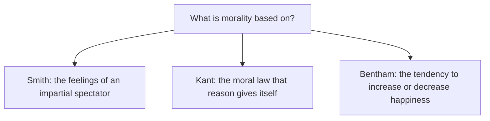

## Answer {#answer}

Enlightenment philosophers asked what reason, experience and feeling can justify.[^1]
Hume traced causation and the self back to patterns of experience.[^2]
Kant answered that the understanding is the source of the laws of nature, and that reason gives itself the moral law.[^11]
Smith grounded morals in sympathy, and Bentham grounded them in utility.[^15][^17]
La Mettrie's *Man a Machine* treated humans as natural mechanisms.[^1][^7]
Public automata showed how a simulation, or a hidden human, could pass for intelligence.[^19][^20]
This is part 5 of the series on the history of philosophy. It follows [[renaissance-early-modern-philosophy]]. Slovenian version: [[razsvetljenska-filozofija]].

## Key insights {#key-insights}

1. Hume found no impression of necessary connection and no enduring self. He found constant conjunction, expectation and bundles of perceptions.[^2]
2. Kant's Humanity Formula forbids treating humanity "as a means only".[^13]
3. Smith's impartial spectator and Bentham's principle of utility are early roots of sentiment-based and outcome-based ethics.[^15][^17]
4. SEP says the title of La Mettrie's *Man a Machine* seems designed to deflate humanity's self-conception.[^1]
5. Vaucanson's duck faked its digestion, and the Turk hid a human chess player.[^19][^20]

## Three sources of morality {#morality}

The diagram compares three answers to the question of what morality rests on.

*Figure 1. Three Enlightenment answers about the basis of morality. Sources: SEP.*

Each answer is explained in the sections below.[^11][^15][^17]

## Berkeley and Hume {#empiricism}

George Berkeley (1685–1753) defended idealism, the view that reality consists only of minds and their ideas.[^5]
He denied that there are mind-independent things. The phrase *esse est percipi* means "to be is to be perceived".[^5]
For Berkeley there is no material world, but there is a physical world of ordinary objects made of ideas.[^5]

David Hume (1711–1776) applied the experimental method to traditional problems in philosophy more rigorously than any other modern thinker.[^2]
His idea of causation has three parts: contiguity in space, priority in time and, most importantly, necessary connection.[^2]
Hume gave two definitions of a cause.[^2]
The first identifies causation with constant conjunction. The second appeals to an inner expectation that leads the mind from one event to the other.[^2]
The IEP says that, after enough cases of constant conjunction, the mind passes by a "natural determination" from cause to effect.[^4]

### Is and ought {#is-ought}

Hume noticed that moral systems move from "is" premises to "ought" conclusions without remark.[^3]
Such a deduction seemed to him "altogether inconceivable".[^3]
SEP says few passages in Hume have caused more interpretive controversy.[^3]
The dominant 20th-century reading is that no "ought" follows from premises that only use "is".[^3]

### The self as a bundle {#bundle}

Hume found no idea of an enduring self beneath our perceptions.[^2]
He identified the self with a bundle of perceptions at one time, or a succession of them over time.[^2]
In the Appendix to the *Treatise*, he voiced doubts about this theory.[^2]

## Voltaire and Diderot {#philosophes}

Voltaire (François-Marie d'Arouet, 1694–1778) played a singular role in defining the Enlightenment.[^6]
His *Lettres philosophiques* (1734) marked his turn to philosophy.[^6]
He defended natural science against the claims of philosophers such as Leibniz, Malebranche and Descartes.[^6]
*Candide* (1759) contains a serious attack on Leibniz's philosophy.[^6]
His defence of Jean Calas and his motto *Écrasez l'infâme!* ("Crush the infamy!") tied philosophy to social criticism and reform.[^6]

Denis Diderot (1713–1784) is often seen as second only to Voltaire among the leaders of the *philosophes*.[^7]
He saw the *Encyclopédie* as an engine for changing knowledge, not for codifying it, and developed this in his article "Encyclopédie" (1755).[^7]

## La Mettrie's machine man {#la-mettrie}

*L'Homme machine* was first published anonymously by Elie Luzac in Leiden at the end of 1747, but dated 1748.[^18]
SEP dates it 1748.[^1][^7]
The SEP Enlightenment entry says the period typically treats humans as fully natural creatures, without free will or an immortal soul.[^1]
La Mettrie wrote that the soul is "just a pointless term".[^7]
Given the slightest principle of movement, he argued, living bodies can "move, feel, think, repent".[^7]
He also insisted that we are "self-winding machines".[^7]
His view extends to humans the machine model that Descartes applied to animals (see [[renaissance-early-modern-philosophy#bacon-descartes]]) (inferred).

## Rousseau and Wollstonecraft {#society}

In *The Social Contract*, Jean-Jacques Rousseau (1712–1778) held that a state is legitimate only if its members' "general will" guides it.[^8]
He posited a natural passion of *pitié* (compassion). Morality proper needs social self-consciousness and conscience.[^8]

Mary Wollstonecraft (1759–1797) analysed the condition of women in modern society.[^9]
She argued that women's education left them unable to meet society's expectations.[^9]
She wanted women to aspire to full citizenship, which required the development of reason.[^9]
SEP's entry on feminist history of philosophy names her among women philosophers now raised to the canon.[^10]

## Kant {#kant}

Immanuel Kant (1724–1804) wrote three *Critiques*:[^11]

- *Critique of Pure Reason* (1781, second edition 1787)
- *Critique of Practical Reason* (1788)
- *Critique of the Power of Judgment* (1790)

Their unifying idea is human autonomy.[^11]
In the first *Critique*, Kant tried assuming that objects must conform to our cognition. He compared this to Copernicus's new hypothesis.[^11]
The human understanding is the source of the general laws of nature that structure our experience.[^11]
So we can know only appearances a priori, never things in themselves.[^11]
Reason cannot give us knowledge of God or of a world beyond the senses.[^12]

For Kant, freedom means being bound by laws that are in some sense of one's own making.[^13]
The Humanity Formula says we should never treat humanity, in ourselves or in others, "as a means only but always as an end in itself".[^13]
The third formulation speaks of "the will of every rational being as a will that legislates universal law".[^13]
Most people agree that treating others merely as means is wrong, but precise accounts of it remain controversial.[^14]
SEP notes that Kant himself never envisioned AI.[^13]
From a Kantian standpoint, SEP adds, questions about artificial agents are "interesting philosophical questions but not pressing practical ones".[^13]

## Smith and Bentham {#smith-bentham}

In *The Theory of Moral Sentiments* (1759), Adam Smith built morality on sympathy.[^15]
For Smith, moral norms express the feelings of an impartial spectator.[^15]
SEP calls Smith's sympathy "projective": we imagine ourselves in the other's place. Hume's is a "contagion" account.[^15]
Hume and Smith did not treat the moral sense as a primitive, innate capacity. They explained it through sympathy.[^16]

Jeremy Bentham (1748–1832) set out classical utilitarianism in *An Introduction to the Principles of Morals and Legislation*.[^17]
It was printed in 1780 and published with additions in 1789.[^17]
The principle of utility approves or disapproves of every action by its tendency to increase or decrease the happiness of those affected.[^17]

## Automata {#automata}

The automata in this section are documented in museum and library sources, not in SEP or IEP. Where the sources differ, both are given.

### Vaucanson's duck {#vaucanson}

Jacques de Vaucanson unveiled his first public automaton, the Flute Player, in Paris in February 1738.[^19]
Later that same year he added a fife-and-drum player and the Digesting Duck.[^19]
The duck moved its head, flapped its wings, drank, ate grain and ejected a pellet.[^19]
Vaucanson claimed that the duck processed its food.[^19]
Later investigation showed that the food went into one cavity. The pellet came from a separate store of green-dyed breadcrumbs.[^19]

### Kempelen's Turk {#turk}

Wolfgang von Kempelen built a chess-playing machine known as "the Turk".[^20][^21]
The Heinz Nixdorf MuseumsForum says he first presented it to Empress Maria Theresa in 1769.[^21]
The Linda Hall Library says he unveiled it in 1770.[^20]
According to the museum, it toured Europe until 1785.[^21]
The Linda Hall Library calls the Turk "an ingenious hoax": a hidden human operator controlled it.[^20]
Both sources say it burned in Philadelphia in 1854. The museum names the Chinese Museum, and the library names Peale's Museum.[^20][^21]

## Later influence {#thread}

Each point below links an idea from this article to a later topic. The links are our own reasoning (inferred).

- **Mind:** Hume's bundle self and La Mettrie's machine man raise the later question of whether a system of states can be a mind (inferred).[^2][^7]
- **Machines:** the duck and the Turk passed off simulation or hidden human work as intelligence.[^19][^20] The same pattern recurs in debates about AI (inferred).
- **Ethics:** Kant's persons as ends, Bentham's utility and Smith's impartial spectator remain three starting points for AI ethics (inferred).[^13][^15][^17]

## Key claims {#key-claims}

- Hume's first definition identifies causation with constant conjunction.[^2]
- Hume found the move from "is" to "ought" "altogether inconceivable", and the passage is much disputed.[^3]
- Hume identified the self with a bundle or succession of perceptions.[^2]
- *L'Homme machine* appeared at the end of 1747, dated 1748.[^18]
- Kant's Humanity Formula forbids treating humanity as a means only.[^13]
- For Smith, moral norms express an impartial spectator's feelings.[^15]
- Vaucanson's duck faked digestion, and the Turk was a hoax.[^19][^20]

## Quiz {#quiz}

The quiz for this article is in `quizzes/enlightenment-philosophy.yaml`.
The site shows it on the quiz page for this article.

## Open questions {#open-questions}

- Is the strong "no ought from is" reading of Hume right? SEP calls it the dominant 20th-century reading, in a much-disputed passage.[^3]
- Should artificial agents have moral standing? From a Kantian standpoint, SEP says, this is not yet a pressing practical question.[^13]
- In which year was the Turk first shown, and in which Philadelphia museum did it burn? The sources disagree.[^20][^21]

## Sources {#sources}

The sources are listed in the frontmatter field `sources`. The text cites them as footnotes.
