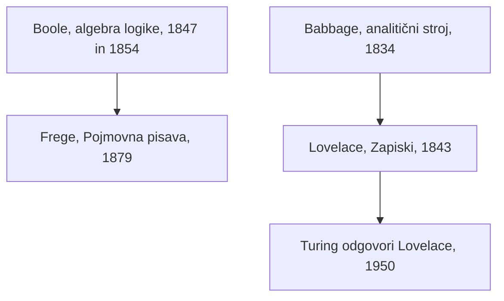

## Odgovor {#answer}

Filozofija 19. stoletja je mišljenje zgodovinsko umestila, s Heglovim pojmom duha in Marxovim pojmom proizvodnje.[^1][^6]
Schopenhauer, Kierkegaard in Nietzsche so vsak po svoje zamajali zaupanje v racionalne sisteme.[^3][^8][^9]
Mill in pragmatisti so ideje presojali po posledicah in praktičnih učinkih.[^5][^11]
Darwin je človeka in njegov moralni čut umestil v naravno zgodovino.[^10]
Boole in Frege sta logiko spremenila v izrecen simbolni postopek.[^12][^17]
Babbage je zasnoval programljiv stroj, Lovelace pa se je vprašala, kaj tak stroj zmore in česa ne.[^13][^15]
To je 6. del serije o zgodovini filozofije. Nadaljuje članek [[razsvetljenska-filozofija]]. Angleška različica: [[nineteenth-century-philosophy]].

## Ključni poudarki {#key-insights}

1. Pri Heglu *aufheben* (odpraviti, »sublimirati«) pomeni »hkrati odpraviti (ali zanikati) in ohraniti«.[^2]
2. Schopenhauer, Kierkegaard in Nietzsche so poimenovali nekaj, kar abstraktni razum spregleda: slepo voljo, eksistirajoči jaz in perspektive za vrednotami.[^3][^8][^9]
3. Marx je odtujitev videl v kapitalističnih družbenih razmerjih, ne v strojih kot takih.[^7]
4. Boole in Frege sta logiki dala algebrske in formalne metode, ki so pozneje vplivale na računalništvo.[^12][^17]
5. Lovelace je zapisala, da analitični stroj »nima prav nobenih pretenzij, da bi kar koli ustvaril«. Turing je na ta ugovor odgovoril leta 1950.[^16][^18]

## Od logike do računalništva {#logic-computing}

Diagram prikazuje niti tega dela, ki vodijo k računalništvu.

*Slika 1. Dve niti 19. stoletja, ki vodita k računalništvu. Viri: SEP, Science Museum, Bodleian Libraries.*

Letnice so iz SEP ter virov muzeja in knjižnice.[^12][^13][^14][^17][^18]

## Hegel in Schopenhauer {#hegel}

Georg Wilhelm Friedrich Hegel (1770–1831) je bil »najbolj sistematičen med idealisti«.[^1]
Njegova *Fenomenologija duha* je izšla leta 1807.[^1]
V njegovi dialektiki pojem zaradi svoje enostranskosti postane nestabilen in preide v nasprotje.[^2]
*Aufheben* pomeni hkrati odpraviti in ohraniti, zato prejšnja stopnja ni preprosto zavržena.[^2]
SEP dodaja, da se mnogi Heglovi prehodi ne ujemajo dobro z znanim vzorcem teza–antiteza–sinteza.[^2]
*Geist* lahko pomeni »um« ali »duh«. SEP zaradi kulturnega pomena, kot v *Zeitgeist*, raje uporablja »duh«.[^1]

Arthur Schopenhauer (1788–1860) je *Svet kot voljo in predstavo* dokončal marca 1818. Izšel je decembra istega leta, z letnico 1819.[^3]
Stvar na sebi je opisal kot Voljo, »brezciljno, slepo stremljenje«.[^3]
Svoje telo poznamo na dva načina: od zunaj kot predmet in od znotraj kot hotenje.[^3]
Njegov pogled je »na koncu asketski«: želje naj zmanjšamo, da dosežemo mirnejše stanje duha.[^3]

## Mill {#mill}

John Stuart Mill (1806–1873) je napisal *Sistem logike* (1843), *O svobodi* (1859) in *Utilitarizem* (1861).[^4]
Utilitarizem vztraja, »da je sreča vsakogar enako pomembna«.[^5]
Mill je menil, da je »bolje biti nezadovoljen človek kot zadovoljen prašič«.[^5]
Njegovo načelo škode pravi, da je preprečevanje škode drugim edini dober razlog za uporabo moči nad človekom proti njegovi volji.[^5]
SEP dodaja, da je za Milla preprečevanje škode »nujen, ne pa zadosten« pogoj za upravičeno omejitev.[^5]
Millove induktivne metode, na primer metoda ujemanja, iščejo vzroke s sistematično primerjavo.[^4]

## Marx {#marx}

Karl Marx (1818–1883) je razvil zgodovinski materializem.[^6]
Po tem pogledu se družbene oblike vzpnejo, ko pospešujejo človeško proizvodno moč, in propadejo, ko jo zavirajo.[^6]
V *Rokopisih* iz leta 1844 je navedel štiri razsežnosti odtujenega dela.[^6]
Delavci so odtujeni od svojega izdelka, od svoje dejavnosti, od drugih ljudi in od svoje človeške narave.[^6]
Odtujeno delo je »lahko … dobro plačano, časovno omejeno in razmeroma varno«.[^6]
Za Marxa sistematično odtujitev povzročajo družbena razmerja, ne »znanost, tehnologija in industrializacija kot take«.[^7]
Pohvalil je delavce, ki so se naučili »razlikovati med stroji in tem, kako jih uporablja kapital«.[^7]

## Kierkegaard in Nietzsche {#kierkegaard-nietzsche}

Søren Kierkegaard (1813–1855) jaza ni videl toliko kot substanco, temveč bolj kot »dosežek, cilj, h kateremu stremimo«.[^8]
Z delom *Ali–ali* (1843) je začel pisati pod psevdonimi.[^8]
Njegova dela pogosto berejo skozi tri »eksistencialne sfere«: estetsko, etično in religiozno. SEP pravi, da je število natanko tri »poenostavitev«.[^8]
Njegov odnos do Hegla je »veliko bolj zapleten in niansiran, kot so včasih mislili«.[^8]

Friedrich Nietzsche (1844–1900) je leta 1887 objavil *H genealogiji morale*.[^9]
Delo postavi vzorec vrednotenja dobro/slabo nasproti vzorcu dobro/zlo.[^9]
Po njegovi razlagi je *resentiment* nemočnih spodbudil nov pojem zla.[^9]
Njegov perspektivizem pravi, da je naš pojem o neki stvari tem popolnejši, čim več oči nanjo usmerimo.[^9]

## Darwin in pragmatisti {#darwin-pragmatism}

Darvinizem je bil prvič oblikovan v delu *O nastanku vrst* (1859).[^10]
Darwin je verjel, da je človekov moralni čut mogoče razložiti z evolucijo.[^10]
V *Človekovem poreklu* se je, pravi SEP, »spogledoval« z razlago na ravni skupine.[^10]

Pragmatizem je nastal v Združenih državah okoli leta 1870.[^11]
Uveljavil se je z javnimi predavanji Williama Jamesa leta 1898.[^11]
Charles Sanders Peirce je svojo pragmatično maksimo zapisal leta 1878: pojem razjasnimo z zamisljivimi praktičnimi učinki njegovega predmeta.[^11]
James je v *Pragmatizmu* (1907) za resnično označil »vse, kar se izkaže za dobro kot prepričanje, in to iz določljivih razlogov«.[^11]

## Boole in Frege {#boole-frege}

George Boole (1815–1864) je »revolucioniral logiko«, ko je nanjo uporabil metode simbolne algebre.[^12]
Njegovi glavni deli sta *Matematična analiza logike* (1847) in *Zakoni mišljenja* (1854).[^12]
V njegovi algebri je *xy* presek dveh razredov, 1 pa univerzum.[^12]
Prazni razred, zapisan z 0, se v knjigi iz leta 1847 ne pojavi.[^12]
Sodobna algebra logike izvira od Jevonsa iz leta 1864. Boole je to različico zavrnil.[^12]

Gottlob Frege (1848–1925) je stavke analiziral s funkcijo in argumentom.[^17]
S tem je logiko osvobodil analize subjekt–predikat iz aristotelske logike. Dal je tudi splošno obravnavo izrazov »vsak« in »neki«.[^17]
Njegova logika je drugega reda: dovoljuje kvantifikacijo po funkcijah in po predmetih.[^17]
Leta 1902 je Russell Fregeju pisal o protislovju v temeljih njegovih *Osnovnih zakonov aritmetike*.[^17]

## Babbage in Lovelace {#babbage-lovelace}

Charles Babbage (1791–1871) je analitični stroj zasnoval leta 1834, da bi »izvedel vsak izračun, ki mu ga postavimo«.[^13]
Imel je shrambo za števila, ločen mlin za aritmetiko in luknjane kartice, kot na Jacquardovih statvah.[^13]
Za njegovega življenja ga niso nikoli izdelali.[^13]
Mehanizem je lahko ponovil sveženj kartic, »da bi izvedel zanko«.[^14]
Stroj bi lahko z že izračunanimi vrednostmi izbral tudi med dvema možnima naslednjima korakoma.[^14]

### Lovelacini zapiski {#lovelace}

Ada Lovelace (1815–1852) je prevedla Menabreov članek o stroju in mu dodala svoje opombe.[^13][^14]
Članek je izšel avgusta 1843 v Taylorjevih *Scientific Memoirs*.[^14]
Njena zadnja opomba, opomba G, prikaže izračun Bernoullijevih števil.[^14]
Njeno tabelo pogosto imenujejo »prvi računalniški program«. Avtorji iz knjižnice Bodleian jo imenujejo »sled izvajanja«.[^14]
V opombi A je zapisala, da bi stroj »lahko skladal dovršene in znanstvene glasbene skladbe«.[^15]

### Ugovor o izvirnosti {#originality}

V opombi G, kot je bila natisnjena leta 1843, je Lovelace zapisala, da stroj »nima prav nobenih pretenzij, da bi kar koli ustvaril«.[^16]
Naredi lahko »vse, kar mu znamo ukazati«.[^16]
Zamislila si je tudi, da bi stroj delal na izmišljenih zakonih in dal rezultate, »ki jih sicer morda ne bi pomislili iskati«.[^14]
Turing je leta 1950 odgovoril na »ugovor lady Lovelace«.[^18]

## Poznejši vpliv {#thread}

Vsaka točka spodaj povezuje misel iz tega članka s poznejšo temo. Te povezave niso iz virov (sklepanje).

- **Logika:** Boolova algebra in Fregejevi kvantifikatorji vodijo k poznejši matematični logiki.[^12][^17] To nit nadaljuje 7. del (sklepanje).
- **Stroji:** Lovelacin ugovor sprašuje, ali sledenje navodilom izključuje izvirnost.[^16][^18] Vprašanje se vrača v razpravah o umetni inteligenci (sklepanje).
- **Etika:** Millove posledice, Marxova proizvodna razmerja in Nietzschejeva genealogija dajejo različne poti za razpravo o tehnologiji (sklepanje).[^5][^7][^9]

## Ključne trditve {#key-claims}

- Pri Heglu *aufheben* pomeni hkrati odpraviti in ohraniti.[^2]
- Schopenhauer je Voljo opisal kot brezciljno, slepo stremljenje.[^3]
- Za Milla je preprečevanje škode nujen, ne pa zadosten pogoj za omejitev.[^5]
- Marx je odtujitev videl v kapitalističnih družbenih razmerjih, ne v tehnologiji kot taki.[^7]
- Darwin je verjel, da je človekov moralni čut mogoče razložiti z evolucijo.[^10]
- Boolova algebra se razlikuje od poznejše Jevonsove algebre.[^12]
- Analitičnega stroja za Babbageovega življenja niso izdelali.[^13]
- Lovelace je zapisala, da stroj »nima prav nobenih pretenzij, da bi kar koli ustvaril«.[^16]

## Kviz {#quiz}

Kviz za ta članek je v datoteki `quizzes/filozofija-19-stoletja.yaml`.
Spletno mesto ga prikaže na strani s kvizom za ta članek.

## Odprta vprašanja {#open-questions}

- SEP predstavi več branj Hegla: tradicionalno metafizično, postkantovsko in prenovljeno metafizično. Katero drži?[^1]
- Ali je Millovo razvrščanje višjih užitkov združljivo s hedonizmom?[^5]
- Kaj loči nepričakovan rezultat stroja od izvirnega prispevka? To je vprašanje med Lovelace in Turingom.[^15][^18]

## Viri {#sources}

Viri so navedeni v polju `sources` v glavi datoteke. V besedilu so citirani kot opombe.
