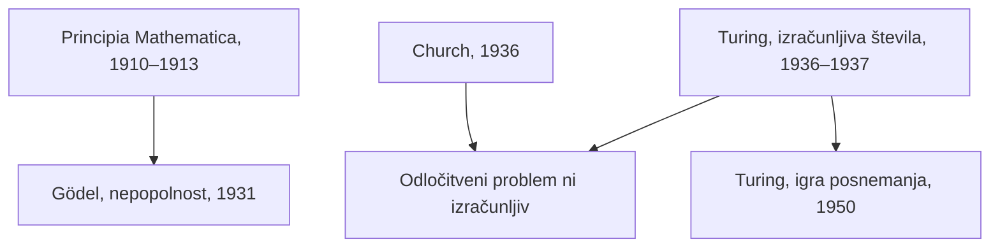

## Odgovor {#answer}

Logiki 20. stoletja so zgradili formalna orodja, na katerih temelji sodobno računalništvo.[^1]
Gödel in Turing sta nato dokazala meje formalnega dokazovanja in mehaničnih postopkov.[^5][^6]
Fenomenologija in eksistencializem sta raziskovala izkustvo, praktično vpetost v svet in umeščeno svobodo.[^10][^11][^12][^13]
Popper, Kuhn in Quine so na novo premislili, kako znanstveno vednost preizkušamo in kako se spreminja.[^14][^15][^16]
Rawls se je vprašal, kaj naredi ustanove pravične.[^17]
Wiener in Jonas sta trdila, da močna tehnologija prinaša nove odgovornosti.[^21][^22]
To je 7. del serije o zgodovini filozofije. Nadaljuje članek [[filozofija-19-stoletja]]. Angleška različica: [[twentieth-century-philosophy]].

## Ključni poudarki {#key-insights}

1. *Principia Mathematica* je zagovarjala logicizem, a trije njeni aksiomi so bili »po naravi verjetno nelogični«.[^1]
2. Gödel je omejil, kaj lahko dokažejo formalni sistemi, Turing pa, kaj lahko odloči računanje.[^5][^6]
3. SEP poroča o »širokem soglasju«, da sklepi od Gödla do trditve, da umi niso stroji, ne držijo.[^5]
4. Pozni Wittgenstein je pomen povezal z rabo. Husserl in Heidegger sta opisala izkustvo in praktično vpetost pred teorijo.[^2][^10][^11]
5. Wiener je leta 1960 opozoril, da je človeška kritika hitrih strojev lahko »neučinkovita še dolgo potem, ko bi bila pomembna«.[^21]

## Logika in njene meje {#logic-limits}

Diagram prikazuje, kako so povezani formalni rezultati tega dela.

*Slika 1. Formalne meje in igra posnemanja. Viri: SEP.*

Gödlov prvotni izrek je bil dokazan za različico sistema iz *Principia*.[^5]
Church je do istega rezultata kot Turing prišel neodvisno, z drugačnim formalnim orodjem.[^7]

## Russell, Wittgenstein in Dunajski krožek {#analytic}

Alfred North Whitehead in Bertrand Russell sta *Principia Mathematica* objavila v letih 1910–1913.[^1]
Delo je zagovarjalo logicizem, tezo, da je matematiko v nekem pomembnem smislu mogoče prevesti na logiko.[^1]
Da bi se izognilo Russellovemu paradoksu, je uporabilo t. i. »razvejano teorijo tipov«.[^1]
Aksiomi neskončnosti, reducibilnosti in izbire verjetno niso bili logični.[^1]

Wittgensteinov *Traktat* je izšel v nemščini leta 1921 in v angleščini leta 1922.[^2]
Stavek obravnava kot sliko: »slika je model resničnosti«.[^2]
*Filozofske raziskave* so izšle po njegovi smrti, leta 1953.[^2]
V njih je zapisal, da je »za velik razred primerov« pomen besede njena raba v jeziku.[^2]
Novejše raziskave postavljajo pod vprašaj staro ostro ločnico med zgodnjim in poznim delom.[^2]

Dunajski krožek se je pod vodstvom Moritza Schlicka sestajal od leta 1924 do 1936.[^3]
Trdil je, da so izjave zunaj logike in matematike smiselne le, če jih lahko preizkusimo z izkustvom.[^3]
Kako ta kriterij oblikovati, je bilo »problematično in zelo sporno«. Do leta 1931 se je začela »liberalizacija empirizma«.[^3]
Schlick je bil leta 1936 umorjen, številni člani pa so emigrirali.[^3]

## Gödel in Turing {#goedel-turing}

Kurt Gödel je izrek o polnosti logike prvega reda dokazal v disertaciji leta 1929, objavljeni leta 1930.[^4]
Izreka o nepopolnosti sta sledila leta 1931.[^4][^5]
Prvi izrek pravi, da ima vsak konsistenten formalni sistem z dovolj aritmetike stavke, ki jih ne more ne dokazati ne ovreči.[^5]
Drugi pravi, da tak sistem ne more dokazati lastne konsistentnosti.[^5]
Gentzen je dokazal konsistentnost Peanove aritmetike, a le s predpostavko načela, ki ga aritmetika sama ne more dokazati.[^5]
Lucas (1961) je iz Gödla sklepal, da umi niso stroji. SEP poroča o »širokem soglasju«, da taki argumenti ne držijo.[^5]

Alan Turing je za Gödlove rezultate izvedel na predavanjih Maxa Newmana leta 1935.[^6]
Njegov članek »O izračunljivih številih« (1936–37) je dal »opredelitev računanja in absolutno mejo tega, kar računanje lahko doseže«.[^6]
Univerzalni Turingov stroj lahko posnema vsak drug Turingov stroj, če dobi njegov opis kot vhod.[^7]
Turing je s svojimi stroji pokazal, da odločitveni problem logike prvega reda ni izračunljiv.[^7]
Church–Turingova teza zadeva neformalni pojem »učinkovite metode«. Pravi, da lahko tako metodo izvede Turingov stroj.[^8]

### Igra posnemanja {#turing}

Leta 1950 je Turing vprašanje »Ali stroji lahko mislijo?« označil za »preveč brez pomena«, da bi o njem razpravljali.[^9]
Nadomestil ga je z vprašanjem, ali se digitalni računalnik lahko dobro odreže v igri posnemanja.[^9]
Njegov argument naj bi obšel vprašanja o mišljenju in zavesti ter se oprl na zunanje opazovanje.[^6]
Predlagal je tudi »učeče se stroje« in mreže logičnih sestavnih delov (»neorganizirane stroje«), ki bi jih lahko urili.[^6]
Odgovoril je na devet ugovorov, med njimi na »ugovor lady Lovelace« (glej [[filozofija-19-stoletja#originality]]).[^9]

## Fenomenologija in eksistencializem {#phenomenology}

Edmund Husserl je *Logične raziskave* (1900–1901) imel za svoj »preboj« k fenomenologiji.[^10]
Znan je po analizah intencionalnosti, zaznave, časa, utelešenosti in življenjskega sveta.[^10]
*Epoché* želi »zadržati ali nevtralizirati določeno dogmatično držo do resničnosti«, ne dvomiti o resničnosti.[^10]

Glavno delo Martina Heideggra je *Bit in čas* (1927).[^11]
Ljudi je razumel kot bivajoče-v-svetu, ki jih oblikujejo praktični in družbeni konteksti.[^11]
V tehnološki dobi se bivajoče po njegovem kaže kot *Bestand*, »zaloga« zamenljivih stvari.[^11]
Ta način razkrivanja je imenoval »najvišja nevarnost« za človeštvo.[^11]
Heidegger se je 1. maja 1933 včlanil v nacistično stranko in ostal član do konca režima.[^11]
Kaj to in njegov antisemitizem pomenita za njegovo filozofijo, je »močno sporno«.[^11]

Jean-Paul Sartre je leta 1943 objavil *Bit in nič*.[^12]
Za Sartra nismo svobodni storiti česar koli: bivanje-za-sebe je »vedno v faktični situaciji«.[^12]
Pri slabi veri natakar igra natakarja, kot da bi bila ta vloga njegova nespremenljiva bit.[^12]
Simone de Beauvoir v *Etiki dvoumnosti* (1947) trdi, da svoje svobode ne morem živeti, ne da bi potrjevala svobodo drugih.[^13]
*Drugi spol* (1949) je njeno najbolj znano delo.[^13]

## Popper, Kuhn in Quine {#science}

Za Karla Popperja je teorija znanstvena, če jo je mogoče ovreči. Ločil je logiko ovrgljivosti od njene uporabne metodologije.[^14]
Kuhnova *Struktura znanstvenih revolucij* (1962) je ena najbolj citiranih akademskih knjig vseh časov.[^15]
Kuhn je opisal normalno znanost znotraj paradigme, ki jo prekinjajo revolucije.[^15]
Poudaril je, »da nesoizmerljivost ne pomeni neprimerljivosti«.[^15]
Geslo o Kuhnu pravi, da Popper za zavrnitev teorije zahteva le »en sam ponovljiv, anomalen pojav«. Geslo o Popperju poudarja njegove metodološke zadržke.[^14][^15]

W. V. O. Quine je trdil, da večina stavkov nima posledic za izkustvo, če jih »jemljemo enega po enega«.[^16]
Zanj »nobena izjava ni imuna za revizijo«.[^16]
Zavrnil je vsako »prvo filozofijo« zunaj znanosti.[^16]

## Rawls {#rawls}

John Rawls je pravičnost kot poštenost predstavil v *Teoriji pravičnosti* (1971) in jo še naprej predeloval.[^17]
V izvirnem položaju tančica nevednosti skrije dejstva, kot so rasa, razred in spol, pred tistimi, ki izbirajo načela.[^17]
Prvo načelo zagotavlja enake temeljne svoboščine.[^17]
Drugo zahteva pošteno enakost možnosti. Po načelu razlike morajo neenakosti tudi »najbolj koristiti najmanj privilegiranim«.[^17]

## Wiener in Jonas {#wiener}

Norbert Wiener je s sodelavci leta 1943 ciljno usmerjeno vedenje organizmov in strojev razložil z negativno povratno zanko.[^18]
Nekdanje geslo SEP o računalniški etiki Wienerja imenuje utemeljitelja tega področja.[^20]
Prizadeval si je, »da bi preprečil množično brezposelnost zaradi robotiziranih tovarn«.[^20]
Videl je, da lahko stroji na podlagi informacij delujejo »brez neposrednega vnosa človeškega akterja«.[^19]

V reviji *Science* (1960) je Wiener zapisal, da lahko stroji med učenjem razvijejo nepredvidene strategije s hitrostjo, ki zbega njihove programerje.[^21]
Poročal je, da so stroji za dame po 10 do 20 urah igranja premagali ljudi, ki so jih programirali.[^21]
Stroji so »teoretično podvrženi človeški kritiki«, a kritika lahko pride prepozno.[^21]
Če ne moremo poseči vmes, »moramo biti povsem prepričani, da je namen, ki smo ga vložili v stroj, res namen, ki si ga želimo«.[^21]

### Jonas {#jonas}

Hans Jonas je *Das Prinzip Verantwortung* objavil leta 1979, angleško različico pa leta 1984.[^22]
Trdil je, da tehnologija potrebuje etiko z odgovornostjo v središču, in sicer iz dveh razlogov.[^22]
Prvič, tehnologija človeštvu omogoča, da uniči Zemljo in sebe. Drugič, poganjajo jo družbene in politične sile.[^22]
Založnik opisuje etiko »človekovih dolžnosti do sebe, svojih potomcev in okolja«.[^24]
SEP navaja njegovo »hevristiko strahu« v razpravah o negotovi prihodnosti.[^25]
Jonasa še vedno navajajo za stališče, da tehnologija otežuje pripisovanje moralne odgovornosti.[^23]

## Poznejši vpliv {#thread}

Vsaka točka spodaj povezuje misel iz tega članka s poznejšo temo. Te povezave niso iz virov (sklepanje).

- **Um:** Turingov test, Wittgenstein o rabi in fenomenologi o izkustvu dajejo tekmujoča izhodišča za vprašanje, kaj zahteva inteligenca (sklepanje).[^2][^9][^10]
- **Etika:** Rawls o pravičnih ustanovah, Wiener o namenih in Jonas o odgovornosti za prihodnost pripravljajo etiko umetne inteligence (sklepanje).[^17][^21][^22]

## Ključne trditve {#key-claims}

- *Principia Mathematica* (1910–1913) je zagovarjala logicizem, a uporabila verjetno nelogične aksiome.[^1]
- Pozni Wittgenstein je pomen razložil kot rabo »za velik razred primerov«, ne za vse.[^2]
- Gödlov prvi izrek velja za konsistentne formalne sisteme z dovolj aritmetike.[^5]
- Turing (1936–37) je pokazal, da odločitveni problem ni izračunljiv, Church pa je to pokazal neodvisno.[^6][^7]
- Heidegger je tehnološko razkrivanje imenoval »najvišja nevarnost«.[^11]
- Kuhn je trdil, da nesoizmerljivost ni neprimerljivost.[^15]
- Wiener (1960) je opozoril, da lahko človeška kritika hitrih strojev pride prepozno.[^21]

## Kviz {#quiz}

Kviz za ta članek je v datoteki `quizzes/filozofija-20-stoletja.yaml`.
Spletno mesto ga prikaže na strani s kvizom za ta članek.

## Odprta vprašanja {#open-questions}

- Ali Gödlovi izreki kaj povedo o umu? SEP poroča o širokem soglasju proti antimehanističnim argumentom.[^5]
- Kako strog je bil Popperjev falsifikacionizem? Gesli SEP o Kuhnu in Popperju poudarjata različni plati.[^14][^15]
- Kako razdeliti odgovornost, ko tehnologija dejanje razprši med ljudi in stroje?[^23]

## Viri {#sources}

Viri so navedeni v polju `sources` v glavi datoteke. V besedilu so citirani kot opombe.
