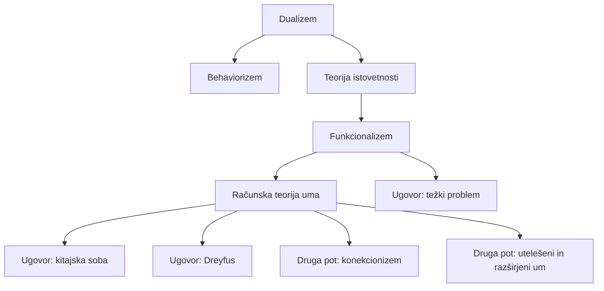

# Filozofija uma in tehnologija

## Odgovor {#answer}

Filozofija uma 20. stoletja se je od vprašanja, iz česa so umi, premaknila k vprašanju, kaj umi počnejo. Funkcionalizem opredeljuje duševna stanja z njihovimi vlogami, zato bi jih načeloma lahko imel tudi nebiološki sistem.[^4][^5] Glavni ugovori zadevajo razumevanje (Searle), utelešeno veščino (Dreyfus) in subjektivno izkušnjo (Nagel, Chalmers).[^7][^9][^11][^13] Razprave o velikih jezikovnih modelih (LLM) te ugovore ponovno uporabljajo. Tu navedeni članki iz let 2020–2024 sodijo, da sedanji sistemi verjetno niso zavestni, prihodnje pa puščajo odprte.[^17][^18][^19]

To je 8. del serije o zgodovini filozofije. Nadaljuje članek [[filozofija-20-stoletja]]. Angleška različica: [[philosophy-of-mind-and-technology]].

## Ključni poudarki {#key-insights}

- Večkratna uresničljivost je bila najvplivnejši argument proti teorijam istovetnosti uma in možganov in je pomagala utemeljiti funkcionalizem.[^5]
- Searlov ožji sklep je, da izvajanje programa samo po sebi ne more ustvariti razumevanja.[^7][^8]
- Dreyfus, Nagel in Chalmers imenujejo nekaj, kar računanju morda uide: utelešeno znanje, zorni kot in izkušnjo samo.[^9][^11][^13]
- Konekcionizem ter utelešena in razširjena kognicija izpodbijajo sliko uma kot računalnika, ki obdeluje simbole.[^14][^15][^16]
- Bender in Koller trdita, da iz same oblike ne more nastati pomen. Chalmers ter Butlin in sodelavci imajo strojno zavest za odprto vprašanje.[^17][^18][^19]

## Zemljevid stališč {#map}

Diagram prikazuje glavna stališča in ugovore, obravnavane spodaj. Puščice so naš povzetek (sklepanje).[^6][^7]

## Dualizem, behaviorizem in teorija istovetnosti {#mind-body}

- **Dualizem:** Descartes je trdil, da sta um in telo različni substanci. SEP to imenuje »standardno izhodišče za razprave o problemu duha in telesa«.[^1] Glej tudi [[renesansna-in-zgodnjenovoveska-filozofija#bacon-descartes]].
- **Problem interakcije:** Elizabeta Češka je spraševala, kako lahko um in telo vplivata drug na drugega. Z mehanistično znanostjo je to postalo »glavni ugovor dualizmu«.[^1]
- **Behaviorizem** ima tri oblike.[^2] Metodološki behaviorizem (Watson) proučuje vedenje, ne duševnih stanj. Psihološki behaviorizem (Pavlov, Skinner) vedenje pojasnjuje z dražljaji in ojačitvijo. Analitični behaviorizem (Ryle) ima duševno stanje za vedenjsko dispozicijo.
- Behaviorizem je prevladoval, dokler ni dozorela kognitivna znanost, približno med letoma 1960 in 1985.[^2]
- **Teorija istovetnosti:** začela sta jo U. T. Place (1956) in H. Feigl (1958), leta 1959 se jima je pridružil J. J. C. Smart.[^3] Po tem pogledu so izkušnje možganski procesi in z njimi niso le povezane.[^3]

## Funkcionalizem in večkratna uresničljivost {#functionalism}

- **Funkcionalizem:** duševno stanje »ni odvisno od notranje sestave, temveč le od svoje funkcije oziroma vloge«.[^4]
- SEP ga povezuje z Aristotelovim pojmovanjem duše in Hobbesovim »računskim strojem«. Zgodnji različici sta bili teoriji »strojnih stanj« Hilaryja Putnama.[^4]
- **Večkratna uresničljivost:** eno duševno vrsto lahko uresničijo številne različne fizične vrste.[^5]
- Putnam (1967) jo je uporabil proti »teoretikom možganskih stanj«. Bolečino lahko očitno čutijo ljudje, druge živali in celo hobotnice, zato ena skupna nevronska vrsta ni verjetna.[^5]
- **Rezilo na obe strani:** Putnam (1988) je večkratno uresničljivost pozneje uporabil proti samemu funkcionalizmu.[^5]

## Računska teorija uma {#computation}

- Računska teorija uma (CTM) trdi, da je um računski sistem. SEP piše, da je v kognitivni znanosti »dolgo uživala status ortodoksije«.[^6]
- McCulloch in Pitts (1943) sta prva predlagala, da bi bilo nekaj podobnega Turingovemu stroju lahko model uma.[^6] O Turingu glej [[filozofija-20-stoletja#turing]].
- **Jezik misli:** Jerry Fodor je trdil, da duševna dejavnost vključuje »računanje Turingovega tipa nad jezikom misli«.[^6]
- SEP opisuje tradicionalno kognitivno znanost kot »zapriseženo računalništvu«, z možgani kot sedežem kognicije.[^15]

## Izzivi za strojne ume {#challenges}

### Searlova kitajska soba {#chinese-room}

- John Searle (1932–2025) je argument objavil leta 1980.[^7] Predstavlja si, da po programu odgovarja v kitajščini. Kitajsko ne razume, ljudje zunaj pa mislijo, da je v sobi govorec kitajščine.[^7]
- **Ožji sklep:** program lahko poskrbi, da je videti, kot da računalnik razume jezik, pravega razumevanja pa ne more ustvariti.[^7]
- **Širši sklep:** umi »morajo izhajati iz bioloških procesov; računalniki lahko te procese kvečjemu simulirajo«.[^7] IEP ključni trditvi povzame kot »možgani povzročajo ume« in »sintaksa ne zadošča za semantiko«.[^8]
- **Glavna odgovora:** sistemski odgovor, ki ga je Searle imenoval »morda najpogostejši odgovor«, pravi, da razume sistem kot celota. Robotski odgovor pravi, da razumevanje zahteva čutila in delovanje.[^7]

### Dreyfus {#dreyfus}

- Hubert Dreyfus je leta 1972 objavil knjigo *What Computers Can't Do*. MIT Press jo je leta 1992 ponovno izdal kot *What Computers Still Can't Do*, z novim uvodom.[^10]
- SEP: za Dreyfusa človeško strokovno znanje ne temelji na »eksplicitnem, neutelešenem, mehaničnem upravljanju simbolnih informacij«.[^9]
- Založnik piše, da je neuspeh napovedal, ker je bilo pojmovanje duševnega delovanja v UI »naivno«.[^10]

### Nagel in takšnosti {#nagel}

- Thomas Nagel (1974) je trdil, da so netopirji zavestni, ker je »nekaj, kar je biti netopir«.[^11]
- **Takšnosti** (lat. *qualia*) so »introspektivno dostopni, fenomenalni vidiki našega duševnega življenja«. Najbolj znan miselni poskus o njih je Jacksonova Marija, znanstvenica za barve, ki je odraščala v črno-beli sobi.[^12]

### Chalmers: težki problem {#hard-problem}

- IEP: David Chalmers je »skoval ime ›težki problem‹ (1995, 1996)«, problem sam pa »ni povsem nov«.[^13]
- Lahki problemi zadevajo funkcije zavesti. Težki problem sprašuje, zakaj sploh obstaja izkušnja.[^13]
- SEP: naloga je podati »razumljivo razlago«, kako bi fenomenalna zavest »lahko nastala iz fizičnih ali nevronskih procesov«.[^11]

## Konekcionizem, utelešeni in razširjeni um {#connectionism-embodiment}

- **Konekcionizem:** nevronske mreže ponujajo »alternativo klasični teoriji uma«.[^14] SEP »zlato dobo« konekcionizma umešča v leta 1980–1995, globoko učenje pa imenuje njegov »novi val«.[^14]
- **Utelešena kognicija** trdi, da telo ali njegova interakcija z okoljem sestavlja kognicijo ali k njej prispeva.[^15]
- **Razširjeni um:** Clark in Chalmers (1998) sprašujeta, kje se um konča in kje se začne preostali svet.[^16] Otto, ki ima Alzheimerjevo bolezen, uporablja beležnico tako, kot Inga uporablja spomin.[^16]
- **Ugovor:** Adams in Aizawa to imenujeta »zmota sklopitve in sestave«.[^15]

## Veliki jezikovni modeli: razumevanje in zavest {#llms}

To področje se hitro spreminja. Vsaka trditev spodaj je datirana in označena po vrsti objave, preverjeno 18. 10. 2026.

- **Razumevanje (recenzirano, ACL 2020):** Bender in Koller trdita, da sistem, »učen le na obliki, a priori nima nobene možnosti, da bi se naučil pomena«.[^17] Njun »test hobotnice« to ponazori.[^17]
- **Chalmers (preprint, 2023; vabljeno predavanje na NeurIPS, 28. 11. 2022; objavljeno tudi v *Boston Review*):**
  - V sedanjih modelih vidi »pomembne ovire« za zavest, na primer odsotnost rekurentne obdelave ali globalnega delovnega prostora.[^18]
  - Zavest sedanjih LLM se mu zdi »precej malo verjetna«, z verjetnostjo »nekje pod 10 odstotki«.[^18]
- **Butlin, Long in 17 soavtorjev (preprint, avgust 2023):**
  - Računski funkcionalizem sprejmejo »kot delovno hipotezo«.[^19]
  - Sklenejo, da »noben sedanji sistem UI ni zavesten«, in ne vidijo »očitnih tehničnih ovir« za sisteme, ki bi izpolnjevali njihove kazalnike.[^19]
- Ugotovitev Benderjeve in Kollerja posodablja Searlovo trditev o sintaksi in semantiki (sklepanje).[^7][^17]

## Poznejši vpliv {#thread}

Vsaka točka spodaj povezuje misel iz tega članka s poznejšo temo. Te povezave niso iz virov (sklepanje).

- **Moralni status:** ali bi sistemi UI lahko šteli moralno, je morda odvisno od kitajske sobe, netopirja in težkega problema.[^7][^13]
- **Tveganje pripisovanja:** Butlin in sodelavci obravnavajo tveganje, da sistemom UI zavest pripišemo premalo ali preveč.[^19]
- **Odgovornost:** če je kognicija razširjena, si odgovornost za odločitve s pomočjo UI morda delijo sistemi ljudi in orodij.[^16]

## Ključne trditve {#key-claims}

- SEP ima Descartesov dualizem za standardno izhodišče problema duha in telesa.[^1]
- Funkcionalizem opredeljuje duševna stanja z njihovo funkcionalno vlogo.[^4]
- Putnam (1967) je večkratno uresničljivost uporabil proti teorijam možganskih stanj.[^5]
- Searle trdi, da program ne more ustvariti pravega razumevanja.[^7]
- Chalmers je skoval ime »težki problem«.[^13]
- Butlin in sodelavci (preprint, 2023) sklenejo, da noben sedanji sistem UI ni zavesten.[^19]

## Kviz {#quiz}

Kviz za ta članek je v datoteki `quizzes/filozofija-uma-in-tehnologija.yaml`.
Spletno mesto ga prikaže na strani s kvizom za ta članek.

## Odprta vprašanja {#open-questions}

- SEP Consciousness je bil nazadnje vsebinsko prenovljen leta 2014. Morda bo potreben novejši pregled.
- Do 18. 10. 2026 nobeden od člankov na arXivu nima potrjene recenzirane različice. Pred objavo preveriti znova.
- Ali večkratna uresničljivost podpira funkcionalizem ali ga spodkopava? SEP kaže obe rabi.[^5]

## Viri {#sources}

Viri so navedeni v polju `sources` v glavi datoteke. V besedilu so citirani kot opombe.
