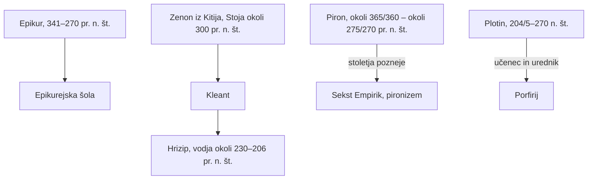

## Odgovor {#answer}

Po Aristotelu se je filozofija organizirala v šole, in vsaka šola je ponujala celoten način življenja.
Epikurejci so srečo razumeli kot odsotnost telesne bolečine in duševne vznemirjenosti.[^1]
Stoiki so fiziko, logiko in etiko povezali v en sistem.[^3]
Skeptiki so zadržali sodbo, novoplatonizem pa je vse razlagal iz enega prvega počela, Enega.[^9][^11]
To je 2. del serije o zgodovini filozofije. Nadaljuje članek [[starogrska-filozofija]]. Angleška različica: [[hellenistic-roman-philosophy]].

## Ključni poudarki {#key-insights}

1. Epikur je strah pred smrtjo in pred kaznijo po smrti imel za glavni vzrok človeške tesnobe.[^1]
2. Stoiki so od Zenona naprej filozofijo delili na tri dele: fiziko, logiko in etiko.[^3]
3. Hrizip je razvil izjavno logiko z deduktivnim sistemom. Mnogi so ga v antiki imeli za največjega logika.[^4]
4. Pironski skepticizem ne dvomi le o možnosti znanja, ampak o racionalnosti prepričanj. Njegov cilj je duševni mir.[^9]
5. Novoplatonsko poučevanje se ni končalo leta 529. V Aleksandriji in Konstantinoplu se je nadaljevalo do konca 6. stoletja.[^11]

## Šole in učitelji {#schools}

Diagram kaže glavne šole tega obdobja in nekatere njihove voditelje.
Zenon je stoiško šolo ustanovil okoli leta 300 pr. n. št. Za njim sta jo vodila Kleant in nato Hrizip.[^3]
Piron je bil izhodišče pironizma, ki je zacvetel več stoletij po njem.[^8]
Porfirij, Plotinov učenec, je uredil spise svojega učitelja.[^11][^12]

*Slika 1. Ustanovitelji in voditelji glavnih šol. Vsako šolo je vodilo zaporedje naslednikov ali pa je bila pozneje obujena. Vir: SEP.*

## Epikurejstvo {#epicureanism}

Epikur (341–270 pr. n. št.) je zgradil celovit sistem s tremi deli:[^1]

- etika: cilj življenja je sreča, ki izhaja iz odsotnosti telesne bolečine in duševne vznemirjenosti
- teorija spoznanja: zaznave so nezmotljiva merila
- fizika: atomistični materializem

Epikur je učil, da duša ne preživi smrti telesa.[^1]
Zato po smrti ne more biti kazni.[^1]
Smrt nam ni nič: dokler smo, smrti ni, ko pa pride smrt, nas ni več.[^1]
Njegova šola je svetovala, naj se človek, kadar je mogoče, izogiba politiki, prijateljstvo pa je imela za bistveno.[^1]
Učila je tudi, da se bogovi ne menijo za ljudi.[^1]

Lukrecij je živel od sredine devetdesetih do sredine petdesetih let 1. stoletja pr. n. št.[^2]
Napisal je *O naravi stvari* (*De rerum natura*), latinsko pesnitev v šestih knjigah o epikurejski fiziki.[^2]
Večinoma po naključju je to naš najpopolnejši vir za epikurejsko atomistično fiziko.[^2]

## Stoicizem {#stoicism}

Hrizip je stoiško šolo vodil od okoli 230 do 206 pr. n. št. in je bil njen glavni sistematik.[^3]
Od zgodnjih stoikov so se ohranili le fragmenti.[^3]
Edina celotna ohranjena stoiška dela so iz rimskega cesarskega obdobja, predvsem od Seneke, Epikteta in Marka Avrelija.[^3]

- **Logika:** stoiška »logika« je obsegala argumentacijo, retoriko, slovnico, teorijo spoznanja in preučevanje jezika.[^3]
- **Izjave:** stoiški argumenti so zgrajeni iz izjav, ne iz terminov. To je izjavna logika, za razliko od Aristotelove logike terminov.[^3]
- **Nedokazljivi sklepi:** veljavni silogizmi imajo obliko enega od petih osnovnih sklepov ali pa se nanje prevedejo. Dva od njih sta *modus ponens* in *modus tollens*.[^3]
- **Strasti:** za stoike so vse strasti nagoni vodilnega dela duše. V stoiški shemi so »razumski nagoni«.[^3]
- **Epiktet:** nekoč je bil suženj. Njegov nauk se osredinja na »voljo« (*prohairesis*) in na pravilno rabo predstav.[^5]
- **Mark Avrelij:** vsaj del *Premišljevanj* je napisal v zadnjih letih svojih vojaških pohodov. Strokovnjaki se danes večinoma strinjajo, da jih je pisal za lastno moralno izboljšanje.[^6]

## Skepticizem {#skepticism}

Akademsko in pironsko skeptično gibanje sta se začela približno v 3. stoletju pr. n. št.[^7]
Končata se s Sekstom Empirikom.[^7]
Piron je živel od okoli 365/360 do okoli 275/270 pr. n. št.[^8]

Akademsko izročilo je imelo središče v Platonovi Akademiji.[^8]
Karnead (214–129/8 pr. n. št.) je ena njegovih glavnih osebnosti.[^7]
Na poslanstvu v Rimu je po izročilu en dan govoril za pravičnost, naslednji dan pa proti njej.[^7]

Sekst Empirik je živel verjetno v 2. ali 3. stoletju n. št.[^9]
Njegovi *Očrti pironizma* so najboljši in najpopolnejši opis pironskega skepticizma, kar jih imamo.[^9]
Pironist za vsak argument najde enakovreden nasprotni argument.[^9]
To vodi do zadržanja sodbe in na koncu do duševnega miru.[^9]

## Ciceron {#cicero}

Ciceron (106–43 pr. n. št.) je bil državnik in govornik pozne rimske republike.[^10]
Ohranilo se je približno ducat njegovih filozofskih del.[^10]
Njegova *Academica* predstavi teorijo spoznanja skeptične Akademije in hkrati brani njegovo lastno metodo.[^10]
Delo ni enostransko, saj navede tudi kritiko skeptične Akademije.[^10]
Njegova dela *O državi*, *O zakonih* in *O govorniku* so v latinsko književnost uvedla obliko dialoga.[^10]

## Novoplatonizem {#neoplatonism}

Novoplatonizem je trajal približno od sredine 3. do sredine 7. stoletja n. št.[^11]
Je strog »monizem počela«: vse razlaga iz enega samega božanskega vzroka.[^11]
Novoplatoniki so ta vzrok imenovali »Prvo«, »Eno« ali »Dobro«.[^11]

Plotina (204/5–270) navadno imajo za utemeljitelja novoplatonizma.[^11]
Po njegovi smrti je Porfirij njegove spise uredil v *Eneade*: šest knjig po devet razprav.[^11][^12]
Plotinov sistem ima tri nadčutne ravni ali »hipostaze«: Dušo, Um in Eno.[^12]

Atenski novoplatoniki so se razšli po zakonodaji cesarja Justinijana iz leta 529, ki je zaprla platonistično akademijo.[^11]
Poučevanje se je v Aleksandriji in Konstantinoplu nadaljevalo do konca 6. stoletja.[^11]

## Poznejši vpliv {#thread}

Vsaka točka spodaj povezuje misel iz tega članka s poznejšo temo. Te povezave niso iz virov (sklepanje).

- **Logika:** SEP vidi presenetljive podobnosti med Hrizipovo filozofsko logiko in logiko Gottloba Fregeja.[^4] Izjavna logika je pozneje postala temelj računalništva (sklepanje).
- **Znanje:** skeptik vsakemu argumentu postavi nasproti enakovreden argument.[^9] To je tudi način, kako preizkusiti trditve, tudi trditve sistemov umetne inteligence (sklepanje).
- **Čustva:** stoiki strasti obravnavajo kot nagone razumske duše.[^3] S tem postanejo čustva stvar sodbe (sklepanje).

## Ključne trditve {#key-claims}

- Epikur (341–270 pr. n. št.) je srečo razumel kot odsotnost telesne bolečine in duševne vznemirjenosti.[^1]
- Lukrecijeva pesnitev *O naravi stvari* je naš najpopolnejši vir za epikurejsko fiziko.[^2]
- Stoiki so filozofijo delili na fiziko, logiko in etiko.[^3]
- Stoiška logika je izjavna logika.[^3]
- Hrizip je razvil izjavno logiko, ki jo okrona deduktivni sistem.[^4]
- Strokovnjaki se večinoma strinjajo, da je Mark Avrelij *Premišljevanja* pisal za lastno moralno izboljšanje.[^6]
- Antični skepticizem sega od približno 3. stoletja pr. n. št. do Seksta Empirika.[^7]
- Pironizem je zacvetel stoletja po Pironu.[^8]
- Pironizem dvomi o racionalnosti prepričanj in teži k duševnemu miru.[^9]
- Ciceronova *Academica* predstavi teorijo spoznanja skeptične Akademije.[^10]
- Novoplatonizem sega približno od sredine 3. do sredine 7. stoletja n. št.[^11]
- Plotinove tri hipostaze so Duša, Um in Eno.[^12]

## Kviz {#quiz}

Kviz za ta članek je v datoteki `quizzes/helenisticna-in-rimska-filozofija.yaml`.
Spletno mesto ga prikaže na strani s kvizom za ta članek.

## Odprta vprašanja {#open-questions}

- Viri Seksta Empirika ne datirajo enako: verjetno 2. ali 3. stoletje n. št. ali pa 2. stoletje n. št.[^9][^7]
- Ni gotovo, da je zgodba o Karneadovih dveh govorih o pravičnosti zgodovinsko točna.[^7]

## Viri {#sources}

Viri so navedeni v polju `sources` v glavi datoteke. V besedilu so citirani kot opombe.
