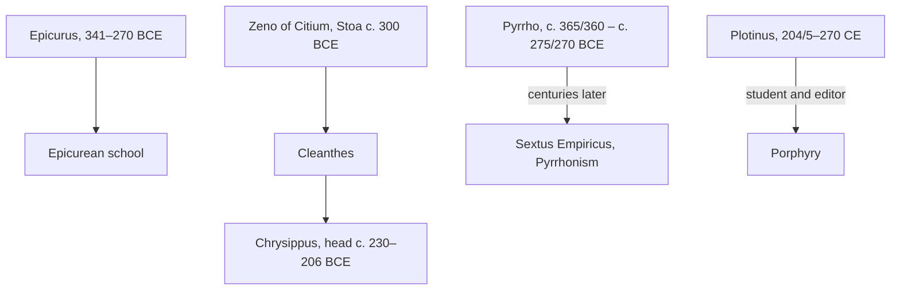

## Answer {#answer}

After Aristotle, philosophy was organised in schools, and each school offered a whole way of life.
The Epicureans saw happiness as the absence of physical pain and mental disturbance.[^1]
The Stoics joined physics, logic and ethics into one system.[^3]
The Skeptics suspended judgement, and Neoplatonism explained everything from one first principle, the One.[^9][^11]
This is part 2 of the series on the history of philosophy. It follows [[ancient-greek-philosophy]]. Slovenian version: [[helenisticna-in-rimska-filozofija]].

## Key insights {#key-insights}

1. Epicurus saw the fear of death and of punishment after death as the main cause of human anxiety.[^1]
2. From Zeno onwards, the Stoics divided philosophy into three parts: physics, logic and ethics.[^3]
3. Chrysippus built a propositional logic with a deductive system. Many in antiquity saw him as the greatest logician.[^4]
4. Pyrrhonian skepticism questions the rationality of belief, not only the possibility of knowledge. Its goal is tranquillity.[^9]
5. Neoplatonic teaching did not end in 529 CE. It continued in Alexandria and Constantinople until the end of the 6th century.[^11]

## Schools and teachers {#schools}

The diagram shows the main schools of this period and some of their leaders.
Zeno founded the Stoic school around 300 BCE. Cleanthes and then Chrysippus led it after him.[^3]
Pyrrho was the starting point for Pyrrhonism, which flourished several centuries after him.[^8]
Porphyry, a student of Plotinus, edited his teacher's writings.[^11][^12]

*Figure 1. Founders and leaders of the main schools. Each school was led by a line of successors or revived later. Source: SEP.*

## Epicureanism {#epicureanism}

Epicurus (341–270 BCE) built a complete system with three parts:[^1]

- ethics: the goal of life is happiness, which comes from the absence of physical pain and mental disturbance
- theory of knowledge: sensations are infallible criteria
- physics: atomist materialism

Epicurus held that the soul does not survive the death of the body.[^1]
So there can be no punishment after death.[^1]
Death is nothing to us: while we exist, our death is not there, and when it comes, we no longer exist.[^1]
His school advised people to avoid politics where possible and treated friendship as essential.[^1]
It also taught that the gods do not concern themselves with human beings.[^1]

Lucretius lived from the mid-90s to the mid-50s BCE.[^2]
He wrote *De rerum natura*, a Latin poem in six books about Epicurean physics.[^2]
Largely by accident, it is our fullest source for Epicurean atomist physics.[^2]

## Stoicism {#stoicism}

Chrysippus led the Stoic school from about 230 to 206 BCE and was its foremost systematiser.[^3]
Only fragments of the early Stoics survive.[^3]
The only complete Stoic works that survive are from the Roman imperial period, mainly by Seneca, Epictetus and Marcus Aurelius.[^3]

- **Logic:** Stoic "logic" covered argument, rhetoric, grammar, epistemology and the study of language.[^3]
- **Propositions:** Stoic arguments are built from propositions, not terms. This is a propositional logic, unlike Aristotle's logic of terms.[^3]
- **Indemonstrables:** valid syllogisms take the form of five basic arguments or reduce to them. Two of these are *modus ponens* and *modus tollens*.[^3]
- **Passions:** for the Stoics, all passions are impulses of the commanding part of the soul. In the Stoic scheme they are "rational impulses".[^3]
- **Epictetus:** he was once a slave. His teaching centres on "volition" (*prohairesis*) and the correct use of impressions.[^5]
- **Marcus Aurelius:** he wrote at least part of the *Meditations* during his last military campaigns. Scholars now generally agree that he wrote it for his own moral improvement.[^6]

## Skepticism {#skepticism}

The Academic and Pyrrhonian skeptical movements began roughly in the 3rd century BCE.[^7]
They end with Sextus Empiricus.[^7]
Pyrrho lived from about 365/360 to about 275/270 BCE.[^8]

The Academic tradition was based in Plato's Academy.[^8]
Carneades (214–129/8 BCE) is one of its main figures.[^7]
On an embassy to Rome, he is said to have argued for justice one day and against it the next.[^7]

Sextus Empiricus lived probably in the 2nd or 3rd century CE.[^9]
His *Outlines of Pyrrhonism* is the best and fullest account of Pyrrhonian skepticism that we have.[^9]
The Pyrrhonist finds an equal and opposing argument for every argument.[^9]
This leads to suspension of judgement and, finally, to tranquillity.[^9]

## Cicero {#cicero}

Cicero (106–43 BCE) was a statesman and orator of the late Roman republic.[^10]
About a dozen of his philosophical works survive.[^10]
His *Academica* presents the epistemology of the skeptical Academy, and it also defends his own method.[^10]
The work is not one-sided, because it also states the critique of the skeptical Academy.[^10]
His *Republic*, *Laws* and *On the Orator* introduced the dialogue form into Latin literature.[^10]

## Neoplatonism {#neoplatonism}

Neoplatonism lasted roughly from the middle of the 3rd to the middle of the 7th century CE.[^11]
It is a strict "principle-monism": it explains everything from a single divine cause.[^11]
Neoplatonists called this cause "the First", "the One" or "the Good".[^11]

Plotinus (204/5–270) is commonly regarded as the founder of Neoplatonism.[^11]
After his death, Porphyry arranged his writings into the *Enneads*: six books of nine treatises each.[^11][^12]
Plotinus' system has three supra-sensible levels, or "hypostases": Soul, Intellect and the One.[^12]

The Athenian Neoplatonists disbanded after Emperor Justinian's legislation of 529, which closed the Platonist academy.[^11]
Teaching continued in Alexandria and Constantinople until the end of the 6th century.[^11]

## Later influence {#thread}

Each point below links an idea from this article to a later topic. The links are our own reasoning (inferred).

- **Logic:** SEP finds striking similarities between Chrysippus' philosophical logic and Gottlob Frege's.[^4] Propositional logic later became basic to computing (inferred).
- **Knowledge:** the skeptic sets an equal argument against every argument.[^9] This is also a way to test claims, including claims made by AI systems (inferred).
- **Emotion:** the Stoics treat passions as impulses of the rational soul.[^3] This makes emotion a matter of judgement (inferred).

## Key claims {#key-claims}

- Epicurus (341–270 BCE) saw happiness as the absence of physical pain and mental disturbance.[^1]
- Lucretius' *De rerum natura* is our fullest source for Epicurean physics.[^2]
- The Stoics divided philosophy into physics, logic and ethics.[^3]
- Stoic logic is a propositional logic.[^3]
- Chrysippus developed a propositional logic crowned by a deductive system.[^4]
- Scholars generally agree that Marcus Aurelius wrote the *Meditations* for his own moral improvement.[^6]
- Ancient skepticism runs from about the 3rd century BCE to Sextus Empiricus.[^7]
- Pyrrhonism flourished centuries after Pyrrho.[^8]
- Pyrrhonism questions the rationality of belief and aims at tranquillity.[^9]
- Cicero's *Academica* presents the skeptical Academy's epistemology.[^10]
- Neoplatonism spans roughly the mid-3rd to the mid-7th century CE.[^11]
- Plotinus' three hypostases are Soul, Intellect and the One.[^12]

## Quiz {#quiz}

The quiz for this article is in `quizzes/hellenistic-roman-philosophy.yaml`.
The site shows it on the quiz page for this article.

## Open questions {#open-questions}

- Sources date Sextus Empiricus differently: probably the 2nd or 3rd century CE, or the 2nd century CE.[^9][^7]
- It is not certain that the story of Carneades' two speeches on justice is historically correct.[^7]

## Sources {#sources}

The sources are listed in the frontmatter field `sources`. The text cites them as footnotes.
