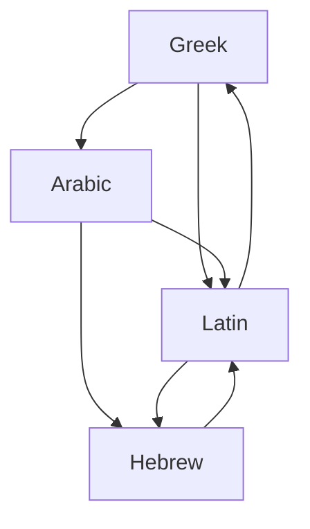

## Answer {#answer}

Specialists now treat medieval philosophy as one tradition in four languages: Latin, Greek, Arabic and Hebrew.[^1]
A series of translation movements linked the four branches.[^1]
Medieval philosophy was based especially on texts and commentary on them.[^1]
Its central problems included the eternity of the world, God's foreknowledge and human freedom, and universals.[^1][^9]
This is part 3 of the series on the history of philosophy. It follows [[hellenistic-roman-philosophy]]. Slovenian version: [[srednjeveska-filozofija]].

## Key insights {#key-insights}

1. In the 19th and 20th centuries, medieval philosophy meant mostly Latin thought in Western Europe. Today it also includes Greek, Arabic and Hebrew writers.[^1]
2. Along with Augustine and Aristotle, Boethius is the fundamental philosophical and theological author in the Latin tradition.[^2]
3. Avicenna was the most important Arabic philosopher, and he also strongly influenced Jewish and Latin philosophy.[^1]
4. Abelard, Scotus and Ockham gave three different answers to the problem of universals.[^8][^10][^11]
5. Leibniz was inspired by Llull's combinatorial *Ars*, but he was thoroughly critical of it.[^15]

## Dates and languages {#scope}

Most specialists agree that the period runs at least from 500 to 1500.[^1]
Some move the start earlier or the end later.[^1]
For the Latin tradition, 1500 is the traditional and still widespread end date.[^1]

The diagram shows the main directions of translation that SEP describes.
Between the 8th and the early 10th century, much of the Greek scientific and philosophical heritage was translated into Arabic.[^1]
Syriac-speaking Christians often did this work, and almost the whole of Aristotle was translated.[^1]

*Figure 1. Directions of translation between the four branches. Arabic was a bridge from Greek to Latin and Hebrew. Source: SEP, Medieval Philosophy.*

## Augustine and Boethius {#augustine-boethius}

Augustine (354–430) was the greatest influence on medieval Latin philosophy.[^1]
By some chronologies, he is also the founder of the tradition.[^1]
Plotinus and Porphyry, whom he read in Latin translation, partly shaped his thought.[^1]

Boethius was born c. 475–7 and died probably in 526.[^2]
He translated Aristotle's logical works into Latin and wrote commentaries and logic textbooks.[^2]
Accused of treason and magic, he was imprisoned and probably executed in 526.[^2]
Before his death, he wrote his most popular work, the *Consolation of Philosophy*.[^2]
By the 11th century, the Latin logic syllabus was a few works of Aristotle with Porphyry and Boethius, the "old logic".[^1]
The rest of Aristotle's logic, the "new logic", became available by the early 13th century.[^1]

## Arabic philosophy {#falsafa}

Philosophy in the Greek style in the Islamic world is called *falsafa*.[^1]

- **Al-Kindī** (ca. 800–870) was the first self-identified philosopher in the Arabic tradition. He worked with translators of Aristotle, the Neoplatonists and Greek scientists.[^3]
- **Al-Fārābī** is known as "the second master", the first being Aristotle.[^4]
- **Avicenna** (Ibn Sīnā, before 980–1037) identified the first cause as the one necessary being. Everything else is possible in itself and necessary only through God.[^1]
- **Avicenna on knowledge:** he held an empirical theory of knowledge, in which the senses are the means by which the soul acquires knowledge.[^5]
- **Al-Ghazālī:** his *Incoherence of the Philosophers* attacked *falsafa* as Avicenna presented it.[^1]
- **Three charges:** al-Ghazālī convicted the philosophers of heresy on only three doctrines. These are the eternity of the world, God's knowledge only of universals, and the denial of bodily resurrection.[^1]
- **Averroes** (Ibn Rushd, 1126–1198) was a philosopher, physician and judge in al-Andalus.[^6]
- **Averroes on philosophy:** he held that philosophy can reach demonstrative certainty in many domains and that Aristotle is the main guide.[^6]

## Maimonides {#maimonides}

Maimonides (1138–1204) is the greatest Jewish philosopher of the medieval period.[^7]
The Almohads invaded his home region in 1148 and gave non-Muslims a choice: conversion, exile or death.[^7]
He arrived in Egypt in 1166 and settled in Fustat, a part of Cairo.[^7]
His *Guide of the Perplexed* tries to resolve the conflict between religious and secular knowledge.[^7]
It stresses the limits of human knowledge.[^7]
Like Aquinas, he held that logic alone cannot show whether the universe was created or is eternal.[^7]

## Scholasticism {#scholasticism}

Anselm (1033–1109) found a new argument for the existence of God, later called the "Ontological Proof".[^1]
Peter Abelard (1079–1142) was the leading philosopher and theologian of the 12th century.[^8]
Thomas Aquinas (ca. 1225–1274) epitomises the scholastic method of the new universities.[^13]
Aquinas held that Christian doctrine also contains truths that only revelation can make known.[^1]
In 1277 the Bishop of Paris condemned thinkers in the university. The condemnation partly affected Aquinas, who had recently died.[^1]

## The problem of universals {#universals}

SEP calls the problem of universals a "historically variable bundle" of metaphysical, logical and epistemological questions.[^9]

- **Abelard:** nothing in the world meets the criteria for a universal. So universality is a semantic feature of language, not an ontological feature of the world.[^8]
- **Scotus:** the "common nature" exists outside the mind only in particular things. There, a "haecceity" (thisness) makes it individual.[^10]
- **Ockham:** the only real universals are concepts in the mind and the spoken or written terms that express them.[^11]
- **Ockham's Razor:** he did not reject universals on the basis of the Razor. He held that the realist theories of his time were outright incoherent.[^11]

## Scotus and Ockham on God {#scotus-ockham}

Scotus (1263/66–1308) argued that things can be contingent only if God himself wills contingently.[^1][^10]
He stressed divine omnipotence and made the divine will the determinant of good and evil.[^1]
Scotus held that some predicates apply to God and creatures with exactly the same meaning (univocally).[^10]
Aquinas allowed only analogical predication.[^10]
Ockham (c. 1287–1347) followed Scotus on God's will.[^1][^11]
Instead of Scotus' metaphysics, he used a very sparse ontology and explained distinctions through a mental language.[^1]

## Llull's Ars {#llull}

Ramon Llull (1232–1316) wrote more than 200 works in Catalan, Arabic and Latin.[^12]
He was among the first authors to use his vernacular language, Catalan, for his thought.[^12]
SEP describes his *Ars Magna* as a combining logical system to discover the truth.[^12]
Llull meant it as an instrument for interfaith dialogue, to convert non-Christians ("infidels").[^12]
The *Ars* rests on the divine "Dignities", such as goodness and greatness.[^12]

The link from Llull to Leibniz comes from Leibniz and from later readers, not from Llull:

- Couturat reports that Leibniz was inspired by Llull's example but was thoroughly critical of the *Ars magna*.[^15]
- In a letter of July 1714, Leibniz recalled that he took some pleasure in Llull's art when young but found flaws in it.[^15]
- In the 19th century, Trendelenburg named "the ars magna of Raymundus Lullus" as a precursor of Leibniz's universal characteristic.[^14]
- SEP's Llull entry does not call the *Ars* a machine or a forerunner of computing.[^12]

## Later influence {#thread}

Each point below links an idea from this article to a later topic. The links are our own reasoning (inferred).

- **Logic:** Llull's rule-governed combination of concepts was later read as a precursor of Leibniz's program.[^14] Part 4 tests that reading (inferred).
- **Mind:** Abelard concluded that intentionality is a primitive feature of the mind.[^8] Later debates ask what concepts are and whether minds can be mechanised (inferred).
- **Ethics:** for Abelard, the agent's intention alone decides the moral worth of an action.[^8] Later ethics asks whether morality lies in intention, consequences or command (inferred).

## Key claims {#key-claims}

- SEP treats medieval philosophy as Latin, Greek, Arabic and Hebrew branches of one tradition.[^1]
- Boethius translated Aristotle's logical works into Latin.[^2]
- Al-Kindī was the first self-identified philosopher in the Arabic tradition.[^3]
- Al-Fārābī is known as "the second master" after Aristotle.[^4]
- Avicenna identified the first cause as the one necessary being.[^1]
- Averroes held that philosophy can reach demonstrative certainty in many domains.[^6]
- Maimonides held that logic alone cannot show whether the universe is created or eternal.[^7]
- Abelard held that universality is a semantic feature, not an ontological one.[^8]
- Ockham held that the only universals are concepts and the terms that express them.[^11]
- Llull's *Ars Magna* is a combining logical system. Its link to Leibniz comes from Leibniz and later interpreters.[^12][^14][^15]

## Quiz {#quiz}

The quiz for this article is in `quizzes/medieval-philosophy.yaml`.
The site shows it on the quiz page for this article.

## Open questions {#open-questions}

- Specialists remain divided about when medieval philosophy begins and ends.[^1]
- Sources give different dates for Llull: SEP gives 1232–1316, and Couturat gives 1234–1315.[^12][^15]

## Sources {#sources}

The sources are listed in the frontmatter field `sources`. The text cites them as footnotes.
