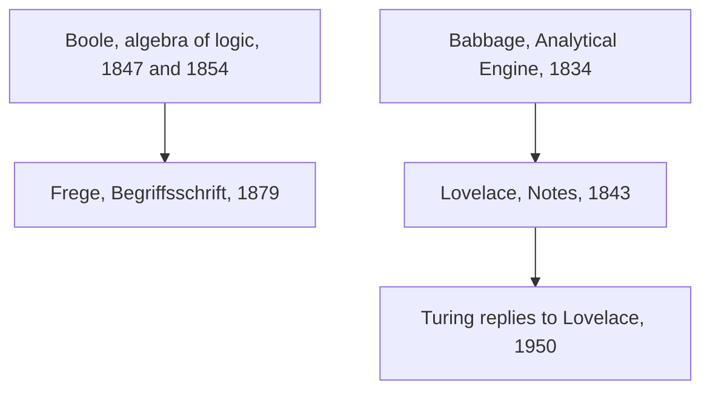

## Answer {#answer}

Nineteenth-century philosophy made thought historical, through Hegel's account of spirit and Marx's account of production.[^1][^6]
Schopenhauer, Kierkegaard and Nietzsche each challenged confidence in rational systems.[^3][^8][^9]
Mill and the pragmatists judged ideas by their consequences and practical effects.[^5][^11]
Darwin placed humans and their moral sense inside natural history.[^10]
Boole and Frege turned logic into explicit symbolic procedure.[^12][^17]
Babbage designed a programmable engine, and Lovelace asked what such a machine could and could not do.[^13][^15]
This is part 6 of the series on the history of philosophy. It follows [[enlightenment-philosophy]]. Slovenian version: [[filozofija-19-stoletja]].

## Key insights {#key-insights}

1. For Hegel, *aufheben* (sublate) means "both to cancel (or negate) and to preserve".[^2]
2. Schopenhauer, Kierkegaard and Nietzsche each named something abstract reason leaves out: blind will, the existing self, and the perspectives behind values.[^3][^8][^9]
3. Marx located alienation in capitalist social relations, not in machines as such.[^7]
4. Boole and Frege gave logic algebraic and formal methods that later fed into computing.[^12][^17]
5. Lovelace wrote that the Analytical Engine "has no pretensions whatever to originate any thing". Turing answered this objection in 1950.[^16][^18]

## From logic to computing {#logic-computing}

The diagram shows the strands of this part that lead toward computing.

*Figure 1. Two nineteenth-century strands that lead toward computing. Sources: SEP, Science Museum, Bodleian Libraries.*

The dates come from SEP and the museum and library sources.[^12][^13][^14][^17][^18]

## Hegel and Schopenhauer {#hegel}

Georg Wilhelm Friedrich Hegel (1770–1831) was "the most systematic of the idealists".[^1]
His *Phenomenology of Spirit* was published in 1807.[^1]
In his dialectic, a concept's one-sidedness makes it unstable, and it passes into its opposite.[^2]
*Aufheben* means both to cancel and to preserve, so an earlier stage is not simply discarded.[^2]
SEP adds that many of Hegel's transitions do not fit the familiar thesis–antithesis–synthesis pattern well.[^2]
*Geist* can mean "mind" or "spirit". SEP prefers "spirit" for its cultural sense, as in *Zeitgeist*.[^1]

Arthur Schopenhauer (1788–1860) finished *The World as Will and Representation* in March 1818. It was published that December, dated 1819.[^3]
He described the thing-in-itself as Will, "an aimless, blind striving".[^3]
We know our own body in two ways: from outside as an object and from inside as willing.[^3]
His outlook is "ultimately ascetic": we should reduce our desires to reach a calmer state of mind.[^3]

## Mill {#mill}

John Stuart Mill (1806–1873) wrote *System of Logic* (1843), *On Liberty* (1859) and *Utilitarianism* (1861).[^4]
Utilitarianism insists "that everyone's happiness matters equally".[^5]
Mill held that "it is better to be a human being dissatisfied than a pig satisfied".[^5]
His harm principle says that preventing harm to others is the only good reason to use power over a person against their will.[^5]
SEP adds that, for Mill, preventing harm is "a necessary but not sufficient" condition for justified restriction.[^5]
Mill's methods of induction, such as the Method of Agreement, aim to find causes by systematic comparison.[^4]

## Marx {#marx}

Karl Marx (1818–1883) developed historical materialism.[^6]
In this view, forms of society rise when they further human productive power and fall when they hold it back.[^6]
In the 1844 Manuscripts he named four dimensions of alienated labour.[^6]
Workers are separated from their product, from their activity, from other people and from their human nature.[^6]
Alienated labour "could … be highly remunerated, limited in duration, and relatively secure".[^6]
For Marx, social relations, not "science, technology, and industrialisation, as such", cause systematic alienation.[^7]
He praised workers who learned "to distinguish between machinery and its employment by capital".[^7]

## Kierkegaard and Nietzsche {#kierkegaard-nietzsche}

Søren Kierkegaard (1813–1855) saw the self less as a substance and more as "an achievement, a goal to strive for".[^8]
*Either/Or* (1843) began his authorship under pseudonyms.[^8]
His works are often read in terms of three "existence-spheres": aesthetic, ethical and religious. SEP calls exactly three "an over-simplification".[^8]
His relation to Hegel "is much more complex and nuanced than has sometimes been thought".[^8]

Friedrich Nietzsche (1844–1900) published *On the Genealogy of Morality* in 1887.[^9]
It contrasts a good/bad pattern of valuation with a good/evil pattern.[^9]
On his account, the *ressentiment* of the powerless motivated the new concept of evil.[^9]
His perspectivism holds that the more eyes we bring to a matter, the more complete our concept of it.[^9]

## Darwin and the pragmatists {#darwin-pragmatism}

Darwinism was first formulated in *On the Origin of Species* (1859).[^10]
Darwin believed that the human moral sense could be explained by evolution.[^10]
In *The Descent of Man*, SEP says, he "flirted with" a group-level explanation.[^10]

Pragmatism originated in the United States around 1870.[^11]
It became prominent through William James's public lectures in 1898.[^11]
Charles Sanders Peirce stated his pragmatic maxim in 1878: clarify a concept by the conceivable practical effects of its object.[^11]
In *Pragmatism* (1907), James called true "whatever proves itself to be good in the way of belief, and good, too, for definite assignable reasons".[^11]

## Boole and Frege {#boole-frege}

George Boole (1815–1864) "revolutionized logic" by applying methods of symbolic algebra to it.[^12]
His main works were *The Mathematical Analysis of Logic* (1847) and *The Laws of Thought* (1854).[^12]
In his algebra, *xy* is the intersection of two classes and 1 is the universe.[^12]
The empty class, written 0, does not appear in the 1847 book.[^12]
The modern algebra of logic came from Jevons in 1864. Boole had rejected that version.[^12]

Gottlob Frege (1848–1925) analysed sentences in terms of function and argument.[^17]
This freed logic from the subject–predicate analysis of Aristotelian logic. It also gave a general treatment of "every" and "some".[^17]
His logic is second-order: it allows quantification over functions as well as objects.[^17]
In 1902 Russell wrote to Frege about a contradiction in the foundations of his *Grundgesetze*.[^17]

## Babbage and Lovelace {#babbage-lovelace}

Charles Babbage (1791–1871) conceived the Analytical Engine in 1834, "to perform any calculation set before it".[^13]
It had a store for numbers, a separate mill for arithmetic, and punched cards like those of the Jacquard loom.[^13]
It was never built in his lifetime.[^13]
A mechanism could repeat a deck of cards "so as to execute a loop".[^14]
The machine could also use values it had already found to choose between two possible next steps.[^14]

### Lovelace's Notes {#lovelace}

Ada Lovelace (1815–1852) translated Menabrea's paper on the engine and added her own notes.[^13][^14]
The paper appeared in Taylor's *Scientific Memoirs* in August 1843.[^14]
Her final note, Note G, works through the calculation of the Bernoulli numbers.[^14]
Her table is often called "the first computer program". The Bodleian authors call it an "execution trace".[^14]
In Note A she wrote that the engine "might compose elaborate and scientific pieces of music".[^15]

### The originality objection {#originality}

In Note G, as printed in 1843, Lovelace wrote that the engine "has no pretensions whatever to originate any thing".[^16]
It can do "whatever we know how to order it to perform".[^16]
She also imagined setting the engine to work on invented laws, to get results "we might not otherwise have thought of obtaining".[^14]
Turing later answered "Lady Lovelace's Objection" in his 1950 paper.[^18]

## Later influence {#thread}

Each point below links an idea from this article to a later topic. The links are our own reasoning (inferred).

- **Logic:** Boole's algebra and Frege's quantifiers feed later mathematical logic.[^12][^17] Part 7 follows this line (inferred).
- **Machines:** Lovelace's objection asks whether following instructions rules out originality.[^16][^18] The question returns in AI debates (inferred).
- **Ethics:** Mill's consequences, Marx's productive relations and Nietzsche's genealogy give distinct ways to argue about technology (inferred).[^5][^7][^9]

## Key claims {#key-claims}

- For Hegel, *aufheben* means both to cancel and to preserve.[^2]
- Schopenhauer described Will as aimless, blind striving.[^3]
- For Mill, preventing harm is a necessary, not a sufficient, condition for restriction.[^5]
- Marx located alienation in capitalist social relations, not in technology as such.[^7]
- Darwin believed the human moral sense could be explained by evolution.[^10]
- Boole's own algebra differs from the later algebra of Jevons.[^12]
- The Analytical Engine was never built in Babbage's lifetime.[^13]
- Lovelace wrote that the engine "has no pretensions whatever to originate any thing".[^16]

## Quiz {#quiz}

The quiz for this article is in `quizzes/nineteenth-century-philosophy.yaml`.
The site shows it on the quiz page for this article.

## Open questions {#open-questions}

- SEP sets out several readings of Hegel: a traditional metaphysical one, a post-Kantian one and a revised metaphysical reply. Which is right?[^1]
- Can Mill's ranking of higher pleasures be squared with hedonism?[^5]
- What separates a machine's unexpected result from an original contribution? This is the question between Lovelace and Turing.[^15][^18]

## Sources {#sources}

The sources are listed in the frontmatter field `sources`. The text cites them as footnotes.
