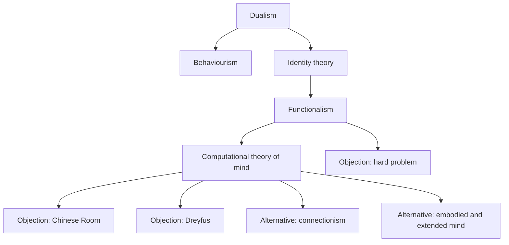

# Philosophy of mind and technology

## Answer {#answer}

Twentieth-century philosophy of mind moved from asking what minds are made of to asking what minds do. Functionalism defines mental states by their roles, so in principle a non-biological system could have them.[^4][^5] The main objections concern understanding (Searle), embodied skill (Dreyfus) and subjective experience (Nagel, Chalmers).[^7][^9][^11][^13] Debates about large language models (LLMs) reuse these objections. The papers cited here, from 2020 to 2024, judge current systems unlikely to be conscious and leave future systems open.[^17][^18][^19]

This is part 8 of the series on the history of philosophy. It follows [[twentieth-century-philosophy]]. Slovenian version: [[filozofija-uma-in-tehnologija]].

## Key insights {#key-insights}

- Multiple realizability was the most influential argument against mind–brain identity theories, and it helped launch functionalism.[^5]
- Searle's narrow conclusion is that running a program cannot by itself produce understanding.[^7][^8]
- Dreyfus, Nagel and Chalmers each name something computation may leave out: embodied know-how, a point of view, and experience itself.[^9][^11][^13]
- Connectionism and embodied and extended cognition each challenge the picture of the mind as a symbol-processing computer.[^14][^15][^16]
- On LLMs, Bender and Koller argue that form alone cannot yield meaning. Chalmers and Butlin et al. treat machine consciousness as an open question.[^17][^18][^19]

## Map of positions {#map}

The diagram shows the main positions and the objections discussed below. The arrows are our own summary (inferred).[^6][^7]

## Dualism, behaviourism and identity theory {#mind-body}

- **Dualism:** Descartes argued that mind and body are distinct substances. SEP calls this "a standard starting point for discussions of the mind-body problem ever since".[^1] See also [[renaissance-early-modern-philosophy#bacon-descartes]].
- **The interaction problem:** Elisabeth of Bohemia asked how mind and body could interact. With mechanistic science this became "the leading objection to dualism".[^1]
- **Behaviourism** has three forms.[^2] Methodological behaviourism (Watson) studies behaviour, not mental states. Psychological behaviourism (Pavlov, Skinner) explains behaviour by stimuli and reinforcement. Analytical behaviourism (Ryle) treats a mental state as a behavioural disposition.
- Behaviourism was dominant until cognitive science matured, roughly from 1960 to 1985.[^2]
- **Identity theory:** U. T. Place (1956) and H. Feigl (1958) began it, and J. J. C. Smart joined in 1959.[^3] On this view experiences are brain processes, not merely correlated with them.[^3]

## Functionalism and multiple realizability {#functionalism}

- **Functionalism:** a mental state "depends not on its internal constitution, but solely on its function, or the role it plays".[^4]
- SEP traces it to Aristotle's view of the soul and Hobbes's "calculating machine". Hilary Putnam's "machine state" theories were early versions.[^4]
- **Multiple realizability:** one mental kind can be realized by many distinct physical kinds.[^5]
- Putnam (1967) used it against "brain state theorists". Humans, other animals and even octopuses seem able to feel pain, so one shared neural kind is unlikely.[^5]
- **It cut both ways:** Putnam (1988) later used multiple realizability against functionalism itself.[^5]

## Computational theory of mind {#computation}

- The computational theory of mind (CTM) holds that the mind is a computational system. "For many years, it enjoyed orthodox status" in cognitive science.[^6]
- McCulloch and Pitts (1943) first suggested that something like the Turing machine might model the mind.[^6] On Turing, see [[twentieth-century-philosophy#turing]].
- **Language of thought:** Jerry Fodor argued that mental activity involves "Turing-style computation over the language of thought".[^6]
- SEP describes traditional cognitive science as "wedded to computationalism", with the brain as the seat of cognition.[^15]

## Challenges to machine minds {#challenges}

### Searle's Chinese Room {#chinese-room}

- John Searle (1932–2025) published the argument in 1980.[^7] He imagines himself following a program to answer in Chinese. He understands no Chinese, yet people outside think a Chinese speaker is inside.[^7]
- **Narrow conclusion:** a program may make a computer appear to understand language but cannot produce real understanding.[^7]
- **Broader conclusion:** minds "must result from biological processes; computers can at best simulate these biological processes".[^7] IEP sums up the key claims as "brains cause minds" and "syntax doesn't suffice for semantics".[^8]
- **Main replies:** the Systems Reply, which Searle called "perhaps the most common reply", says the whole system understands. The Robot Reply says understanding needs sensors and action.[^7]

### Dreyfus {#dreyfus}

- Hubert Dreyfus published *What Computers Can't Do* in 1972. MIT Press reissued it in 1992 as *What Computers Still Can't Do*, with a new introduction.[^10]
- SEP: for Dreyfus, human expertise does not rest on "explicit, disembodied, mechanical manipulation of symbolic information".[^9]
- The publisher says he predicted failure because AI's conception of mental functioning was "naive".[^10]

### Nagel and qualia {#nagel}

- Thomas Nagel (1974) argued that bats are conscious because "there is something that it is like for a bat".[^11]
- **Qualia** are "the introspectively accessible, phenomenal aspects of our mental lives". Jackson's Mary, a colour scientist raised in a black-and-white room, is the best-known thought experiment about them.[^12]

### Chalmers: the hard problem {#hard-problem}

- IEP: "David Chalmers coined the name "hard problem" (1995, 1996)", but the problem is "not wholly new".[^13]
- The easy problems concern the functions of consciousness. The hard problem asks why there is experience at all.[^13]
- SEP: the task is to give "an intelligible account" of how phenomenal consciousness "might arise from physical or neural processes".[^11]

## Connectionism, embodied and extended mind {#connectionism-embodiment}

- **Connectionism:** neural networks offer "an alternative to the classical theory of the mind".[^14] SEP dates connectionism's "Golden Age" to 1980–1995 and calls deep learning its "New Wave".[^14]
- **Embodied cognition** holds that the body, or its interaction with the environment, constitutes or contributes to cognition.[^15]
- **The extended mind:** Clark and Chalmers (1998) ask where the mind stops and the rest of the world begins.[^16] Otto, who has Alzheimer's disease, uses a notebook the way Inga uses her memory.[^16]
- **Objection:** Adams and Aizawa call this a "coupling-constitution fallacy".[^15]

## LLMs: understanding and consciousness {#llms}

This field moves fast. Each claim below is dated and labelled by venue, as checked on 2026-10-18.

- **Understanding (peer-reviewed, ACL 2020):** Bender and Koller argue that "a system trained only on form has a priori no way to learn meaning".[^17] Their "octopus test" illustrates the point.[^17]
- **Chalmers (preprint, 2023; NeurIPS invited lecture, 28 November 2022; also in *Boston Review*):**
  - He finds "significant obstacles" to consciousness in current models, such as no recurrent processing or global workspace.[^18]
  - He judges current LLM consciousness "somewhat unlikely", with credence "somewhere under 10 percent".[^18]
- **Butlin, Long and 17 co-authors (preprint, August 2023):**
  - They adopt computational functionalism "as a working hypothesis".[^19]
  - They conclude that "no current AI systems are conscious" and see "no obvious technical barriers" to systems that meet their indicators.[^19]
- Bender and Koller's point updates Searle's syntax-versus-semantics claim (inferred).[^7][^17]

## Later influence {#thread}

Each point below links an idea from this article to a later topic. The links are our own reasoning (inferred).

- **Moral status:** whether AI systems could count morally may depend on the Chinese Room, the bat and the hard problem.[^7][^13]
- **Attribution risk:** Butlin et al. discuss the risks of under- and over-attributing consciousness to AI.[^19]
- **Responsibility:** if cognition is extended, responsibility for AI-assisted decisions may be shared across human–tool systems.[^16]

## Key claims {#key-claims}

- SEP calls Descartes's dualism the standard starting point for the mind–body problem.[^1]
- Functionalism defines mental states by their functional role.[^4]
- Putnam (1967) used multiple realizability against brain-state theories.[^5]
- Searle argues that a program cannot produce real understanding.[^7]
- Chalmers coined the name "hard problem".[^13]
- Butlin et al. (2023 preprint) conclude that no current AI systems are conscious.[^19]

## Quiz {#quiz}

The quiz for this article is in `quizzes/philosophy-of-mind-and-technology.yaml`.
The site shows it on the quiz page for this article.

## Open questions {#open-questions}

- SEP Consciousness was last substantively revised in 2014. A newer survey may be needed.
- As of 2026-10-18 neither arXiv paper has a confirmed peer-reviewed version. Re-check before publishing.
- Does multiple realizability support or undermine functionalism? SEP shows it used both ways.[^5]

## Sources {#sources}

The sources are listed in the frontmatter field `sources`. The text cites them as footnotes.
