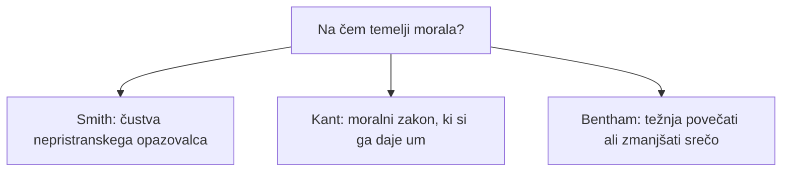

## Odgovor {#answer}

Razsvetljenski filozofi so se spraševali, kaj lahko upravičijo razum, izkustvo in čustvo.[^1]
Hume je vzročnost in jaz izpeljal iz vzorcev izkustva.[^2]
Kant je odgovoril, da je razum vir naravnih zakonov in da si um sam daje moralni zakon.[^11]
Smith je moralo utemeljil v simpatiji, Bentham pa v koristi.[^15][^17]
La Mettriejev *Človek stroj* je ljudi obravnaval kot naravne mehanizme.[^1][^7]
Javni avtomati so pokazali, kako lahko simulacija ali skriti človek velja za inteligenco.[^19][^20]
To je 5. del serije o zgodovini filozofije. Nadaljuje članek [[renesansna-in-zgodnjenovoveska-filozofija]]. Angleška različica: [[enlightenment-philosophy]].

## Ključni poudarki {#key-insights}

1. Hume ni našel vtisa nujne povezanosti ne trajnega jaza. Našel je stalno povezanost, pričakovanje in snope zaznav.[^2]
2. Kantova formula človečnosti prepoveduje, da bi človečnost obravnavali »le kot sredstvo«.[^13]
3. Smithov nepristranski opazovalec in Benthamovo načelo koristnosti sta zgodnji korenini etike, ki temelji na čustvih, in etike, ki temelji na posledicah.[^15][^17]
4. SEP pravi, da je naslov La Mettriejevega *Človeka stroja* videti namenjen temu, da bi zmanjšal človekovo samopodobo.[^1]
5. Vaucansonova raca je prebavo ponarejala, Turek pa je skrival človeškega šahista.[^19][^20]

## Trije viri morale {#morality}

Diagram primerja tri odgovore na vprašanje, na čem temelji morala.

*Slika 1. Trije razsvetljenski odgovori o temelju morale. Viri: SEP.*

Vsak odgovor je razložen v razdelkih spodaj.[^11][^15][^17]

## Berkeley in Hume {#empiricism}

George Berkeley (1685–1753) je zagovarjal idealizem, stališče, da resničnost sestavljajo le umi in njihove ideje.[^5]
Zanikal je, da obstajajo od uma neodvisne stvari. Izrek *esse est percipi* pomeni »biti pomeni biti zaznan«.[^5]
Za Berkeleyja ni materialnega sveta, obstaja pa fizični svet vsakdanjih predmetov, sestavljen iz idej.[^5]

David Hume (1711–1776) je eksperimentalno metodo na tradicionalne filozofske probleme uporabil strožje kot kateri koli drug novoveški mislec.[^2]
Njegova ideja vzročnosti ima tri sestavine: prostorsko bližino, časovno prednost in, kar je najpomembnejše, nujno povezanost.[^2]
Hume je podal dve opredelitvi vzroka.[^2]
Prva vzročnost enači s stalno povezanostjo. Druga se sklicuje na notranje pričakovanje, ki um vodi od enega dogodka k drugemu.[^2]
IEP pravi, da um po dovolj primerih stalne povezanosti z »naravno določenostjo« preide od vzroka k učinku.[^4]

### Biti in morati {#is-ought}

Hume je opazil, da moralni sistemi neopazno preidejo od premis z »je« k sklepom z »mora«.[^3]
Tak sklep se mu je zdel »povsem nepojmljiv«.[^3]
SEP pravi, da je le malo Humovih odlomkov sprožilo več razlagalnih sporov.[^3]
Prevladujoče branje 20. stoletja je, da »mora« ne sledi iz premis, ki uporabljajo le »je«.[^3]

### Jaz kot snop {#bundle}

Hume pod našimi zaznavami ni našel ideje trajnega jaza.[^2]
Jaz je enačil s snopom zaznav v enem trenutku ali z njihovim zaporedjem v času.[^2]
V Dodatku k *Razpravi* je o tej teoriji sam izrazil dvome.[^2]

## Voltaire in Diderot {#philosophes}

Voltaire (François-Marie d'Arouet, 1694–1778) je imel edinstveno vlogo pri opredelitvi razsvetljenstva.[^6]
Njegova *Filozofska pisma* (1734) so zaznamovala njegov preobrat k filozofiji.[^6]
Naravoslovje je branil pred trditvami filozofov, kot so Leibniz, Malebranche in Descartes.[^6]
*Candide* (1759) vsebuje resen napad na Leibnizevo filozofijo.[^6]
Njegova obramba Jeana Calasa in geslo *Écrasez l'infâme!* (»Strite nesramnost!«) sta filozofijo povezala z družbeno kritiko in reformo.[^6]

Denisa Diderota (1713–1784) pogosto vidijo kot drugega za Voltairom med vodilnimi *filozofi*.[^7]
*Enciklopedijo* je videl kot gonilo za spreminjanje vednosti, ne za njeno kodificiranje, kar je razvil v geslu »Encyclopédie« (1755).[^7]

## La Mettriejev človek stroj {#la-mettrie}

*L'Homme machine* je prvič izšel anonimno pri Elieju Luzacu v Leidnu konec leta 1747, a z letnico 1748.[^18]
SEP ga datira v leto 1748.[^1][^7]
Geslo SEP o razsvetljenstvu pravi, da obdobje ljudi praviloma prikazuje kot povsem naravna bitja, brez svobodne volje in nesmrtne duše.[^1]
La Mettrie je zapisal, da je duša »le prazen izraz«.[^7]
Če obstaja vsaj najmanjše načelo gibanja, je trdil, se živa telesa lahko »gibljejo, čutijo, mislijo, kesajo«.[^7]
Vztrajal je tudi, da smo »stroji, ki se sami navijajo«.[^7]
Njegovo stališče na ljudi razširi model stroja, ki ga je Descartes uporabil za živali (glej [[renesansna-in-zgodnjenovoveska-filozofija#bacon-descartes]]) (sklepanje).

## Rousseau in Wollstonecraft {#society}

V *Družbeni pogodbi* je Jean-Jacques Rousseau (1712–1778) trdil, da je država legitimna le, če jo vodi »splošna volja« njenih članov.[^8]
Predpostavil je naravno strast *pitié* (sočutje). Prava morala zahteva družbeno samozavedanje in vest.[^8]

Mary Wollstonecraft (1759–1797) je analizirala položaj žensk v moderni družbi.[^9]
Trdila je, da ženske zaradi svoje izobrazbe ne morejo izpolniti pričakovanj družbe.[^9]
Želela je, da ženske stremijo k polnemu državljanstvu, za kar je potreben razvoj razuma.[^9]
Geslo SEP o feministični zgodovini filozofije jo uvršča med filozofinje, ki so jih danes sprejeli v kanon.[^10]

## Kant {#kant}

Immanuel Kant (1724–1804) je napisal tri *Kritike*:[^11]

- *Kritika čistega uma* (1781, druga izdaja 1787)
- *Kritika praktičnega uma* (1788)
- *Kritika razsodne moči* (1790)

Njihova povezovalna zamisel je človekova avtonomija.[^11]
V prvi *Kritiki* je Kant poskusil predpostaviti, da se morajo predmeti ravnati po našem spoznanju. To je primerjal s Kopernikovo novo hipotezo.[^11]
Človeški razum je vir splošnih naravnih zakonov, ki strukturirajo naše izkustvo.[^11]
Zato lahko a priori spoznamo le pojave, nikoli stvari na sebi.[^11]
Um nam ne more dati spoznanja o Bogu ali o svetu onkraj čutov.[^12]

Za Kanta svoboda pomeni biti zavezan zakonom, ki so v nekem smislu naši lastni.[^13]
Formula človečnosti pravi, naj človečnosti, v sebi ali v drugih, nikoli ne obravnavamo »le kot sredstvo, temveč vedno tudi kot smoter sam na sebi«.[^13]
Tretja formulacija govori o »ideji volje vsakega umnega bitja kot volje, ki daje splošno zakonodajo«.[^13]
Večina se strinja, da je obravnavanje drugih zgolj kot sredstva napačno, natančne opredelitve tega pa ostajajo sporne.[^14]
SEP opozarja, da si Kant sam umetne inteligence ni nikoli zamislil.[^13]
S kantovskega stališča, dodaja SEP, so vprašanja o umetnih akterjih »zanimiva filozofska vprašanja, ne pa nujna praktična«.[^13]

## Smith in Bentham {#smith-bentham}

Adam Smith je v *Teoriji moralnih čustev* (1759) moralo zgradil na simpatiji.[^15]
Za Smitha moralne norme izražajo čustva nepristranskega opazovalca.[^15]
SEP Smithovo simpatijo imenuje »projektivno«: postavimo se na mesto drugega. Humova je razlaga z »okužbo«.[^15]
Hume in Smith moralnega čuta nista imela za prvotno, prirojeno zmožnost. Razložila sta ga s simpatijo.[^16]

Jeremy Bentham (1748–1832) je klasični utilitarizem predstavil v delu *Uvod v načela morale in zakonodaje*.[^17]
Natisnjeno je bilo leta 1780, z dodatki pa objavljeno leta 1789.[^17]
Načelo koristnosti vsako dejanje odobri ali zavrne glede na to, ali povečuje ali zmanjšuje srečo prizadetih.[^17]

## Avtomati {#automata}

Avtomati v tem razdelku so dokumentirani v virih muzeja in knjižnice, ne v SEP ali IEP. Kjer se viri razlikujejo, navajamo oba.

### Vaucansonova raca {#vaucanson}

Jacques de Vaucanson je svoj prvi javni avtomat, Flavtista, predstavil februarja 1738 v Parizu.[^19]
Še istega leta je dodal piskača z bobnom in Prebavljajočo raco.[^19]
Raca je premikala glavo, mahala s perutmi, pila, jedla zrnje in izločila kroglico.[^19]
Vaucanson je trdil, da raca hrano predela.[^19]
Poznejša preiskava je pokazala, da je hrana šla v eno votlino. Kroglica je prišla iz ločene zaloge zeleno obarvanih krušnih drobtin.[^19]

### Kempelenov Turek {#turk}

Wolfgang von Kempelen je izdelal šahovski stroj, znan kot »Turek«.[^20][^21]
Heinz Nixdorf MuseumsForum pravi, da ga je prvič predstavil cesarici Mariji Tereziji leta 1769.[^21]
Knjižnica Linda Hall pravi, da ga je razkril leta 1770.[^20]
Po navedbah muzeja je do leta 1785 gostoval po Evropi.[^21]
Knjižnica Linda Hall Turka imenuje »domiselna prevara«: upravljal ga je skrit človek.[^20]
Oba vira pravita, da je leta 1854 zgorel v Filadelfiji. Muzej navaja Kitajski muzej, knjižnica pa Pealov muzej.[^20][^21]

## Poznejši vpliv {#thread}

Vsaka točka spodaj povezuje misel iz tega članka s poznejšo temo. Te povezave niso iz virov (sklepanje).

- **Um:** Humov jaz kot snop in La Mettriejev človek stroj odpirata poznejše vprašanje, ali je sistem stanj lahko um (sklepanje).[^2][^7]
- **Stroji:** raca in Turek sta simulacijo ali skrito človeško delo predstavljala kot inteligenco.[^19][^20] Isti vzorec se vrača v razpravah o umetni inteligenci (sklepanje).
- **Etika:** Kantove osebe kot smotri, Benthamova korist in Smithov nepristranski opazovalec ostajajo tri izhodišča etike umetne inteligence (sklepanje).[^13][^15][^17]

## Ključne trditve {#key-claims}

- Humova prva opredelitev vzročnost enači s stalno povezanostjo.[^2]
- Prehod od »je« k »mora« se je Humu zdel »povsem nepojmljiv«, odlomek pa je zelo sporen.[^3]
- Hume je jaz enačil s snopom ali zaporedjem zaznav.[^2]
- *L'Homme machine* je izšel konec leta 1747, z letnico 1748.[^18]
- Kantova formula človečnosti prepoveduje obravnavanje človečnosti le kot sredstva.[^13]
- Za Smitha moralne norme izražajo čustva nepristranskega opazovalca.[^15]
- Vaucansonova raca je prebavo ponarejala, Turek pa je bil prevara.[^19][^20]

## Kviz {#quiz}

Kviz za ta članek je v datoteki `quizzes/razsvetljenska-filozofija.yaml`.
Spletno mesto ga prikaže na strani s kvizom za ta članek.

## Odprta vprašanja {#open-questions}

- Ali drži močno branje Huma, da »mora« ne sledi iz »je«? SEP ga imenuje prevladujoče branje 20. stoletja v zelo spornem odlomku.[^3]
- Ali bi morali imeti umetni akterji moralni status? S kantovskega stališča, pravi SEP, to še ni nujno praktično vprašanje.[^13]
- Katerega leta so Turka prvič pokazali in v katerem filadelfijskem muzeju je zgorel? Viri se ne ujemajo.[^20][^21]

## Viri {#sources}

Viri so navedeni v polju `sources` v glavi datoteke. V besedilu so citirani kot opombe.
