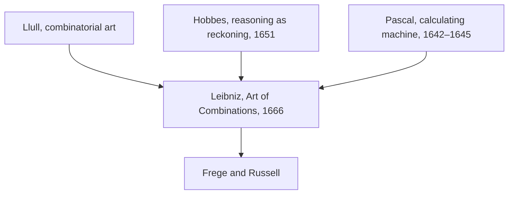

## Answer {#answer}

Renaissance thinkers used ancient texts to rethink human nature, politics and knowledge.[^1][^3]
Descartes explained living bodies, including animal bodies, as machines.[^5]
Hobbes described reasoning as computation, and Leibniz praised him for it.[^6][^14]
Pascal and Leibniz built calculating machines.[^11][^15]
Leibniz still argued that perception cannot be explained mechanically.[^14]
This is part 4 of the series on the history of philosophy. It follows [[medieval-philosophy]]. Slovenian version: [[renesansna-in-zgodnjenovoveska-filozofija]].

## Key insights {#key-insights}

1. SEP calls the usual reading of Pico's speech as a charter of human freedom and dignity a "miscarried reading".[^1]
2. Montaigne transformed ancient skepticism: for him, the two sides of an argument are never perfectly balanced.[^3]
3. Bacon's eliminative induction and Descartes' method of doubt are two different ways to secure knowledge.[^4][^5]
4. Pascal's machine mechanised arithmetic. Leibniz hoped that an ideal logical language would let people settle disputes by calculation.[^11][^13][^15]
5. Locke tied personal identity to consciousness, not to the same body or soul.[^17]

## From calculation to mind {#calculation}

The diagram shows how ideas about calculation reached Leibniz and passed on from him.

*Figure 1. Sources and heirs of Leibniz's program. Leibniz joined combinatorics, computation and machines. Sources: SEP, IEP, Couturat.*

The four links are these:

- Leibniz's combinatorial vision goes back to Llull, around 1308.[^15]
- Leibniz wrote in 1666 that Hobbes rightly called everything done by our mind a computation.[^14]
- Pascal invented his machine before Leibniz designed his own.[^15]
- Leibniz's ideal of a logical language influenced later philosophers, most notably Frege and Russell.[^13]

## Pico and humanism {#pico}

Humanism was a new way to read, write and teach, based on the philology of ancient languages.[^1]
It was called "humanism" only in the 19th century.[^1]
Giovanni Pico della Mirandola (1463–1494) assembled 900 theses from many authorities and had them printed in Rome at the end of 1486.[^1]
He planned to debate them in public in 1487, but the Holy See blocked the debate.[^1]
Pope Innocent VIII indicted 13 of the theses.[^1]
Pico wrote a speech to introduce the debate but never gave or published it.[^1]
After his death, others called it the *Oration on the Dignity of Man*.[^1]
SEP calls the reading of this speech as a charter of freedom and dignity "miscarried".[^1]
In Pico's text, our task is to become angels.[^1]

## Machiavelli and Montaigne {#machiavelli-montaigne}

Niccolò Machiavelli (1469–1527) wrote *The Prince* at the end of 1513, or perhaps early in 1514.[^2]
It was published only after his death, in 1532.[^2]
For Machiavelli, goodness does not ensure power, and a ruler gains no authority by being good.[^2]

Michel de Montaigne (1533–1592) published the first edition of his *Essays* in 1580.[^3]
In them, his main aim was to exercise his own judgement properly.[^3]
Around 1576 he had a medal made with two skeptical mottos: *Epecho* ("I abstain") and *Que sais-je?* ("What do I know?").[^3]
For Montaigne, the two sides of the scale are never perfectly balanced, so judgement weighs one view against another.[^3]
He compared the cruelty of France's religious civil wars with cannibalism.[^3]

## Bacon and Descartes {#bacon-descartes}

Francis Bacon (1561–1626) planned the *Instauratio magna*, a program to renew all knowledge.[^4]
Its main volume came out in October 1620.[^4]
For Bacon, knowledge should be operative and beneficial to humankind, not only speculative.[^4]
His method, often called eliminative induction, uses tables of instances.[^4]
For heat, the sun's rays are a positive instance and the moon's rays a negative one. So light is excluded as the form of heat.[^4]
He named four "idols" that mislead the mind, starting with the Idols of the Tribe, which are founded in human nature.[^4]

René Descartes (1596–1650) published the *Discourse on the Method* in 1637 and the *Meditations* in 1641.[^5]
His method came to include a method of doubt.[^5]
He held that the essence of matter is extension.[^5]
He placed an immaterial mind in direct relation to the brain, which led to the modern mind–body problem.[^5]
He was fascinated by automata and used the idea of a machine to describe living things.[^5]
He regarded nonhuman animals as machines without mind and consciousness.[^5]
Some recent scholars question whether he denied all feeling to animals.[^5]

## Hobbes and Spinoza {#hobbes-spinoza}

Thomas Hobbes (1588–1679) defended materialist, nominalist and empiricist views.[^7]
In *Leviathan* (1651), he called reasoning "nothing but reckoning", that is, adding and subtracting.[^6]
SEP calls this account an early ancestor of contemporary functionalism.[^6]
The Hobbes entry notes possible links to the computational theory of mind.[^7]
In politics, Hobbes argued that we ought to submit to an absolute, "undivided and unlimited" sovereign.[^8]
The sovereign can be a natural person, such as a monarch, or an artificial person, such as an assembly.[^8]

Baruch Spinoza (1632–1677) held that there is only one substance, God, and that everything else is in God.[^9]
Thought and extension are two ways in which one Nature expresses itself.[^9]
In nature, nothing is contingent: everything is necessarily determined.[^9]

## Pascal and Leibniz {#pascal-leibniz}

Blaise Pascal (1623–1662) started work on a calculating machine in 1642, to help with his father's tax work.[^11]
It was presented to the public in 1645 and later called the Pascaline.[^11]
SEP dates the first prototype, built at Rouen, to 1645.[^10]
A full turn of one wheel moved the next wheel one tenth of a turn.[^11]
Pascal received a royal patent for the machine in 1649.[^11]

Gottfried Wilhelm Leibniz (1646–1716) published the *Art of Combinations* in 1666.[^12]
It sketched a plan for a "universal characteristic" and a logical calculus.[^12]
He described the art of combinations as a method for producing new ideas and for analysing complex ideas into simple ones.[^15]
An ideal logical language could work as a calculus of reasoning, with a logic of proof and a logic of discovery.[^13]
In 1685 he wrote that people in a dispute could simply say: "Let us calculate".[^15]
He designed a calculating machine for all four arithmetic operations and presented his designs in London in 1673.[^12]

Leibniz on Llull (see [[medieval-philosophy#llull]]):

- Couturat reports that Leibniz was inspired by Llull's example but was thoroughly critical of the *Ars magna*.[^16]
- Leibniz objected to Llull's arbitrary choice of basic concepts and to fixing their number at nine.[^16]
- In a letter of July 1714, Leibniz recalled that he took pleasure in Llull's art as a young man but found flaws in it.[^16]

### Computation and consciousness {#consciousness}

Leibniz is known for his critiques of materialism.[^14]
In 1695 he wrote that the true unity called "the I in us" could not occur in artificial machines.[^14]
In the *Monadology* he imagined a thinking machine enlarged so that one could walk inside it, like a mill.[^14]
Inside, one would find only parts pushing one another, and nothing that explains a perception.[^14]

## Locke on personal identity {#locke}

John Locke (1632–1704) added his chapter on personal identity to the second edition of his *Essay* in 1694.[^17]
For Locke, a person is a thinking, intelligent being that can consider itself the same thinking thing at different times and places.[^17]
Personal identity reaches as far back as consciousness can be extended.[^17]
In the "prince and the cobbler" case, the person goes with the consciousness, not with the body.[^17]
For Locke, "person" is a forensic term: it ties actions to responsibility.[^17]
Some scholars read Locke as a strict memory theorist, a reading that goes back at least to Thomas Reid.[^17]

## Later influence {#thread}

Each point below links an idea from this article to a later topic. The links are our own reasoning (inferred).

- **Computation:** Hobbes' reckoning and Leibniz's calculus point toward later computational theories of mind.[^6][^7][^13] Later parts return to this (inferred).
- **Experience:** Descartes' animal machines and Leibniz's mill leave open whether mechanism can explain experience.[^5][^14] Calculating and experiencing are separate questions (inferred).
- **Responsibility:** Locke's forensic person ties identity to responsibility.[^17] Later debates about personhood return to this link (inferred).

## Key claims {#key-claims}

- SEP calls the reading of Pico's speech as a charter of dignity a miscarried reading.[^1]
- Machiavelli denied that goodness ensures power or adds authority.[^2]
- For Montaigne, the two sides of an argument are never perfectly balanced.[^3]
- Bacon's method excludes candidate forms by using tables of instances.[^4]
- Descartes regarded nonhuman animals as machines without mind. Scholars debate whether he denied them all feeling.[^5]
- Hobbes called reasoning "reckoning" with general names.[^6]
- Spinoza held that there is one substance, God, with the attributes of thought and extension.[^9]
- Pascal began his machine in 1642 and presented it in 1645.[^10][^11]
- Leibniz published the *Art of Combinations* in 1666.[^12]
- In 1714, Leibniz recalled early pleasure in Llull's art but found flaws in it.[^16]
- Locke tied personal identity to consciousness.[^17]

## Quiz {#quiz}

The quiz for this article is in `quizzes/renaissance-early-modern-philosophy.yaml`.
The site shows it on the quiz page for this article.

## Open questions {#open-questions}

- Sources date the Pascaline differently: SEP's Computational Philosophy entry says 1642, while the Pascal entries give 1642 as the start and 1645 as the prototype.[^15][^10][^11]
- Scholars debate whether Descartes denied all feeling to animals.[^5]
- Scholars debate whether Locke's "consciousness" is simply memory.[^17]

## Sources {#sources}

The sources are listed in the frontmatter field `sources`. The text cites them as footnotes.
