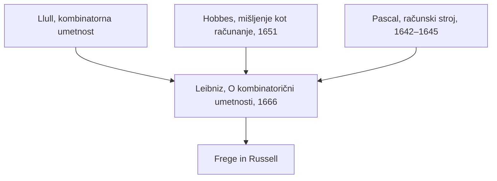

## Odgovor {#answer}

Renesančni misleci so z antičnimi besedili na novo premislili človeško naravo, politiko in vednost.[^1][^3]
Descartes je živa telesa, tudi živalska, razlagal kot stroje.[^5]
Hobbes je mišljenje opisal kot računanje, Leibniz pa ga je zato pohvalil.[^6][^14]
Pascal in Leibniz sta zgradila računska stroja.[^11][^15]
Leibniz je kljub temu trdil, da zaznave ni mogoče razložiti mehanično.[^14]
To je 4. del serije o zgodovini filozofije. Nadaljuje članek [[srednjeveska-filozofija]]. Angleška različica: [[renaissance-early-modern-philosophy]].

## Ključni poudarki {#key-insights}

1. SEP običajno branje Picovega govora kot listine človekove svobode in dostojanstva imenuje »zgrešeno branje«.[^1]
2. Montaigne je antični skepticizem preoblikoval: zanj obe strani argumenta nikoli nista popolnoma uravnoteženi.[^3]
3. Baconova eliminativna indukcija in Descartesova metoda dvoma sta dve različni poti do zanesljive vednosti.[^4][^5]
4. Pascalov stroj je mehaniziral aritmetiko. Leibniz je upal, da bi idealni logični jezik omogočil reševanje sporov z računanjem.[^11][^13][^15]
5. Locke je osebno identiteto povezal z zavestjo, ne z istim telesom ali dušo.[^17]

## Od računanja do uma {#calculation}

Diagram prikazuje, kako so zamisli o računanju prišle do Leibniza in kam so vodile od njega.

*Slika 1. Viri in dediči Leibnizevega programa. Leibniz je združil kombinatoriko, računanje in stroje. Viri: SEP, IEP, Couturat.*

Štiri povezave so:

- Leibnizeva kombinatorna vizija sega nazaj do Llulla, okoli leta 1308.[^15]
- Leibniz je leta 1666 zapisal, da je Hobbes upravičeno vse, kar dela naš um, imenoval računanje.[^14]
- Pascal je svoj stroj izumil, preden je Leibniz zasnoval svojega.[^15]
- Leibnizev ideal logičnega jezika je vplival na poznejše filozofe, predvsem na Fregeja in Russella.[^13]

## Pico in humanizem {#pico}

Humanizem je bil nov način branja, pisanja in poučevanja, ki je temeljil na filologiji antičnih jezikov.[^1]
Ime »humanizem« je dobil šele v 19. stoletju.[^1]
Giovanni Pico della Mirandola (1463–1494) je zbral 900 tez iz številnih avtoritet in jih konec leta 1486 natisnil v Rimu.[^1]
O njih je želel leta 1487 javno razpravljati, a je Sveti sedež razpravo preprečil.[^1]
Papež Inocenc VIII. je obtožil 13 tez.[^1]
Pico je za uvod v razpravo napisal govor, ki ga ni nikoli izrekel ne objavil.[^1]
Po njegovi smrti so ga drugi poimenovali *Govor o človekovem dostojanstvu*.[^1]
SEP branje tega govora kot listine svobode in dostojanstva imenuje »zgrešeno«.[^1]
V Picovem besedilu je naša naloga postati angeli.[^1]

## Machiavelli in Montaigne {#machiavelli-montaigne}

Niccolò Machiavelli (1469–1527) je *Vladarja* napisal konec leta 1513 ali morda v začetku leta 1514.[^2]
Izšel je šele po njegovi smrti, leta 1532.[^2]
Za Machiavellija dobrota ne zagotavlja moči in vladar z njo ne pridobi avtoritete.[^2]

Michel de Montaigne (1533–1592) je prvo izdajo *Esejev* objavil leta 1580.[^3]
V njih je želel predvsem pravilno uporabljati lastno presojo.[^3]
Okoli leta 1576 si je dal izdelati medaljo z dvema skeptičnima gesloma: *Epecho* (»zadržim se«) in *Que sais-je?* (»Kaj vem?«).[^3]
Za Montaigna obe strani tehtnice nikoli nista popolnoma uravnoteženi, zato presoja tehta eno stališče proti drugemu.[^3]
Krutost francoskih verskih državljanskih vojn je primerjal s kanibalizmom.[^3]

## Bacon in Descartes {#bacon-descartes}

Francis Bacon (1561–1626) je zasnoval *Instauratio magna*, program prenove vse vednosti.[^4]
Njegov glavni zvezek je izšel oktobra 1620.[^4]
Za Bacona naj vednost ne bo le spekulativna, ampak tudi dejavna in koristna za človeštvo.[^4]
Njegova metoda, pogosto imenovana eliminativna indukcija, uporablja tabele primerov.[^4]
Pri toploti so sončni žarki pozitiven primer, mesečevi pa negativen. Zato svetloba ne more biti forma toplote.[^4]
Navedel je štiri »malike«, ki zavajajo um, najprej malike rodu, ki izvirajo iz človeške narave.[^4]

René Descartes (1596–1650) je leta 1637 objavil *Razpravo o metodi*, leta 1641 pa *Meditacije*.[^5]
Njegova metoda je vključila tudi metodo dvoma.[^5]
Trdil je, da je bistvo materije razsežnost.[^5]
Nesnovni um je postavil v neposreden odnos z možgani, kar je pripeljalo do sodobnega problema duha in telesa.[^5]
Navduševali so ga avtomati, živa bitja pa je opisoval s pojmom stroja.[^5]
Živali je imel za stroje brez uma in zavesti.[^5]
Nekateri novejši raziskovalci dvomijo, da je živalim odrekal vsakršno čutenje.[^5]

## Hobbes in Spinoza {#hobbes-spinoza}

Thomas Hobbes (1588–1679) je zagovarjal materialistična, nominalistična in empiristična stališča.[^7]
V *Leviatanu* (1651) je mišljenje imenoval »nič drugega kot računanje«, torej seštevanje in odštevanje.[^6]
SEP ta opis imenuje zgodnjega predhodnika sodobnega funkcionalizma.[^6]
Geslo o Hobbesu omenja možne povezave z računsko teorijo uma.[^7]
V politiki je Hobbes trdil, da se moramo podrediti absolutni, »nedeljeni in neomejeni« suvereni oblasti.[^8]
Suveren je lahko naravna oseba, na primer monarh, ali umetna oseba, na primer skupščina.[^8]

Baruch Spinoza (1632–1677) je trdil, da obstaja ena sama substanca, Bog, in da je vse drugo v Bogu.[^9]
Mišljenje in razsežnost sta dva načina, kako se izraža ena Narava.[^9]
V naravi ni nič naključno: vse je nujno določeno.[^9]

## Pascal in Leibniz {#pascal-leibniz}

Blaise Pascal (1623–1662) je leta 1642 začel delati na računskem stroju, da bi olajšal očetovo davčno delo.[^11]
Javnosti ga je predstavil leta 1645, pozneje pa so ga poimenovali paskalina.[^11]
SEP prvi prototip, izdelan v Rouenu, datira v leto 1645.[^10]
Ob polnem obratu enega kolesa se je sosednje kolo zavrtelo za desetino obrata.[^11]
Leta 1649 je Pascal za stroj dobil kraljevi patent.[^11]

Gottfried Wilhelm Leibniz (1646–1716) je leta 1666 objavil spis *O kombinatorični umetnosti*.[^12]
V njem je zasnoval »univerzalno karakteristiko« in logični račun.[^12]
Kombinatorično umetnost je opisal kot metodo za ustvarjanje novih zamisli in za razstavljanje zapletenih pojmov na preproste.[^15]
Idealni logični jezik bi lahko deloval kot račun sklepanja, z logiko dokaza in logiko odkritja.[^13]
Leta 1685 je zapisal, da bi ljudje v sporu lahko preprosto rekli »Izračunajmo«.[^15]
Zasnoval je računski stroj za vse štiri računske operacije in svoje načrte leta 1673 predstavil v Londonu.[^12]

Leibniz o Llullu (glej [[srednjeveska-filozofija#llull]]):

- Couturat poroča, da je Leibniza navdihnil Llullov zgled, a je *Ars magna* ostro kritiziral.[^16]
- Leibniz je Llullu očital poljubno izbiro temeljnih pojmov in to, da je njihovo število določil na devet.[^16]
- V pismu iz julija 1714 se je Leibniz spominjal, da ga je Llullova umetnost v mladosti veselila, a je v njej našel pomanjkljivosti.[^16]

### Računanje in zavest {#consciousness}

Leibniz je znan po svojih kritikah materializma.[^14]
Leta 1695 je zapisal, da prava enotnost, ki ji pravimo »jaz v nas«, ne bi mogla nastati v umetnih strojih.[^14]
V *Monadologiji* si je zamislil misleči stroj, povečan tako, da bi lahko vanj vstopili kot v mlin.[^14]
V njem bi našli le dele, ki se med seboj potiskajo, in nič, kar bi razložilo zaznavo.[^14]

## Locke o osebni identiteti {#locke}

John Locke (1632–1704) je poglavje o osebni identiteti dodal drugi izdaji svojega *Eseja* leta 1694.[^17]
Za Locka je oseba misleče, razumno bitje, ki se lahko ob različnih časih in na različnih krajih zaveda sebe kot iste misleče stvari.[^17]
Osebna identiteta sega tako daleč nazaj, kot lahko seže zavest.[^17]
V primeru »princa in čevljarja« gre oseba z zavestjo, ne s telesom.[^17]
Za Locka je »oseba« forenzični izraz: dejanja povezuje z odgovornostjo.[^17]
Nekateri raziskovalci Locka berejo kot strogega teoretika spomina; to branje sega vsaj do Thomasa Reida.[^17]

## Poznejši vpliv {#thread}

Vsaka točka spodaj povezuje misel iz tega članka s poznejšo temo. Te povezave niso iz virov (sklepanje).

- **Računanje:** Hobbesovo računanje in Leibnizev račun kažeta proti poznejšim računskim teorijam uma.[^6][^7][^13] K temu se vračajo poznejši deli (sklepanje).
- **Doživljanje:** Descartesovi živalski stroji in Leibnizev mlin puščajo odprto, ali lahko mehanizem razloži doživljanje.[^5][^14] Računanje in doživljanje sta ločeni vprašanji (sklepanje).
- **Odgovornost:** Lockova forenzična oseba identiteto povezuje z odgovornostjo.[^17] Poznejše razprave o osebnosti se vračajo k tej povezavi (sklepanje).

## Ključne trditve {#key-claims}

- SEP branje Picovega govora kot listine dostojanstva imenuje zgrešeno branje.[^1]
- Machiavelli je zanikal, da dobrota zagotavlja moč ali daje avtoriteto.[^2]
- Za Montaigna obe strani argumenta nikoli nista popolnoma uravnoteženi.[^3]
- Baconova metoda s tabelami primerov izloča možne forme.[^4]
- Descartes je imel živali za stroje brez uma. Raziskovalci razpravljajo, ali jim je odrekal vsakršno čutenje.[^5]
- Hobbes je mišljenje imenoval »računanje« s splošnimi imeni.[^6]
- Spinoza je trdil, da obstaja ena substanca, Bog, z atributoma mišljenja in razsežnosti.[^9]
- Pascal je stroj začel graditi leta 1642 in ga predstavil leta 1645.[^10][^11]
- Leibniz je leta 1666 objavil spis *O kombinatorični umetnosti*.[^12]
- Leta 1714 se je Leibniz spominjal mladostnega veselja nad Llullovo umetnostjo, a je v njej našel pomanjkljivosti.[^16]
- Locke je osebno identiteto povezal z zavestjo.[^17]

## Kviz {#quiz}

Kviz za ta članek je v datoteki `quizzes/renesansna-in-zgodnjenovoveska-filozofija.yaml`.
Spletno mesto ga prikaže na strani s kvizom za ta članek.

## Odprta vprašanja {#open-questions}

- Viri paskalino datirajo različno: geslo SEP o računski filozofiji navaja leto 1642, gesli o Pascalu pa leto 1642 kot začetek dela in 1645 za prototip.[^15][^10][^11]
- Raziskovalci razpravljajo, ali je Descartes živalim odrekal vsakršno čutenje.[^5]
- Raziskovalci razpravljajo, ali je Lockova »zavest« preprosto spomin.[^17]

## Viri {#sources}

Viri so navedeni v polju `sources` v glavi datoteke. V besedilu so citirani kot opombe.
