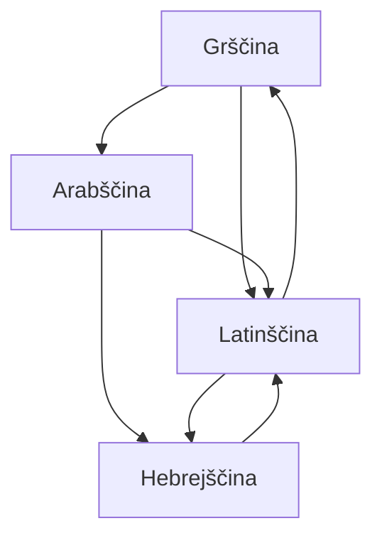

## Odgovor {#answer}

Strokovnjaki danes srednjeveško filozofijo obravnavajo kot eno izročilo v štirih jezikih: latinščini, grščini, arabščini in hebrejščini.[^1]
Štiri veje je povezalo zaporedje prevajalskih gibanj.[^1]
Srednjeveška filozofija je temeljila predvsem na besedilih in komentarjih k njim.[^1]
Med njenimi osrednjimi problemi so bili večnost sveta, Božje predvedenje in človekova svoboda ter univerzalije.[^1][^9]
To je 3. del serije o zgodovini filozofije. Nadaljuje članek [[helenisticna-in-rimska-filozofija]]. Angleška različica: [[medieval-philosophy]].

## Ključni poudarki {#key-insights}

1. V 19. in 20. stoletju je srednjeveška filozofija pomenila predvsem latinsko misel Zahodne Evrope. Danes vključuje tudi grške, arabske in hebrejske pisce.[^1]
2. Boecij je poleg Avguština in Aristotela temeljni filozofski in teološki avtor latinskega izročila.[^2]
3. Avicena je bil najpomembnejši arabski filozof, močno pa je vplival tudi na judovsko in latinsko filozofijo.[^1]
4. Abelard, Duns Skot in Ockham so na problem univerzalij dali tri različne odgovore.[^8][^10][^11]
5. Leibniza je navdihnila Llullova kombinatorna *Ars*, vendar jo je ostro kritiziral.[^15]

## Obdobje in jeziki {#scope}

Večina strokovnjakov se strinja, da obdobje traja vsaj od leta 500 do 1500.[^1]
Nekateri začetek postavljajo prej ali konec pozneje.[^1]
Za latinsko izročilo je leto 1500 tradicionalna in še vedno razširjena končna letnica.[^1]

Diagram kaže glavne smeri prevajanja, ki jih opisuje SEP.
Med 8. in začetkom 10. stoletja so velik del grške znanstvene in filozofske dediščine prevedli v arabščino.[^1]
To delo so pogosto opravljali sirsko govoreči kristjani, prevedli pa so skoraj vsega Aristotela.[^1]

*Slika 1. Smeri prevajanja med štirimi vejami. Arabščina je bila most od grščine do latinščine in hebrejščine. Vir: SEP, Medieval Philosophy.*

## Avguštin in Boecij {#augustine-boethius}

Avguštin (354–430) je najbolj vplival na srednjeveško latinsko filozofijo.[^1]
Po nekaterih kronologijah je tudi utemeljitelj tega izročila.[^1]
Njegovo misel sta deloma oblikovala Plotin in Porfirij, ki ju je bral v latinskem prevodu.[^1]

Boecij se je rodil okoli 475–477 in umrl verjetno leta 526.[^2]
Aristotelova logična dela je prevedel v latinščino ter napisal komentarje in učbenike logike.[^2]
Obtožili so ga izdaje in čarovništva, ga zaprli in verjetno leta 526 usmrtili.[^2]
Pred smrtjo je napisal svoje najbolj priljubljeno delo, *Tolažbo filozofije*.[^2]
Do 11. stoletja je latinski učni načrt logike obsegal nekaj Aristotelovih del s Porfirijem in Boecijem, »staro logiko«.[^1]
Preostala Aristotelova logika, »nova logika«, je postala dostopna do začetka 13. stoletja.[^1]

## Arabska filozofija {#falsafa}

Filozofijo po grškem zgledu v islamskem svetu imenujemo *falsafa*.[^1]

- **Al-Kindi** (okoli 800–870) je bil prvi filozof v arabskem izročilu, ki se je sam imel za filozofa. Delal je s prevajalci Aristotela, novoplatonikov in grških znanstvenikov.[^3]
- **Al-Farabi** je znan kot »drugi učitelj«; prvi je Aristotel.[^4]
- **Avicena** (Ibn Sina, pred 980–1037) je prvi vzrok opredelil kot edino nujno bivajoče. Vse drugo je samo po sebi le mogoče, nujno pa samo po Bogu.[^1]
- **Avicena o spoznanju:** zagovarjal je empirično teorijo spoznanja, po kateri so čuti sredstvo, s katerim duša pridobiva znanje.[^5]
- **Al-Gazali:** njegova *Neskladnost filozofov* je napadla *falsafo*, kot jo je predstavil Avicena.[^1]
- **Tri obtožbe:** al-Gazali je filozofe obtožil krivoverstva le pri treh naukih. To so večnost sveta, Božje vedenje samo o univerzalijah in zanikanje telesnega vstajenja.[^1]
- **Averroes** (Ibn Rušd, 1126–1198) je bil filozof, zdravnik in sodnik v Al Andaluzu.[^6]
- **Averroes o filozofiji:** menil je, da lahko filozofija na mnogih področjih doseže dokazno gotovost in da je Aristotel glavni vodnik.[^6]

## Majmonid {#maimonides}

Majmonid (1138–1204) je največji judovski filozof srednjega veka.[^7]
Almohadi so leta 1148 vdrli v njegovo domače okolje in nemuslimanom dali na izbiro spreobrnjenje, izgnanstvo ali smrt.[^7]
Leta 1166 je prišel v Egipt in se ustalil v Fustatu, delu Kaira.[^7]
Njegov *Vodnik za zbegane* skuša razrešiti spor med verskim in posvetnim znanjem.[^7]
Poudarja meje človeškega spoznanja.[^7]
Tako kot Tomaž Akvinski je menil, da samo z logiko ni mogoče pokazati, ali je bil svet ustvarjen ali je večen.[^7]

## Sholastika {#scholasticism}

Anzelm (1033–1109) je našel nov dokaz za Božji obstoj, ki so ga pozneje imenovali »ontološki dokaz«.[^1]
Peter Abelard (1079–1142) je bil vodilni filozof in teolog 12. stoletja.[^8]
Tomaž Akvinski (okoli 1225–1274) pooseblja sholastično metodo novih univerz.[^13]
Tomaž je menil, da krščanski nauk vsebuje tudi resnice, ki jih lahko spoznamo samo z razodetjem.[^1]
Leta 1277 je pariški škof obsodil mislece na univerzi. Obsodba je deloma zadela tudi pred kratkim umrlega Tomaža.[^1]

## Problem univerzalij {#universals}

SEP problem univerzalij imenuje »zgodovinsko spremenljiv sveženj« metafizičnih, logičnih in spoznavnoteoretskih vprašanj.[^9]

- **Abelard:** nič v svetu ne izpolnjuje meril za univerzalijo. Zato je univerzalnost pomenska lastnost jezika, ne ontološka lastnost sveta.[^8]
- **Duns Skot:** »skupna narava« zunaj duha obstaja samo v posameznih stvareh. Tam jo »tostnost« (*haecceitas*) naredi za posamično.[^10]
- **Ockham:** edine prave univerzalije so pojmi v duhu ter govorjeni ali pisani termini, ki te pojme izražajo.[^11]
- **Ockhamova britev:** univerzalij ni zavrnil na podlagi britve. Menil je, da so realistične teorije njegovega časa naravnost protislovne.[^11]

## Duns Skot in Ockham o Bogu {#scotus-ockham}

Duns Skot (1263/66–1308) je trdil, da je kaj lahko naključno samo, če Bog sam hoče naključno.[^1][^10]
Poudaril je Božjo vsemogočnost in Božjo voljo naredil za tisto, kar določa dobro in zlo.[^1]
Menil je, da nekatere povedke veljajo za Boga in ustvarjena bitja v natanko enakem pomenu (enoznačno).[^10]
Tomaž Akvinski je dopuščal samo analogno predikacijo.[^10]
Ockham (okoli 1287–1347) je pri Božji volji sledil Skotu.[^1][^11]
Namesto Skotove metafizike je uporabil zelo skromno ontologijo, razlike pa je razlagal z duševnim jezikom.[^1]

## Llullova Ars {#llull}

Ramon Llull (1232–1316) je napisal več kot 200 del v katalonščini, arabščini in latinščini.[^12]
Bil je med prvimi avtorji, ki so za svojo misel uporabili svoj ljudski jezik, katalonščino.[^12]
SEP njegovo *Ars Magna* opiše kot kombinatorni logični sistem za odkrivanje resnice.[^12]
Llull jo je zamislil kot orodje za medverski dialog, s katerim bi spreobračal nekristjane (»nevernike«).[^12]
*Ars* temelji na Božjih »Dostojanstvih«, kot sta dobrota in veličina.[^12]

Povezava med Llullom in Leibnizem izhaja iz Leibniza in poznejših bralcev, ne iz Llulla:

- Couturat poroča, da je Leibniza navdihnil Llullov zgled, a da je bil do *Ars magna* zelo kritičen.[^15]
- V pismu iz julija 1714 se je Leibniz spominjal, da ga je Llullova umetnost v mladosti veselila, a da je v njej našel napake.[^15]
- V 19. stoletju je Trendelenburg »ars magna Raymunda Lulla« navedel kot predhodnico Leibnizeve univerzalne karakteristike.[^14]
- Geslo o Llullu v SEP *Ars* ne imenuje stroja ali predhodnice računalništva.[^12]

## Poznejši vpliv {#thread}

Vsaka točka spodaj povezuje misel iz tega članka s poznejšo temo. Te povezave niso iz virov (sklepanje).

- **Logika:** Llullovo kombiniranje pojmov po pravilih so pozneje brali kot predhodnico Leibnizevega programa.[^14] 4. del to branje preizkusi (sklepanje).
- **Duh:** Abelard je sklenil, da je intencionalnost prvotna lastnost duha.[^8] Poznejše razprave sprašujejo, kaj so pojmi in ali je duh mogoče mehanizirati (sklepanje).
- **Etika:** za Abelarda moralno vrednost dejanja določa samo namen delujočega.[^8] Poznejša etika sprašuje, ali je moralnost v namenu, posledicah ali zapovedi (sklepanje).

## Ključne trditve {#key-claims}

- SEP srednjeveško filozofijo obravnava kot latinsko, grško, arabsko in hebrejsko vejo enega izročila.[^1]
- Boecij je Aristotelova logična dela prevedel v latinščino.[^2]
- Al-Kindi je bil prvi filozof v arabskem izročilu, ki se je sam imel za filozofa.[^3]
- Al-Farabi je znan kot »drugi učitelj« za Aristotelom.[^4]
- Avicena je prvi vzrok opredelil kot edino nujno bivajoče.[^1]
- Averroes je menil, da lahko filozofija na mnogih področjih doseže dokazno gotovost.[^6]
- Majmonid je menil, da samo z logiko ni mogoče pokazati, ali je svet ustvarjen ali večen.[^7]
- Abelard je menil, da je univerzalnost pomenska, ne ontološka lastnost.[^8]
- Ockham je menil, da so edine univerzalije pojmi in termini, ki jih izražajo.[^11]
- Llullova *Ars Magna* je kombinatorni logični sistem. Povezava z Leibnizem izhaja iz Leibniza in poznejših razlagalcev.[^12][^14][^15]

## Kviz {#quiz}

Kviz za ta članek je v datoteki `quizzes/srednjeveska-filozofija.yaml`.
Spletno mesto ga prikaže na strani s kvizom za ta članek.

## Odprta vprašanja {#open-questions}

- Strokovnjaki se še vedno ne strinjajo, kdaj se srednjeveška filozofija začne in kdaj konča.[^1]
- Viri Llulla datirajo različno: SEP navaja 1232–1316, Couturat pa 1234–1315.[^12][^15]

## Viri {#sources}

Viri so navedeni v polju `sources` v glavi datoteke. V besedilu so citirani kot opombe.
