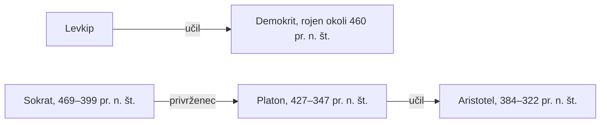

## Odgovor {#answer}

Grška filozofija se je začela s predsokratiki, misleci 6. in 5. stoletja pr. n. št.[^1]
V poznejši antiki so jih imeli za prve filozofe in znanstvenike zahodne tradicije.[^1]
S sofisti in Sokratom sta etika in politična misel postali pomembnejši.[^1]
Platon je pokazal, da resnično mnenje ni dovolj za znanje, Aristotel pa je napisal najstarejšo ohranjeno formalno logiko.[^13][^16]
To je 1. del serije o zgodovini filozofije. Angleška različica: [[ancient-greek-philosophy]].

## Ključni poudarki {#key-insights}

1. Skoraj vse, kar vemo o predsokratikih, izhaja iz navedkov (fragmentov) in poročil (pričevanj) pri poznejših avtorjih.[^1]
2. Predsokratska misel se od starejše grške misli razlikuje po tem, kako razlaga svet. Strokovnjaki se ne strinjajo, kako velika je ta razlika.[^1]
3. Platon v *Teajtetu* loči znanje od resničnega mnenja. Sodobni pogoj »upravičenosti« pogosto izpeljujejo iz tega mesta.[^15]
4. Aristotelova logična dela so najstarejša ohranjena formalna obravnava logike.[^16]
5. Platon in Aristotel sta na Zahodu utemeljitelja etike vrlin. Danes je to eden od treh glavnih pristopov v normativni etiki.[^19]

## Časovnica in učitelji {#timeline}

Misleci iz tega članka so živeli v obdobju približno 300 let:

- Tales: okoli 620 – okoli 546 pr. n. št.[^2]
- Anaksimander: okoli 610–546 pr. n. št.[^3]
- Pitagora: okoli 570 – okoli 490 pr. n. št.[^6]
- Heraklit: deloval okoli leta 500 pr. n. št.[^4]
- Parmenid: deloval v prvi polovici 5. stoletja pr. n. št.[^5]
- Protagora: okoli 490–420 pr. n. št.[^10]
- Sokrat: 469–399 pr. n. št.[^11]
- Demokrit: rojen okoli leta 460 pr. n. št.[^7]
- Platon: 427–347 pr. n. št.[^6]
- Aristotel: 384–322 pr. n. št.[^6]

Diagram kaže dve zaporedji učiteljev in učencev.
Levkip je bil Demokritov učitelj.[^7]
Platon je bil Sokratov privrženec, Aristotel pa Platonov najslavnejši učenec.[^12]

*Slika 1. Dve zaporedji učiteljev in učencev. Zaporedje od Sokrata do Aristotela povezuje tri generacije atenske filozofije. Vira: SEP, IEP.*

## Predsokratiki {#presocratics}

Večina predsokratikov je napisala vsaj eno knjigo, v prozi ali v verzih, vendar se nobeno delo ni ohranilo v celoti.[^1]
Zanašamo se na poznejše filozofe, zgodovinarje in zbiralce, ki so ohranili fragmente in pričevanja.[^1]
Preglednica kaže ustaljeno sliko. Strokovnjaki o mnogih podrobnostih razpravljajo.

| Mislec | Vprašanje | Osrednja misel, kot jo poročajo viri | Opomba |
|---|---|---|---|
| Tales (Milet) | Kaj je izvor stvari? | Aristotel poroča, da je Tales za *arhé* (počelo, iz katerega vse izhaja) imel vodo.[^2] | Aristotel ga je imenoval utemeljitelja filozofije narave.[^2] |
| Anaksimander (Milet) | Kaj je izvor stvari? | »Neomejeno« (*apeiron*).[^3] | Že v antiki so mu očitali, da ni pojasnil, kaj s tem misli.[^3] |
| Heraklit (Efez) | Kako je urejen svet? | Nenehno spreminjanje, enotnost nasprotij in ogenj kot osnovna snov.[^4] | Pisal je v ugankah, razlaga teh naukov pa je sporna.[^4] |
| Parmenid (Elea) | Ali lahko bivajoče nastane ali se spremeni? | Bivajoče je nenastalo, nesmrtno in negibno.[^5] | Branje »strogega monizma« (obstaja natanko ena stvar) je manj pogosto kot nekoč.[^5] |
| Pitagora (Samos, nato Kroton) | Kaj se zgodi z dušo? Kako naj človek živi? | Preseljevanje duš, verski obredi in strog način življenja.[^6] | Ničesar ni napisal. Sporno je, ali se je ukvarjal s kozmologijo ali matematiko.[^6] |
| Demokrit (Abdera) | Iz česa so stvari? | Nedeljivi atomi, ki se gibljejo v neskončni praznini. Ta nauk je začel njegov učitelj Levkip.[^7] | Bil je mlajši Sokratov sodobnik, vendar ga strokovnjaki uvrščajo med predsokratske atomiste.[^7][^1] |

## Sofisti in Sokrat {#sophists-socrates}

Sofisti so bili potujoči poklicni učitelji v drugi polovici 5. stoletja pr. n. št.[^9]
Mlade moške so za plačilo učili *areté* (vrlino ali odličnost).[^9]
V demokratičnih Atenah je *areté* vse bolj pomenila sposobnost prepričati sodržavljane na političnih zborovanjih.[^9]
Protagora (okoli 490–420 pr. n. št.) je bil eden najpomembnejših sofistov.[^10]
Učil je predvsem tehnike argumentacije.[^10]

Osrednja razprava tega obdobja je zadevala *nomos* in *physis*.[^8]
*Nomos* pomeni zakon ali dogovor, *physis* pa naravo.[^8]
Vprašanje je bilo, ali moralne in družbene norme temeljijo na naravi ali le na dogovoru.[^8]

Sokrat ni ničesar napisal. Vse, kar vemo o njem, vemo iz druge roke, in večina tega je sporna.[^11]
Njegovi trije glavni viri so Aristofan, Ksenofont in Platon.[^11]
Nalogo, da v teh virih najdemo zgodovinskega Sokrata, imenujemo »sokratski problem«.[^11]

Sokrat je filozofiral z vprašanji in odgovori.[^12]
Pri *elenhosu* (navzkrižnem izpraševanju) je preizkusil stališče ali opredelitev in jo ovrgel.[^12]
Strokovnjaki razpravljajo, kaj elenhos ovrže in ali lahko sploh kaj dokaže.[^12]
Sokrat za razliko od sofistov ni zahteval plačila.[^9]
Kljub temu ga sodobniki niso vedno ločili od njih.[^9]

## Platon o znanju {#plato}

*Teajtet* preizkusi tri opredelitve znanja:[^13]

1. Znanje je zaznava.
2. Znanje je resnično mnenje.
3. Znanje je resnično mnenje z razlago (*logos*).

Odlomek o sodišču (201a–c) govori proti drugi opredelitvi.[^13]
Če govornik s sofistiko porotnike prepriča o nečem resničnem, imajo porotniki resnično mnenje.[^15]
To mnenje je preslabo utemeljeno, da bi bilo znanje.[^15]
Dialog se konča brez izhoda, ne da bi sprejel kakšno opredelitev.[^13]

*Menon* daje drugačno sliko.[^14]
Tam je znanje resnično mnenje, »privezano« z razlago (*aitias logismos*, 98a).[^14]
To je morda prvi poskus, da bi znanje opredelili kot upravičeno resnično prepričanje.[^14]
V *Državi* iz srednjega obdobja Platon, kot kaže, dopušča znanje samo o idejah.[^14]
Po tem pojmovanju znanje ne more biti nobena vrsta upravičenega resničnega prepričanja.[^14]

Izrecna analiza znanja kot »upravičenega resničnega prepričanja« je iz 20. stoletja.[^15]
Edmund Gettier jo je izrecno zapisal v članku iz leta 1963.[^15]

## Aristotel {#aristotle}

Aristotel se je rodil leta 384 pr. n. št., 15 let po Sokratovi smrti.[^12]
Na Platonovi Akademiji je študiral 20 let.[^12]

### Logika {#aristotle-logic}

- **Sklep:** za Aristotela je sklep (dedukcija) argument, v katerem nekaj predpostavimo in iz tega po nujnosti sledi nekaj drugega (*Prva analitika* I.2, 24b18–20).[^16]
- **Logika terminov:** njegova silogistika obravnava logična razmerja med termini, na primer »človek« in »žival«.[^17]
- **Nova veda:** logika kot popolnoma sistematična veda se začne z Aristotelom.[^17]
- **Modalna silogistika:** teorijo je razširil na premise z »nujno« in »mogoče«. Ta del je veliko težje razložiti.[^16]
- **Vpliv:** v helenističnem obdobju je prevladovala stoiška logika. V pozni antiki je prevladala Aristotelova logika.[^16]
- **Ugled:** Kant je menil, da Aristotelovi logiki v dveh tisočletjih niso dodali nič pomembnega.[^16]

### Etika {#aristotle-ethics}

- **Srečnost:** najvišje človeško dobro je *evdajmonija* (sreča ali dobro življenje).[^18]
- **Funkcija:** Aristotel trdi, da je človekova funkcija (*ergon*) dejavnost razumnega dela duše v skladu z vrlino (1097b22–1098a20).[^18]
- **Sredina:** etična vrlina je stanje med presežkom in pomanjkanjem. Sredina je odvisna od okoliščin, zato ni splošnega pravila.[^18]
- **Praktična modrost:** nižja oblika vrline se razvije v otroštvu z vajo. Etična vrlina je popolnoma razvita šele skupaj s praktično modrostjo (*phronesis*, 1144b14–17).[^18]
- **Ugovor:** kritiki pravijo, da »iskanje sredine« ne opiše dobro mnogih resničnih odločitev.[^18]

## Poznejši vpliv {#thread}

Vsaka točka spodaj povezuje misel iz tega članka s poznejšo temo. Te povezave niso iz virov (sklepanje).

- **Logika:** Aristotelova logika terminov ima skupne prvine s teorijo množic in s predikatno logiko.[^17] Sodobna logika sega veliko dlje (sklepanje).
- **Znanje:** sistem lahko da pravilen odgovor iz slabih razlogov. Platonova [[starogrska-filozofija#plato|razlika med resničnim mnenjem in znanjem]] velja tudi za take primere (sklepanje).[^15]
- **Etika:** etika vrlin poudarja značaj, v nasprotju s pravili ali posledicami.[^19] Ali je primerna za umetno inteligenco, obravnava poznejši del (sklepanje).
- **Duh:** Demokritov atomizem je bil najvplivnejša antična materialistična razlaga narave, ki se ni opirala na namen.[^7] Poznejše razprave o razmerju med duhom in telesom se vračajo k takim razlagam (sklepanje).

## Ključne trditve {#key-claims}

- Predsokratiki so bili misleci 6. in 5. stoletja pr. n. št., ki so jih v antiki imeli za prve zahodne filozofe in znanstvenike.[^1]
- Nobeno predsokratsko delo se ni ohranilo v celoti. Dokazi so fragmenti in pričevanja.[^1]
- Aristotel poroča, da je Tales za počelo imel vodo.[^2]
- Anaksimandrovo počelo je bil *apeiron*, »Neomejeno«.[^3]
- Razlaga Heraklitovega nenehnega spreminjanja, enotnosti nasprotij in ognja je sporna.[^4]
- Branje Parmenida kot strogega monista je manj pogosto kot nekoč.[^5]
- Pitagora ni ničesar napisal, in sporno je, ali je bil matematik.[^6]
- Demokrit je po Levkipu učil, da se atomi gibljejo v neskončni praznini.[^7]
- Sofisti so bili potujoči učitelji, ki so za plačilo učili *areté*.[^9]
- Protagora je živel okoli 490–420 pr. n. št.[^10]
- Sokrat (469–399 pr. n. št.) ni ničesar napisal. Njegovi glavni viri so Aristofan, Ksenofont in Platon.[^11]
- Elenhos je navzkrižno izpraševanje, v katerem Sokrat ovrže stališče ali opredelitev.[^12]
- *Teajtet* preuči tri opredelitve znanja in ne sprejme nobene.[^13]
- *Menon* (98a) opiše znanje kot resnično mnenje, privezano z razlago.[^14]
- Aristotelova logična dela so najstarejša ohranjena formalna obravnava logike.[^16]
- Za Aristotela je etična vrlina popolnoma razvita šele skupaj s praktično modrostjo.[^18]
- Etika vrlin je eden od treh glavnih pristopov v normativni etiki.[^19]

## Kviz {#quiz}

Kviz za ta članek je v datoteki `quizzes/starogrska-filozofija.yaml`.
Spletno mesto ga prikaže na strani s kvizom za ta članek.

## Odprta vprašanja {#open-questions}

- Strokovnjaki se ne strinjajo, koliko se prvi grški filozofi razlikujejo od svojih nefilozofskih predhodnikov.[^1]
- Strokovnjaki razpravljajo, ali lahko Sokratov elenhos sploh kaj dokaže.[^12]
- Razlagalci so predlagali zelo različne rekonstrukcije Aristotelove modalne silogistike.[^16]

## Viri {#sources}

Viri so navedeni v polju `sources` v glavi datoteke. V besedilu so citirani kot opombe.
