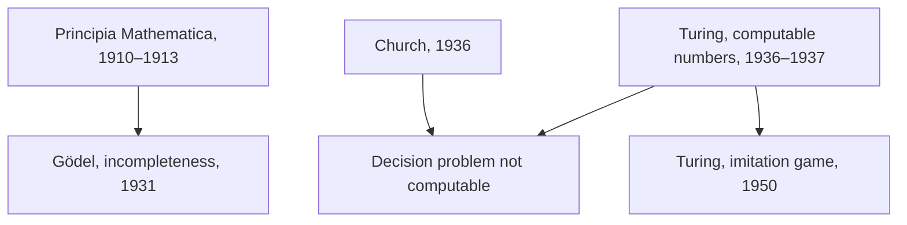

## Answer {#answer}

Twentieth-century logicians built the formal tools behind modern computing.[^1]
Gödel and Turing then proved limits on what formal proof and mechanical procedure can do.[^5][^6]
Phenomenology and existentialism studied experience, practical involvement in the world and situated freedom.[^10][^11][^12][^13]
Popper, Kuhn and Quine rethought how scientific knowledge is tested and how it changes.[^14][^15][^16]
Rawls asked what makes institutions fair.[^17]
Wiener and Jonas argued that powerful technology creates new responsibilities.[^21][^22]
This is part 7 of the series on the history of philosophy. It follows [[nineteenth-century-philosophy]]. Slovenian version: [[filozofija-20-stoletja]].

## Key insights {#key-insights}

1. *Principia Mathematica* defended logicism, but three of its axioms were "arguably non-logical in character".[^1]
2. Gödel limited what formal systems can prove, and Turing limited what computation can decide.[^5][^6]
3. SEP reports "wide consensus" that arguments from Gödel to the claim that minds are not machines fail.[^5]
4. Later Wittgenstein tied meaning to use. Husserl and Heidegger described experience and practical involvement before theory.[^2][^10][^11]
5. Wiener warned in 1960 that human criticism of fast machines "may be ineffective until long after it is relevant".[^21]

## Logic and its limits {#logic-limits}

The diagram shows how the formal results of this part connect.

*Figure 1. Formal limits and the imitation game. Sources: SEP.*

Gödel's original theorem was proved for a variant of the system of *Principia*.[^5]
Church reached the same result as Turing independently, with a different formal device.[^7]

## Russell, Wittgenstein and the Vienna Circle {#analytic}

Alfred North Whitehead and Bertrand Russell published *Principia Mathematica* in 1910–1913.[^1]
It defended logicism, the thesis that mathematics is in some significant sense reducible to logic.[^1]
To avoid Russell's paradox, it used what is now called "the ramified theory of types".[^1]
Its axioms of infinity, reducibility and choice were arguably not logical.[^1]

Ludwig Wittgenstein's *Tractatus* appeared in German in 1921 and in English in 1922.[^2]
It treats a proposition as a picture: "the picture is a model of reality".[^2]
His *Philosophical Investigations* appeared after his death, in 1953.[^2]
There he wrote that, "for a large class of cases", the meaning of a word is its use in the language.[^2]
Recent scholarship questions the old sharp division between the early and the later work.[^2]

The Vienna Circle met under Moritz Schlick from 1924 to 1936.[^3]
It held that statements outside logic and mathematics are meaningful only if they can be tested by experience.[^3]
How to formulate this criterion was "problematical and much debated". By 1931 a "liberalization of empiricism" was under way.[^3]
Schlick was murdered in 1936, and many members emigrated.[^3]

## Gödel and Turing {#goedel-turing}

Kurt Gödel proved the completeness theorem for first-order logic in his 1929 dissertation, published in 1930.[^4]
His incompleteness theorems followed in 1931.[^4][^5]
The first theorem says that any consistent formal system with enough arithmetic has statements it can neither prove nor disprove.[^5]
The second says that such a system cannot prove its own consistency.[^5]
Gentzen proved the consistency of Peano arithmetic, but only by assuming a principle that arithmetic itself cannot prove.[^5]
Lucas (1961) argued from Gödel that minds are not machines. SEP reports "wide consensus" that such arguments fail.[^5]

Alan Turing learned of Gödel's results from Max Newman's lectures in 1935.[^6]
His paper "On computable numbers" (1936–37) gave "a definition of computation and an absolute limitation on what computation could achieve".[^6]
A universal Turing machine can imitate any other Turing machine, given its description as input.[^7]
Turing used his machines to show that the decision problem for first-order logic is not computable.[^7]
The Church–Turing thesis concerns the informal idea of an "effective method". It says such a method can be carried out by a Turing machine.[^8]

### The imitation game {#turing}

In 1950 Turing called the question "Can machines think?" "too meaningless" to deserve discussion.[^9]
He replaced it with whether a digital computer can do well in an imitation game.[^9]
His argument was designed to bypass questions about thought and consciousness and to rely on external observation.[^6]
He also proposed "learning machines" and nets of logical components ("unorganised machines") that could be trained.[^6]
He answered nine objections, including "Lady Lovelace's Objection" (see [[nineteenth-century-philosophy#originality]]).[^9]

## Phenomenology and existentialism {#phenomenology}

Edmund Husserl called his *Logical Investigations* (1900–1901) his "breakthrough" to phenomenology.[^10]
He is known for analyses of intentionality, perception, time, embodiment and the lifeworld.[^10]
The *epoché* aims "to suspend or neutralize a certain dogmatic attitude towards reality", not to doubt reality.[^10]

Martin Heidegger's main work is *Being and Time* (1927).[^11]
He saw human beings as beings-in-the-world, shaped by practical and social contexts.[^11]
In the technological age, he argued, entities appear as *Bestand*, a "stock" of replaceable items.[^11]
He called this mode of revealing "the supreme danger" to humanity.[^11]
Heidegger joined the Nazi Party on 1 May 1933 and stayed a member until the regime ended.[^11]
What this and his anti-Semitism mean for his philosophy "is hotly disputed".[^11]

Jean-Paul Sartre published *Being and Nothingness* in 1943.[^12]
For Sartre we are not free to do just anything: the for-itself "is always in a factical situation".[^12]
In bad faith, a café waiter plays at being a waiter, as if the role were his fixed being.[^12]
Simone de Beauvoir's *The Ethics of Ambiguity* (1947) argues that I cannot live my freedom without affirming the freedom of others.[^13]
*The Second Sex* (1949) is her best-known work.[^13]

## Popper, Kuhn and Quine {#science}

For Karl Popper, a theory is scientific if it can be falsified. He separated the logic of falsifiability from its applied method.[^14]
Thomas Kuhn's *The Structure of Scientific Revolutions* (1962) is one of the most cited academic books of all time.[^15]
Kuhn described normal science within a paradigm, interrupted by revolutions.[^15]
He "stressed that incommensurability did not mean non-comparability".[^15]
The Kuhn entry says Popper needs only "a single reproducible, anomalous phenomenon" to reject a theory. The Popper entry stresses his methodological caveats.[^14][^15]

W. V. O. Quine argued that most sentences have no implications for experience when "taken one-by-one".[^16]
For him, "no statement is immune to revision".[^16]
He rejected any "First Philosophy" outside science.[^16]

## Rawls {#rawls}

John Rawls set out justice as fairness in *A Theory of Justice* (1971) and kept reworking it.[^17]
In the original position, a veil of ignorance hides facts such as race, class and gender from those who choose principles.[^17]
The first principle secures equal basic liberties.[^17]
The second requires fair equality of opportunity. Under the difference principle, inequalities must also be "to the greatest benefit of the least-advantaged".[^17]

## Wiener and Jonas {#wiener}

In 1943 Norbert Wiener and colleagues explained goal-directed behaviour in organisms and machines through negative feedback.[^18]
SEP's former entry on computer ethics calls Wiener the founder of the field.[^20]
He worked "to prevent massive unemployment caused by robotic factories".[^20]
He saw that machines could act on information "without any direct input from a human agent".[^19]

In *Science* (1960), Wiener wrote that learning machines "may develop unforeseen strategies at rates that baffle their programmers".[^21]
He reported that checkers machines could beat the people who programmed them after 10 to 20 hours of play.[^21]
Machines are "theoretically subject to human criticism", but criticism may come too late.[^21]
If we cannot step in, "we had better be quite sure that the purpose put into the machine is the purpose which we really desire".[^21]

### Jonas {#jonas}

Hans Jonas published *Das Prinzip Verantwortung* in 1979, and the English version in 1984.[^22]
He argued that technology needs an ethics with responsibility at its centre, for two reasons.[^22]
First, technology now lets humanity destroy the earth and itself. Second, social and political forces drive it.[^22]
His publisher describes an ethics of "man's duties toward himself, his posterity, and the environment".[^24]
SEP cites his "heuristics of fear" in debates about uncertain futures.[^25]
Jonas is still cited for the view that technology complicates how we ascribe moral responsibility.[^23]

## Later influence {#thread}

Each point below links an idea from this article to a later topic. The links are our own reasoning (inferred).

- **Mind:** Turing's test, Wittgenstein on use and the phenomenologists on experience give rival starting points for asking what intelligence requires (inferred).[^2][^9][^10]
- **Ethics:** Rawls on fair institutions, Wiener on purposes and Jonas on future responsibility set up AI ethics (inferred).[^17][^21][^22]

## Key claims {#key-claims}

- *Principia Mathematica* (1910–1913) defended logicism but used arguably non-logical axioms.[^1]
- Later Wittgenstein explained meaning as use "for a large class of cases", not all.[^2]
- Gödel's first theorem applies to consistent formal systems with enough arithmetic.[^5]
- Turing (1936–37) showed that the decision problem is not computable, and Church did so independently.[^6][^7]
- Heidegger called technological revealing "the supreme danger".[^11]
- Kuhn held that incommensurability is not non-comparability.[^15]
- Wiener (1960) warned that human criticism of fast machines may come too late.[^21]

## Quiz {#quiz}

The quiz for this article is in `quizzes/twentieth-century-philosophy.yaml`.
The site shows it on the quiz page for this article.

## Open questions {#open-questions}

- Do Gödel's theorems say anything about minds? SEP reports wide consensus against the anti-mechanist arguments.[^5]
- How strict was Popper's falsificationism? The SEP entries on Kuhn and Popper stress different sides.[^14][^15]
- How should responsibility be divided when technology spreads action across people and machines?[^23]

## Sources {#sources}

The sources are listed in the frontmatter field `sources`. The text cites them as footnotes.
