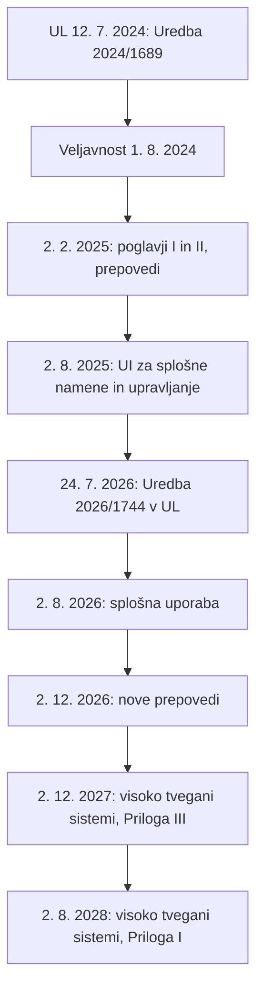

# Umetna inteligenca in etika

## Odgovor {#answer}

Etika umetne inteligence (UI) sprašuje, kako naj se gradijo, uporabljajo in urejajo sistemi, ki razvrščajo, napovedujejo, nadzirajo in delujejo. SEP jo imenuje zelo mlada disciplina. Prvi članki o strojni etiki so izšli v zgodnjih 2000-ih, prva konferenca o etiki UI pa je bila leta 2012.[^1] Klasične teorije poudarijo različne vidike odločitve: značaj, spoštovanje oseb, posledice in pravične ustanove.[^3][^4][^5][^6] Glavne razprave zadevajo pristranskost, neprosojnost, zasebnost, odgovornost, moralni status, usklajevanje, tveganje in delo.[^1][^2] Na dan 18. 10. 2026 je akt EU o umetni inteligenci zavezujoče pravo, kot je bil spremenjen julija 2026, besedili OECD in Unesca pa sta priporočili.[^13][^14][^17][^18]

To je 9. del serije o zgodovini filozofije. Nadaljuje članek [[filozofija-uma-in-tehnologija]]. Angleška različica: [[ai-and-ethics]].

## Ključni poudarki {#key-insights}

- Štiri klasične tradicije niso zamenljivi recepti. Vsaka o isti odločitvi UI postavi drugo vprašanje (sklepanje).[^3][^4][^5][^6]
- Statistična merila pravičnosti si lahko nasprotujejo. Razen v zelo nenavadnih okoliščinah dveh skupin ni mogoče hkrati enako obravnavati po obeh merilih iz razprave o COMPAS.[^7]
- Vrzeli v odgovornosti nastanejo, ko noben človek v celoti ne nadzoruje, kaj sistem počne. Filozofi se ne strinjajo, kako resnične so.[^1][^9]
- Usklajevanje ni le tehnični, temveč tudi normativni problem: čigavim vrednotam naj sistem sledi?[^1][^11]
- SEP svari pred tem, da bi etiko UI obravnavali le kot tveganje, saj so nekatere škode že dejanske.[^1]

## Štiri tradicije, štiri vprašanja {#traditions}

Vzemimo hipotetični sistem, ki razvršča kandidate za zaposlitev. Vprašanja v seznamu so naša ponazoritev (sklepanje).

- **Etika vrlin** uporablja tri grške pojme: *arete* (vrlina), *phronesis* (praktična modrost) in *eudaimonia* (razcvet).[^3] Ali ljudje, ki sistem gradijo in uporabljajo, kažejo praktično presojo? Glej [[starogrska-filozofija#aristotle-ethics]].
- **Kantova formula človeštva** pravi, naj človeštva nikoli ne obravnavamo »le kot sredstvo, temveč vedno tudi kot cilj sam na sebi«.[^4] SEP piše, naj UI ne uporabljamo, da bi »zavajali potrošnike, manipulirali volivce, izkoriščali ranljive skupine ali ubijali nedolžne«.[^4] Glej [[razsvetljenska-filozofija#kant]].
- **Konsekvencializem** trdi, da so »normativne lastnosti odvisne le od posledic«.[^5] Kakšne so koristi in škode za vse prizadete? Glej [[razsvetljenska-filozofija#smith-bentham]].
- **Rawls:** tančica nevednosti »preprečuje, da bi naključna dejstva o državljanih vplivala na dogovor«.[^6] Bi sprejeli pravila, če ne bi vedeli, ali boste sistem imeli v lasti ali vas bo presojal? Glej [[filozofija-20-stoletja#rawls]].

## Strojna etika {#machine-ethics}

- IEP ima Asimove tri zakone robotike iz zgodbe »Runaround« (1942) za prvi etični kodeks za UI. Po prevladujočem mnenju so pomembni, a ne zadostujejo.[^2]
- IEP navaja pristope od spodaj navzgor, od zgoraj navzdol in hibridne pristope k vgrajevanju etike v stroje.[^2]
- Moor razlikuje vrste strojnih agentov. Zanj je »povprečen odrasel človek polni etični agent«, ki zna izrecne etične sodbe sprejeti in utemeljiti.[^1]

## Pristranskost, neprosojnost in zasebnost {#fairness}

- **Povratne zanke:** v primeru napovednega policijskega dela pri IEP (O'Neil 2016) več policije na območju pomeni več prijavljenih kaznivih dejanj, kar napoved navidezno potrdi.[^2]
- **COMPAS:** po kritiki ProPublice so računalnikarji pokazali, da dveh pogostih meril pravičnosti na splošno ni mogoče izpolniti hkrati (Kleinberg idr. 2016; Chouldechova 2016).[^7] Green in Hu svarita, da je razglašati to za nemožnost pravičnosti nasploh »zamenjati zemljevid za ozemlje«.[^7]
- **Neprosojnost:** IEP kot vire neprosojnosti navaja poslovno skrivnost, pomanjkanje javnega strokovnega znanja in sisteme »črne skrinjice«. Protidejstvene razlage pokažejo, katera dejstva bi morala biti drugačna za drugo odločitev.[^2]
- **Zasebnost:** SEP navaja Schneierja: »nadzor je poslovni model interneta«.[^1] Nissenbaumova »kontekstualna celovitost« presoja tokove informacij po normah posameznega družbenega konteksta.[^8]

## Odgovornost in avtonomno orožje {#responsibility}

- **Matthias (2004):** bolj ko so sistemi zapleteni in manj neposredno nadzorovani, težje ljudem pripišemo odgovornost. To imenuje »vrzel v odgovornosti«.[^9]
- **Sparrow (2007):** pri avtonomnem orožju »morda ni odgovoren ne človek ne stroj«.[^1]
- **Odgovori:** ljudi ohraniti »v zanki« ali pod »smiselnim nadzorom« (Santoni de Sio in van den Hoven 2018). Skeptiki dvomijo, da vrzeli res obstajajo.[^1]
- SEP regulativno ocenjuje, da se »popolna prepoved zdaj zdi nerealna«.[^1] Akt o UI izključuje sisteme, ki se uporabljajo »izključno za vojaške, obrambne ali nacionalne varnostne namene« (člen 2(3)).[^13]
- Unesco: pri nepovratnih odločitvah ali odločitvah o življenju in smrti naj velja »končna človeška odločitev«.[^18]

## Moralni status in usklajevanje {#moral-status}

- **Čutenje:** SEP poroča o pomislekih glede ustvarjanja zavestne UI, saj bi lahko trpela. Nekateri avtorji zahtevajo »moratorij na sintetično fenomenologijo« (Metzinger 2021).[^1] Glej [[filozofija-uma-in-tehnologija#llms]].
- **Relacijski obrat:** Coeckelbergh in Gunkel sprašujeta, ali je naš odnos do robotov pomembnejši od tega, kaj »v resnici« so.[^2]
- **Wiener (1960):** stroj lahko deluje prehitro, da bi posegli vanj. Tedaj moramo biti »povsem prepričani, da je namen, vložen v stroj, tisti, ki si ga res želimo«.[^10] Glej [[filozofija-20-stoletja#wiener]].
- **Russell (2019)** po Sutropovi predlaga tri načela:[^11]
  1. Edini cilj stroja je čim bolj uresničiti človeške preference.
  2. Stroj na začetku ne ve zanesljivo, kakšne so te preference.
  3. Končni vir informacij o človeških preferencah je človeško vedenje.
- Sutropova loči tehnični izziv kodiranja vrednot od normativnega izziva izbire, čigave vrednote. Meni, da razvijalci drugega podcenjujejo.[^11]

## Tveganje in delo {#x-risk}

- **Eksistencialno tveganje:** klasični argument pravi, da lahko UI doseže superinteligenco in da to prinaša možnost katastrofe (Bostrom 2014).[^1] SEP piše, da »ostaja odprto vprašanje, ali je UI na poti do splošne inteligence«.[^1]
- SEP opozarja, da se taki argumenti pogosto opirajo na »fanatizem«, pri katerem majhna možnost ogromnega izida pretehta zanesljive dobrine.[^1]
- SEP od etike UI pričakuje »pozitivno vizijo prihodnosti, vredne želje«.[^1]
- **Delo (po SEP, podatki za 2025):** vpliv UI na trg dela je zdaj »jasno viden«. Naložbe v UI so leta 2025 znašale okoli 0,5 bilijona USD.[^1] SEP za zdajšnje neto ustvarjanje delovnih mest navaja Svetovni gospodarski forum (2025), »a obstajajo znaki, da se bo to spremenilo«.[^1]
- **OECD:** vlade naj zagotovijo »pravičen prehod za delavce« in da se koristi UI »široko in pravično delijo«.[^17]

## Upravljanje na dan 18. 10. 2026 {#governance}

Diagram prikazuje datume uporabe akta o UI po členu 113, kot ga je spremenila Uredba (EU) 2026/1744.[^13][^14]

### Akt EU o umetni inteligenci {#eu-ai-act}

- **Uredba (EU) 2024/1689** (CELEX 32024R1689) nosi datum 13. junij 2024, ko je bila podpisana. V Uradnem listu je bila objavljena 12. julija 2024.[^12] Veljati je začela 1. avgusta 2024, dvajset dni po objavi.[^12][^16]
- **Uredba (EU) 2026/1744**, digitalni omnibus o UI (CELEX 32026R1744), je bila podpisana 8. julija 2026. Objavljena je bila 24. julija 2026 in je začela veljati tri dni pozneje.[^14]
- **Postopek:** Komisija jo je predlagala 19. novembra 2025 (COM(2025) 836). Parlament je stališče sprejel 16. junija 2026, Svet pa 29. junija 2026.[^15][^14]
- **Prepovedi** med drugim zajemajo škodljivo manipulacijo, družbeno točkovanje, neciljno zbiranje podob obrazov in prepoznavanje čustev na delovnem mestu in v izobraževanju.[^16]
- **Nova prepoved iz leta 2026:** UI, ki ustvarja intimne podobe brez privolitve, na primer aplikacije za »slačenje« (nudification), ali gradivo o spolni zlorabi otrok. Uporablja se od 2. decembra 2026.[^16][^13]
- **Druge spremembe:** novi člen 4a daje pravno podlago za obdelavo posebnih vrst osebnih podatkov za odkrivanje pristranskosti. Poenostavitve veljajo tudi za mala podjetja s srednje veliko tržno kapitalizacijo.[^14][^16]
- Člen 2(7) ohranja veljavnost GDPR in drugega prava EU o varstvu podatkov, ob upoštevanju členov 4a in 59.[^13]

### OECD in Unesco {#oecd-unesco}

- **OECD:** priporočilo je bilo sprejeto 22. maja 2019. Revidirano je bilo 8. novembra 2023 (opredelitev sistema UI) in 3. maja 2024.[^17]
- **Unesco:** priporočilo je bilo sprejeto 23. novembra 2021. Države članice ga uporabljajo »prostovoljno«.[^18] Pravi, da se UI »ne bi smela uporabljati za družbeno točkovanje ali množični nadzor«.[^18]

## Poznejši vpliv {#thread}

Vsaka točka spodaj povezuje misel iz tega članka s poznejšo temo. Te povezave niso iz virov (sklepanje).

- **Nazaj na začetek:** etika vrlin še vedno uporablja Aristotelove pojme, zato se serija konča tam, kjer se je začel 1. del.[^3]
- **Pravo in filozofija:** akt o UI prejšnje razprave o dostojanstvu, pravičnosti in nadzoru spreminja v pravne obveznosti.[^13]
- **Odprta prihodnost:** zgornji datumi se bodo spreminjali, zato ima ta članek zgodnji datum pregleda.[^14]

## Ključne trditve {#key-claims}

- Etika vrlin temelji na pojmih *arete*, *phronesis* in *eudaimonia*.[^3]
- SEP Kantovo formulo človeštva uporabi proti manipulativni in zavajajoči UI.[^4]
- Pogostih statističnih meril pravičnosti na splošno ni mogoče izpolniti hkrati.[^7]
- Sparrow (2007) je predlagal pojem vrzeli v odgovornosti pri avtonomnem orožju.[^1]
- Russellova načela naredijo stroje negotove glede človeških preferenc.[^11]
- Uredba (EU) 2024/1689 je bila objavljena 12. julija 2024 in je začela veljati 1. avgusta 2024.[^12]
- Uredba (EU) 2026/1744 je obveznosti za visoko tvegane sisteme iz Priloge III premaknila na 2. december 2027.[^13][^14]
- Unescovo priporočilo iz leta 2021 se uporablja prostovoljno.[^18]

## Kviz {#quiz}

Kviz za ta članek je v datoteki `quizzes/umetna-inteligenca-in-etika.yaml`.
Spletno mesto ga prikaže na strani s kvizom za ta članek.

## Odprta vprašanja {#open-questions}

- Kdo naj razsodi spore o vrednotah, ki jim sledijo sistemi UI?
- Kakšni dokazi bi upravičili, da umetni sistem obravnavamo kot moralnega pacienta?
- Ali vrzeli v odgovornosti res obstajajo? SEP to pušča odprto.[^1]
- Komisija lahko izda dodatne smernice k aktu o UI. Vse datume preveriti do 17. 4. 2027.

## Viri {#sources}

Viri so navedeni v polju `sources` v glavi datoteke. V besedilu so citirani kot opombe.
