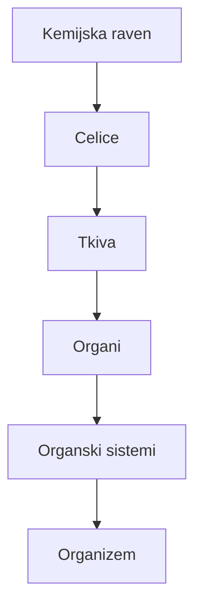

## Odgovor {#answer}

Anatomija človeka je veda o zgradbi človeškega telesa.[^1]
Anatomi telo opisujejo v šestih ravneh, od kemijske ravni do celotnega organizma.[^2]
Telo vedno opisujejo v isti dogovorjeni drži, v anatomski legi.[^3]
Za opis položaja uporabljajo tri glavne ravnine in poimenovane telesne votline.[^6]
Angleška različica: [[human-anatomy-basics]].

## Ključni poudarki {#key-insights}

- Anatomija proučuje zgradbo telesa, fiziologija pa njeno delovanje.[^1]
- V telesu so štiri glavne vrste tkiv: epitelijsko, vezivno, mišično in živčno.[^5]
- Viri se ne ujemajo glede števila organskih sistemov: 10 ali 11.[^2][^4]
- Smerni izrazi se vedno nanašajo na anatomsko lego.[^3]
- Okostje odraslega človeka ima običajno 206 poimenovanih kosti.[^7]

## Anatomija in fiziologija {#what-anatomy-is}

Anatomija proučuje zgradbo telesa.[^1]
Fiziologija proučuje, kako te zgradbe delujejo in omogočajo življenjske procese.[^1]
Nekatere zgradbe so tako majhne, da jih lahko proučujemo le z mikroskopom.[^1]

## Ravni organiziranosti {#levels}

Telo pogosto opisujemo v šestih ravneh.[^2]
Vsaka raven je bolj zapletena od prejšnje:[^2]

1. kemijska raven
2. raven celic
3. raven tkiv
4. raven organov
5. raven organskih sistemov
6. raven organizma

Organ je zgradba iz dveh ali več vrst tkiva.[^2]
Organski sistem je skupina organov, ki delujejo skupaj.[^2]
Najvišja raven je organizem, torej celoten živ človek.[^2]
Diagram kaže, kako vsaka raven gradi na prejšnji.[^2]

*Slika 1. Šest ravni organiziranosti, od preproste do zapletene. Vir: OpenStax, Anatomy and Physiology 2e, poglavje 1.2.*

## Tkiva {#tissues}

Tkivo je skupina podobnih celic, ki delujejo kot celota.[^5]
V telesu so štiri glavne vrste tkiv:[^5]

- epitelijsko (krovno) tkivo
- vezivno tkivo
- mišično tkivo
- živčno tkivo

Stena in sluznica želodca na primer skupaj vsebujeta vse štiri vrste.[^4]

## Organski sistemi {#organ-systems}

Učbeniki organskih sistemov ne štejejo vsi enako.[^2][^4]
Učni tečaj ameriškega Nacionalnega inštituta za raka (NCI) navaja 10 glavnih sistemov:[^4]

- skeletni sistem (okostje)
- mišični sistem
- živčni sistem
- endokrini sistem
- srčno-žilni sistem
- limfni sistem
- dihalni sistem
- prebavni sistem
- sečni sistem
- reproduktivni sistem

Učbenik OpenStax šteje 11 organskih sistemov.[^2]
Med drugim doda še pokrovni sistem: kožo, lase in nohte.[^2]

## Anatomska lega {#anatomical-position}

Anatomska lega je dogovorjena izhodiščna drža telesa.[^3]
Telo stoji pokončno, stopala so vzporedna, prsti pa obrnjeni naprej.[^3]
Roki sta odmaknjeni vstran, dlani pa obrnjeni naprej.[^3]
Smerni izrazi, kot je »sprednji« (anteriorni), se vedno nanašajo na to lego.[^3]

## Telesne ravnine {#planes}

Anatomi z ravninami delijo telo ali katerikoli njegov del.[^6]
Glavne ravnine so tri:[^6]

- **Sagitalna ravnina:** navpična, poteka od spredaj nazaj. Telo deli na desni in levi del.
- **Frontalna (koronalna) ravnina:** navpična, poteka od ene strani do druge. Telo deli na sprednji (anteriorni) in zadnji (posteriorni) del.
- **Prečna (transverzalna) ravnina:** vodoravna. Telo deli na zgornji in spodnji del.

Mediana (srednja) ravnina je sagitalna ravnina skozi sredino telesa.[^6]
Telo deli na dve enaki polovici.[^6]

*Slika 2. Glavne telesne ravnine na stoječi figuri. Vsaka ravnina telo prereže v drugi smeri. Oznake na sliki so v angleščini. »Human anatomy planes, labeled«, avtorji David Richfield, Mikael Häggström in cmglee, Wikimedia Commons, CC BY-SA 4.0, pretvorjeno iz SVG v WebP.*

Opis

- Računalniško izdelan model človeka stoji v anatomski legi. Pogled je od spredaj, pod kotom.
- Tri puščice označujejo osi X, Y in Z.
- Rdeča ravnina (mediana) deli telo na enaki levo in desno polovico.
- Rumena ravnina (parasagitalna) je vzporedna z mediano ravnino, vendar ne poteka po sredini.
- Modra ravnina (frontalna ali koronalna) deli telo na sprednji in zadnji del.
- Zelena ravnina (prečna, aksialna ali vodoravna) deli telo na zgornji in spodnji del.

## Telesne votline {#cavities}

Telesne votline so prostori v telesu, v katerih so notranji organi.[^6]
Glavni telesni votlini sta sprednja (ventralna) in zadnja (dorzalna) votlina.[^6]
Ventralna votlina je večja od obeh.[^6]
Prepona (diafragma), kupolasta dihalna mišica, jo deli na dva dela:[^6]

- V **prsni votlini** so srce, pljuča, sapnik in požiralnik.
- **Trebušno-medenična votlina** ima trebušni in medenični del. V trebušnem delu je večina prebavne cevi in ledvici. V medeničnem delu je večina sečil in spolovil ter danka.

Tudi dorzalna votlina ima dva dela:[^6]

- V **lobanjski votlini** so možgani.
- V **hrbteničnem kanalu** je hrbtenjača.

## Okostje {#skeleton}

Okostje odraslega človeka ima običajno 206 poimenovanih kosti.[^7]
Okostje ima dva dela:[^7]

- **Osni (aksialni) skelet, 80 kosti:** kosti glave, hrbtenica, rebra in prsnica.
- **Skelet okončin (apendikularni skelet), 126 kosti:** kosti okončin in obroči, ki okončine pritrjujejo na osni skelet.

## Ključne trditve {#key-claims}

- Anatomija proučuje zgradbo telesa, fiziologija pa njeno delovanje.[^1]
- Telo opisujemo v šestih ravneh, od kemijske do organizma.[^2]
- Glavne vrste tkiv so štiri: epitelijsko, vezivno, mišično in živčno.[^5]
- Viri se razlikujejo v številu organskih sistemov: tečaj NCI jih navaja 10, OpenStax 11.[^2][^4]
- V anatomski legi telo stoji pokončno, dlani so obrnjene naprej.[^3]
- Okostje odraslega ima običajno 206 kosti: 80 v osnem skeletu in 126 v skeletu okončin.[^7]

## Kviz {#quiz}

Kviz za ta članek je v datoteki `quizzes/osnove-cloveske-anatomije.yaml`.
Spletno mesto ga prikaže na strani s kvizom za ta članek.

## Odprta vprašanja {#open-questions}

- Število organskih sistemov je odvisno od vira. Tečaj NCI jih navaja 10, OpenStax pa 11.[^2][^4]
- Okostje ima »običajno« 206 poimenovanih kosti. Viri tega članka ne pojasnijo, zakaj se število lahko razlikuje.[^7]

## Viri {#sources}

Viri so navedeni v polju `sources` v glavi datoteke. V besedilu so citirani kot opombe.
